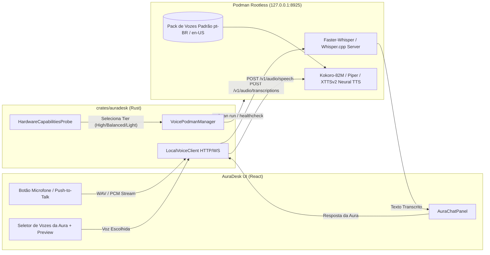
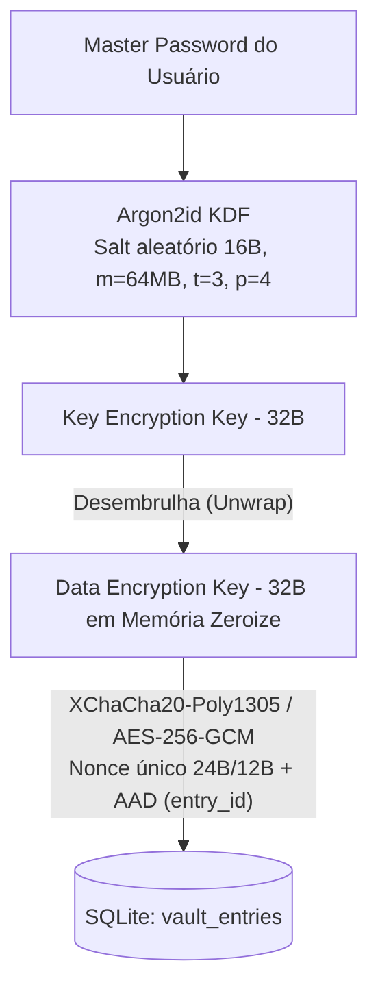

# AuraDesk — Runbook de Implementações Futuras (Fase 6+ / Aura Next-Gen)

> **Data de referência:** 2026-11-22  
> **Escopo:** Evolução do AuraDesk para superar o Hermes como plataforma autônoma de agentes, bots, integração nativa Gemini Antigravity via OAuth 2.0, voz local containerizada em Podman, estética Liquid Glass sobre o universo 3D e segurança criptográfica zero-knowledge.  
> **Diretriz central de produto:** **Zero Atrito no Dia a Dia** — todas as funcionalidades complexas (login OAuth no Gemini Antigravity, skills, servidores MCP, containers Podman de voz, criptografia de senhas) devem ser operadas em 1–2 cliques com defaults inteligentes, diagnósticos claros e automação nos bastidores.  
> **Regra de Ouro Pós-Execução:** **Sempre atualizar o Hindsight** (`engenharia` e `hermes`) imediatamente após concluir cada tarefa ou sprint deste runbook (ver Seção 8).

---

## Backlog Detalhado no GitHub Issues (2026-11-24)

Este runbook descreve a visão. O trabalho acionável — com critérios de aceite, dependências e o que já foi feito — vive em issues. As abaixo foram abertas em 2026-11-24 a partir da auditoria do código e do runtime de agente.

| Issue | Tema | Prioridade | Status |
|---|---|---|---|
| [#22](https://github.com/RAGton/aura-desk/issues/22) | Runtime de agente: loop, planner, orchestrator, executor de ferramentas | alta | pronto |
| [#23](https://github.com/RAGton/aura-desk/issues/23) | Engine de skills autônomo (descoberta, versionamento, avaliação, aprovação) | média | backlog |
| [#24](https://github.com/RAGton/aura-desk/issues/24) | Interface de memória desacoplada + loop de aprendizado pós-tarefa | alta | pronto |
| [#25](https://github.com/RAGton/aura-desk/issues/25) | Registro unificado de capacidades (MCP stdio/HTTP, skills, plugins) | alta | pronto |
| [#26](https://github.com/RAGton/aura-desk/issues/26) | Context Engine: orçamento de tokens, compressão, checkpoints, linhagem | alta | backlog |
| [#27](https://github.com/RAGton/aura-desk/issues/27) | Normalização de saída por API — o raciocínio do modelo não pode vazar | alta | pronto |
| [#28](https://github.com/RAGton/aura-desk/issues/28) | Bootstrap do LightRAG validado numa instalação limpa | média | pronto |
| [#29](https://github.com/RAGton/aura-desk/issues/29) | Welcome Wizard retomável, persistente e idempotente | média | backlog |
| [#30](https://github.com/RAGton/aura-desk/issues/30) | Aura Control Center: observabilidade do agente | baixa | backlog |
| [#31](https://github.com/RAGton/aura-desk/issues/31) | Superfície do Hindsight ainda inacessível da UI | média | pronto |
| [#32](https://github.com/RAGton/aura-desk/issues/32) | Classificador de emoção por modelo (ONNX) — requer aprovação da dependência | baixa | bloqueado |
| [#33](https://github.com/RAGton/aura-desk/issues/33) | Acabamento do chat: bubbles, estados com ação, atalhos | média | pronto |
| [#34](https://github.com/RAGton/aura-desk/issues/34) | Ambiente de homologação (VM) para validar a instalação | média | backlog |
| [#35](https://github.com/RAGton/aura-desk/issues/35) | E2E da galáxia falha por captura antes do canvas estabilizar | média | pronto |

### O que a auditoria de 2026-11-24 já mudou

- **Vazamento de raciocínio corrigido.** O provider MiniMax emite `<think>`; o parser só conhecia `<thought>`/`<thinking>`. Agora todos os formatos são reconhecidos, inclusive bloco ainda em streaming.
- **Parar a geração passou a parar de verdade.** O filho do CLI é rastreado e morto; o botão e o Esc encerram a resposta.
- **Ações de resposta no padrão das IAs de referência:** regenerar, editar e reenviar, voltar à mensagem mais recente.
- **Grafo do Hindsight refeito.** Era branco sobre branco no tema claro (some e não desenhava); virou componente próprio com zoom, arraste, nó por grau, aresta por peso, legenda e tooltip.
- **`fact_type` passou a chegar ao nó** — antes a cor por camada era uma mentira.
- **Bancos do Hindsight agora podem ser renomeados e excluídos** — antes dava para criar e nunca remover.
- **Limites do grafo e do recall viraram settings** (`hindsight.graph_node_limit`, `hindsight.recall_top_k`) com migration.

---

## Visão Geral dos 5 Pilares Principais + Sugestões Estratégicas

| Pilar | Módulo Alvo | Objetivo Principal | Migração SQLite Prevista |
|---|---|---|---|
| **1. Hub de Skills, Plugins MCP & Bots** | `AgentsHubPage.tsx` + `auradesk-core::agents` | Instalar/gerenciar skills (`SKILL.md`), servidores MCP e bots especializados diretamente dentro da aba **Agentes**, superando a ergonomia do Hermes. | `V014__agents_skills_mcp_bots.sql` |
| **2. Voz Local (STT + TTS Multi-Voz) via Podman** | `crates/auradesk/src/voice_podman.rs` + `AuraChatPanel.tsx` + Instalador | Transcrição de áudio (STT) e síntese de voz da Aura (TTS com catálogo de vozes padrão) rodando localmente em container Podman auto-provisionado conforme o hardware da máquina. | `V015__voice_podman_profiles.sql` |
| **3. Tema Claro "Liquid Glass" com Universo 3D Visível** | `globals.css` + `AuraSpaceBackdrop.tsx` + `AppShell.tsx` | Substituir o tema branco opaco atual por superfícies translúcidas **Liquid Glass** (refração, borda especular e blur adaptativo) mantendo o universo/galáxia WebGL visível ao fundo com contraste WCAG AA/AAA. | *(Design Tokens & Shader Uniforms)* |
| **4. Tela de Login & Cofre de Senhas Criptografadas** | `LoginPage.tsx` + `VaultPage.tsx` + `auradesk-core::vault` | Autenticação local no boot/bloqueio (Argon2id + Keyring do SO) e cofre criptografado (XChaCha20-Poly1305 / AES-256-GCM) para senhas pessoais, tokens OAuth e chaves de API. | `V016__auth_and_encrypted_vault.sql` |
| **5. Suporte Nativo ao Gemini Antigravity (API OAuth 2.0)** | `crates/auradesk-core/src/domain/ai.rs` + `crates/auradesk/src/oauth_gemini.rs` + `SettingsPage.tsx` | Autenticação OAuth 2.0 (PKCE + Loopback Callback + Auto-Refresh + Multi-Conta) para usar modelos Gemini e o ecossistema Google Antigravity sem depender apenas de chaves estáticas. | `V017__gemini_antigravity_oauth.sql` |

---

## Pilar 1 — Hub de Skills, Plugins (MCP) & Bots dentro de `Agentes`

### 1.1 Problema & Visão de UX (Superando o Hermes sem Atrito)
Atualmente, `AgentsHubPage.tsx` (`apps/web/src/pages/AgentsHubPage.tsx`) exibe os 8 agentes fixos (`orchestrator`, `memory_agent`, `research_agent`, `browser_agent`, `computer_agent`, `system_agent`, `context_manager`, `tool_registry`), a tabela `agent_tool_policies` e o simulador de planos. No Hermes tradicional, instalar skills, configurar servidores MCP ou criar bots exige editar arquivos YAML/TOML/JSON no terminal.

Para tornar o AuraDesk superior ao Hermes e sem fricção no uso diário, a aba **Agentes** (`/agents`) passa a concentrar 4 sub-áreas integradas em uma única superfície limpa:

1. **Meus Bots & Agentes (`Bots & Squads`)**
   - Cards dos 8 agentes nativos + **Bots Customizados** criados pelo usuário (ex.: *Bot de Revisão de Código*, *Bot de Triagem Comercial*, *Bot Professor NSE/Infra*, *Bot DevOps NixOS*).
   - Criação de Bot em 1 modal rápido: Nome, Ícone/Avatar, Persona (`system_prompt`), Modelo/Provedor preferido (incluindo conta OAuth do **Gemini Antigravity**), Banco Hindsight vinculado, Voz da Aura associada, Skills ativas e Gatilhos rápidos (atalho na Command Palette `Ctrl+K`, botão no dock do chat ou rotina agendada).
2. **Gerenciador & Loja de Skills (`Skills`)**
   - Instalação em 1 clique a partir de:
     - **Catálogo Curado / Repositório Git** (URL GitHub/GitLab ou pacote `.zip`/pasta local contendo `SKILL.md` + `scripts/` + `resources/`).
     - **Importação Automática do Antigravity / Hermes** (detecta skills já presentes na máquina em `~/.gemini/config/plugins/*/skills`, `~/.gemini/antigravity/builtin/skills` ou `~/.hermes/skills` e permite importar/sincronizar com 1 clique).
   - Toggle instantâneo (`Switch`) para habilitar/desabilitar a skill globalmente ou vincular a bots específicos.
   - Visualizador/editor embutido para inspecionar o `SKILL.md`, variáveis requeridas e permissões de risco.
3. **Plugins & Servidores MCP (`Plugins & MCP`)**
   - Registro visual de servidores MCP (`stdio` via comando local/npx/uvx/binário ou `SSE / Streamable HTTP`).
   - **Auto-Discovery & Health Check**: ao adicionar ou ativar um plugin MCP, o backend executa `initialize` + `tools/list`, valida a latência e registra automaticamente todas as tools descobertas na tabela `agent_tool_policies` com classificação de risco inicial (`require_approval` por padrão para tools externas de escrita).
   - **Presets 1-Click**: templates prontos para plugins populares (Filesystem, GitHub, Postgres/SQLite, Hindsight, Browser/Playwright, Podman, NixOS, Cloudflare, Supabase) onde o usuário só preenche o caminho ou seleciona uma credencial do Cofre (Pilar 4).
4. **Governança, Políticas & Execuções (`Policies & Runs`)**
   - Evolução da tabela atual de `agent_tool_policies` e histórico `agent_runs`, adicionando filtro por Bot/Plugin/Skill e aprovação inline com 1 clique.

### 1.2 Arquitetura Técnica & Schema (`V014__agents_skills_mcp_bots.sql`)

```sql
-- V014__agents_skills_mcp_bots.sql
CREATE TABLE IF NOT EXISTS agent_bots (
  id TEXT PRIMARY KEY,
  slug TEXT NOT NULL UNIQUE,
  name TEXT NOT NULL,
  role_kind TEXT NOT NULL DEFAULT 'custom_bot',
  icon TEXT NOT NULL DEFAULT 'bot',
  description TEXT NOT NULL DEFAULT '',
  system_prompt TEXT NOT NULL DEFAULT '',
  preferred_provider TEXT,
  preferred_model TEXT,
  oauth_account_id TEXT,
  hindsight_bank TEXT,
  voice_profile_id TEXT,
  enabled INTEGER NOT NULL DEFAULT 1,
  pinned_in_chat INTEGER NOT NULL DEFAULT 1,
  created_at TEXT NOT NULL,
  updated_at TEXT NOT NULL
);

CREATE TABLE IF NOT EXISTS agent_skills (
  id TEXT PRIMARY KEY,
  slug TEXT NOT NULL UNIQUE,
  name TEXT NOT NULL,
  description TEXT NOT NULL,
  version TEXT NOT NULL DEFAULT '1.0.0',
  source_kind TEXT NOT NULL CHECK (source_kind IN ('builtin', 'local_dir', 'git_repo', 'catalog', 'antigravity_import', 'hermes_import')),
  source_uri TEXT NOT NULL,
  install_path TEXT NOT NULL,
  skill_markdown TEXT NOT NULL,
  config_schema_json TEXT NOT NULL DEFAULT '{}',
  config_values_json TEXT NOT NULL DEFAULT '{}',
  enabled INTEGER NOT NULL DEFAULT 1,
  installed_at TEXT NOT NULL,
  updated_at TEXT NOT NULL
);

CREATE TABLE IF NOT EXISTS agent_bot_skills (
  bot_id TEXT NOT NULL REFERENCES agent_bots(id) ON DELETE CASCADE,
  skill_id TEXT NOT NULL REFERENCES agent_skills(id) ON DELETE CASCADE,
  PRIMARY KEY (bot_id, skill_id)
);

CREATE TABLE IF NOT EXISTS mcp_plugins (
  id TEXT PRIMARY KEY,
  slug TEXT NOT NULL UNIQUE,
  name TEXT NOT NULL,
  transport TEXT NOT NULL CHECK (transport IN ('stdio', 'http_sse')),
  command_or_url TEXT NOT NULL,
  args_json TEXT NOT NULL DEFAULT '[]',
  env_vault_refs_json TEXT NOT NULL DEFAULT '{}',
  enabled INTEGER NOT NULL DEFAULT 1,
  last_health_status TEXT NOT NULL DEFAULT 'unknown',
  last_health_checked_at TEXT,
  discovered_tools_json TEXT NOT NULL DEFAULT '[]',
  created_at TEXT NOT NULL,
  updated_at TEXT NOT NULL
);
```

### 1.3 Contratos IPC (`crates/auradesk/src/ipc/aura.rs` & `apps/web/src/lib/ipc.ts`)
- `agents_bots_list`, `agents_bots_upsert`, `agents_bots_delete`
- `agents_skills_list`, `agents_skills_install` (suporta path local, URL Git ou auto-import do Antigravity/Hermes), `agents_skills_toggle`, `agents_skills_uninstall`
- `agents_mcp_plugins_list`, `agents_mcp_plugins_upsert`, `agents_mcp_plugins_test_connection` (executa handshake MCP e sincroniza `discovered_tools_json` com `agent_tool_policies`), `agents_mcp_plugins_delete`

### 1.4 Critérios de Aceitação (Pilar 1 — Concluído em 2026-11-22)
- [x] O usuário consegue instalar uma skill ou adicionar um plugin MCP dentro de **Agentes** sem abrir terminal nem editar arquivos manualmente.
- [x] Ferramentas expostas por plugins MCP aparecem automaticamente na matriz de permissões (`agent_tool_policies`) com proteção contra `allow` automático em operações destrutivas.
- [x] Bots criados em **Agentes** ficam imediatamente selecionáveis no dock do chat da Aura e no `CommandPalette` (`Ctrl+K`).

---

## Pilar 2 — Motor de Voz Local (STT Transcrição + TTS Multi-Voz da Aura) via Podman

### 2.1 Arquitetura do Subsystem de Voz Containerizado
Atualmente, o AuraDesk captura áudio em WAV (`apps/web/src/lib/wav.ts` + `crates/auradesk/src/hermes.rs::VoiceCaptureResult`) e toca alertas nativos (`crates/auradesk/src/audio.rs`). O objetivo é fornecer **STT (Speech-to-Text / transcrição local de alta precisão)** e **TTS (Text-to-Speech neural com catálogo de vozes padrão para a Aura)** executando 100% na máquina local dentro de um container **Podman rootless**, gerenciado pelo próprio AuraDesk.



### 2.2 Detecção Automática de Requisitos de Hardware (`HardwareCapabilitiesProbe`)
Durante a instalação (e no primeiro boot / tela de configurações), o módulo Rust `crates/auradesk/src/voice_podman.rs` inspeciona automaticamente o host:
1. **CPU & Instruções**: Contagem de cores lógicos/físicos e suporte a `AVX2` / `AVX-512` / `NEON`.
2. **Memória RAM**: Total e disponível (`/proc/meminfo` no Linux, `GlobalMemoryStatusEx` no Windows).
3. **Aceleração de GPU**:
   - NVIDIA (`nvidia-smi` + CDI `/etc/cdi/nvidia.yaml` ou `--device nvidia.com/gpu=all`).
   - AMD ROCm (`/dev/kfd`, `/dev/dri` no Linux).
   - Fallback CPU quantizado (`int8` / ONNX Runtime).
4. **Runtime Podman**: Verifica `podman --version` e `podman info --format json` (no Windows verifica `podman machine` / WSL2).

### 2.3 Perfis Automáticos de Instalação por Hardware (Auto-Tiering)

| Tier Detectado | Critério de Hardware | Engine STT (Transcrição) | Engine TTS (Voz da Aura) | Latência Alvo |
|---|---|---|---|---|
| **Tier 1 — Ultra / GPU** | GPU ≥ 6 GB VRAM + ≥ 16 GB RAM | `faster-whisper-large-v3-turbo` (FP16) | `Kokoro-82M` + `XTTS-v2` (alta expressividade) | < 350 ms |
| **Tier 2 — Balanced (Default)** | CPU ≥ 6 threads (AVX2) + ≥ 8 GB RAM | `faster-whisper-small` / `distil-whisper` (INT8) | `Kokoro-82M` (ONNX) + `Piper Neural HD` | < 600 ms |
| **Tier 3 — Lightweight** | RAM < 8 GB ou CPU sem AVX2 | `whisper-tiny` / `base` (GGML Q5) | `Piper TTS` (ONNX low-footprint) | < 450 ms |

### 2.4 Catálogo de Vozes Padrão da Aura
O container já sobe com um pacote pré-instalado de vozes em `pt-BR` e `en-US` para que o cliente escolha imediatamente sem precisar baixar modelos avulsos manualmente:
- `aura-aurora-ptbr` (**Aurora — Padrão**): Feminina, natural, timbre calmo e executivo (`pt-BR`).
- `aura-serena-ptbr` (**Serena**): Feminina, didática e acolhedora — ideal para modo *Aura Professora / Estudos* (`pt-BR`).
- `aura-orion-ptbr` (**Orion**): Masculina, objetiva e técnica (`pt-BR`).
- `aura-nova-en` (**Nova**): Feminina bilíngue (`en-US` / termos técnicos).
- Controles no UI: Velocidade da fala (`0.8x` a `1.4x`), botão **"Ouvir Preview"**, toggle **"Falar respostas da Aura automaticamente"** e atalho de gravação Push-to-Talk (`Ctrl+Espaço`).

### 2.5 Provisionamento Automático durante a Instalação
- **Linux / NixOS (`flake.nix` & pacotes nativos)**:
  - No NixOS/Linux, declarar `podman` como dependência recomendada e prover comando de bootstrap (`auradesk voice setup --auto`) executado automaticamente no post-install ou no wizard de boas-vindas em background com barra de progresso não-bloqueante.
- **Windows (Instalador NSIS/MSI Tauri)**:
  - Hook de pós-instalação / First-Run Setup Wizard que verifica a presença do Podman; caso ausente, oferece instalação silenciosa via `winget install RedHat.Podman` + `podman machine init --now` e faz o pull da imagem `ghcr.io/ragton/auradesk-voice:<tier>` com verificação de hash SHA-256.
- **Ciclo de Vida Resiliente**:
  - Container nomeado `auradesk-voice-engine` vinculado apenas ao loopback `127.0.0.1:8925`, com volume persistente em `$AURADESK_DATA_DIR/voice-models`.
  - Se o container estiver iniciando ou offline, o AuraDesk mantém o modo degradado gracioso (grava o WAV localmente e enfileira a transcrição ou exibe botão de reconexão em 1 clique).

### 2.6 Critérios de Aceitação (Pilar 2)
- [ ] `voice_hardware_probe` retorna diagnóstico preciso de CPU/RAM/GPU/Podman e recomenda o Tier ideal automaticamente.
- [ ] Provisionamento automático baixa e inicia o container Podman com progresso em tempo real na UI sem exigir comandos manuais de terminal.
- [ ] O usuário consegue gravar áudio no chat, receber a transcrição instantânea (STT) e ouvir a resposta da Aura (TTS) escolhendo entre pelo menos 4 vozes padrão com botão de preview.

---

## Pilar 3 — Reformulação do Tema Claro: "Liquid Glass" com Universo 3D Visível

### 3.1 Diagnóstico Técnico do Tema Claro Atual
A inspeção de `apps/web/src/styles/globals.css` e `apps/web/src/components/AuraSpaceBackdrop.tsx` revelou por que o tema claro atual parece opaco, lavado e esconde o universo:
1. Em `AuraSpaceBackdrop.tsx` (linha 783):
   - `const washedOut = isLightTheme && !galaxyDark;` reduz a visibilidade do canvas e aplica uma camada nebulosa clara por cima quando fora do cockpit.
2. Em `globals.css` (linhas 106–162 e 728–749):
   - `html[data-theme="light"]` define `--aura-bg-base: #eef4fb;` (fundo sólido azul-acinzentado claro) aplicado diretamente ao `body` e `.aura-bg`, cobrindo o canvas WebGL (`fixed inset-0 -z-10`).
   - `.aura-starfield` cai para `opacity: 0.14` (linha 729) e desliga a cintilação das estrelas (`animation: none; opacity: 0.45` nas linhas 744–749).
   - `--aura-surface: rgba(255, 255, 255, 0.72)` cria blocos brancos chapados sem refração cromática nem profundidade espacial.

### 3.2 Especificação Visual do Novo Tema Claro "Liquid Glass Cosmic"
O novo tema claro transforma a interface em **lentes de cristal líquido translúcido flutuando diretamente sobre o universo profundo**:

1. **Universo Sempre Visível ao Fundo (`Cosmic Canvas First`)**:
   - Remover a pintura sólida `#eef4fb` do `body` / `.aura-bg` quando o `AuraSpaceBackdrop` estiver ativo, mantendo o cosmos WebGL (estrelas, nebulosas, galáxias espirais e lente gravitacional) vivo em **todas as telas** no tema claro.
   - Em vez de apagar as estrelas (`opacity: 0.14`), manter o starfield e as nebulosas com luminância rica e aplicar apenas um véu atmosférico translúcido sutil (`radial-gradient` iridescente de baixa opacidade `0.12–0.18`) para harmonizar com os painéis claros.
2. **Materialidade Liquid Glass (Camadas Ópticas)**:
   - **Painéis Primários (`.aura-glass` no modo Light)**:
     - Fundo translúcido perolado com gradiente diagonal:
       `linear-gradient(135deg, rgba(255, 255, 255, 0.62) 0%, rgba(240, 249, 255, 0.46) 55%, rgba(224, 242, 254, 0.38) 100%)`
     - Filtro óptico de refração:
       `backdrop-filter: blur(26px) saturate(210%) contrast(104%) brightness(1.05);`
     - Borda especular dupla (efeito de lente de vidro curvada):
       `border: 1px solid rgba(255, 255, 255, 0.55);`
       `box-shadow: inset 0 1px 1px 0 rgba(255, 255, 255, 0.92), inset 0 -1px 1px 0 rgba(56, 189, 248, 0.22), 0 18px 42px -14px rgba(2, 6, 23, 0.42);`
   - **Cards e Superfícies Elevadas (`.aura-glass-elevated` / `.aura-glass-pill`)**:
     - Camada extra de brilho cáustico no hover (`rgba(56, 189, 248, 0.35)`) que deixa perceber o movimento das estrelas e nebulosas atravessando o vidro desfocado.
3. **Legibilidade e Contraste Garantidos (WCAG AA/AAA)**:
   - Como o fundo atrás do vidro é o universo escuro com nebulosas coloridas, a opacidade do vidro (`0.46–0.68` com `blur(26px)`) garante uma luminância interna clara e uniforme dentro de cada card, onde textos em `slate-900` (`#0f172a`) e `slate-700` (`#334155`) mantêm contraste ≥ 7:1, enquanto as áreas entre os cards revelam o espaço sideral puro.
   - Elementos soltos fora de cards (como cabeçalhos flutuantes sobre o espaço) recebem cápsulas `.aura-glass-pill` ou tokens adaptativos para nunca ficarem texto escuro sobre fundo preto do espaço.

### 3.3 Arquivos a Modificar na Implementação (Pilar 3)
- `apps/web/src/styles/globals.css`: Atualizar bloco `html[data-theme="light"]`, classes `.aura-glass`, `.aura-glass-elevated`, `.aura-glass-pill`, `.aura-starfield` e `.aura-bg`.
- `apps/web/src/components/AuraSpaceBackdrop.tsx`: Manter o WebGL cosmos ativo e nítido no tema claro sem o véu `washedOut` que ocultava as galáxias.
- `apps/web/src/styles/galaxyTheme.test.ts` & `apps/web/e2e/galaxy-theme.spec.ts`: Atualizar e expandir os testes garantindo contraste de texto e transparência real do `body`/backdrop no tema claro.

### 3.4 Critérios de Aceitação (Pilar 3 — Concluído em 2026-11-22)
- [x] Ao alternar para o Tema Claro em qualquer aba (Dashboard, Kanban, Agentes, Hindsight, Configurações), o universo 3D continua visível através dos espaços e refratado através dos painéis Liquid Glass.
- [x] Todos os textos, inputs, badges e tabelas mantêm contraste legível sem elementos lavados ou invisíveis.

---

## Pilar 4 — Tela de Login & Cofre de Senhas Criptografadas (Aura Vault)

### 4.1 Fluxo de Experiência do Usuário (Segurança Forte com Zero Atrito)
1. **Primeiro Acesso (Onboarding Criptográfico)**:
   - Na primeira abertura (ou ao ativar o Cofre), o usuário define sua **Senha Mestre (Master Password)** (e opcionalmente um PIN rápido de desbloqueio de sessão ou vínculo com o Keyring do SO / Windows Hello / Linux Secret Service).
   - O sistema gera um **Recovery Kit** opcional (chave de emergência local que o usuário pode salvar fora da máquina).
2. **Tela de Login Espacial (`LoginPage.tsx` / App Lock Gate)**:
   - Ao abrir o AuraDesk (ou quando bloqueado manualmente via `Ctrl+L` / botão de cadeado na barra / timeout de inatividade do `idle.rs`), a janela exibe a **Tela de Login Liquid Glass** sobre o universo 3D (`AuraSpaceBackdrop`).
   - Nota de segurança operacional: enquanto o app estiver bloqueado na tela de login, o scheduler em background (`RemindersService`) continua ativo, e **alertas críticos/persistentes continuam podendo disparar**, mas dados sensíveis, chat, tarefas e o cofre permanecem inacessíveis até o desbloqueio.
3. **Cofre de Senhas Criptografadas (`VaultPage.tsx` / Acesso Rápido via `Ctrl+K`)**:
   - Aba dedicada **Cofre (`Vault`)** (ou seção protegida) para armazenar:
     - **Credenciais & Logins** (URL/App, usuário, senha criptografada, código TOTP 2FA opcional, notas seguras).
     - **Tokens OAuth & Chaves de API de Agentes/MCP** (tokens OAuth do **Gemini Antigravity**, OpenAI, MiniMax, OpenRouter, GitHub PAT, variáveis secretas de plugins MCP do Pilar 1).
     - **Segredos de Infraestrutura** (senhas de servidores, chaves SSH/WireGuard, credenciais de banco).
   - **Ações de 1 Clique**:
     - Copiar senha (mascarada na tela por padrão) com **Auto-Clear da área de transferência** após 20 segundos.
     - Gerador integrado de senhas fortes / passphrases.
     - Referência direta em Plugins MCP e Provedores de IA (`vault://item-slug`) para que nenhuma API key ou token OAuth precise ficar em texto plano na tabela `settings`.

### 4.2 Arquitetura Criptográfica (`crates/auradesk-core/src/application/vault.rs`)



- **Envelope Encryption (KEK + DEK)**:
  - A `Master Password` passa pelo **Argon2id** (`argon2` crate) para derivar a `KEK` (Key Encryption Key).
  - A `KEK` desembrulha uma `DEK` (Data Encryption Key aleatória de 256 bits) salva de forma autenticada em `vault_meta`. Isso permite **trocar a Senha Mestre instantaneamente** sem precisar re-criptografar milhares de registros (basta re-embrulhar a `DEK`).
  - A `DEK` desbloqueada reside apenas na memória RAM do processo Rust dentro de um wrapper `zeroize::Zeroizing<[u8; 32]>` e é zerada imediatamente no `vault_lock`, no timeout de inatividade ou ao fechar o aplicativo.
- **Criptografia Autenticada por Registro (AEAD)**:
  - Cada item em `vault_entries` tem seu próprio `nonce` criptograficamente aleatório e usa `XChaCha20-Poly1305` (ou `AES-256-GCM`), passando `id || category || updated_at` como **AAD (Associated Authenticated Data)** para impedir ataques de substituição de ciphertext entre linhas do SQLite.
- **Compatibilidade com Backups (`DataIoService`)**:
  - Os backups ZIP exportam `vault_meta` e `vault_entries` mantendo apenas os blobs já criptografados (`ciphertext_b64`, `nonce_b64`, `salt_b64`) — jamais exportam segredos em texto aberto, preservando a garantia validada em `crates/auradesk-core/tests/backup_secret_redaction.rs`.

### 4.3 Schema SQLite (`V016__auth_and_encrypted_vault.sql`)

```sql
-- V016__auth_and_encrypted_vault.sql
CREATE TABLE IF NOT EXISTS vault_meta (
  id INTEGER PRIMARY KEY CHECK (id = 1),
  kdf_algorithm TEXT NOT NULL DEFAULT 'argon2id',
  kdf_salt_b64 TEXT NOT NULL,
  kdf_mem_kib INTEGER NOT NULL DEFAULT 65536,
  kdf_iterations INTEGER NOT NULL DEFAULT 3,
  kdf_parallelism INTEGER NOT NULL DEFAULT 4,
  wrapped_dek_b64 TEXT NOT NULL,
  wrapped_dek_nonce_b64 TEXT NOT NULL,
  verifier_tag_b64 TEXT NOT NULL,
  auto_lock_minutes INTEGER NOT NULL DEFAULT 30,
  require_login_on_start INTEGER NOT NULL DEFAULT 1,
  created_at TEXT NOT NULL,
  updated_at TEXT NOT NULL
);

CREATE TABLE IF NOT EXISTS vault_entries (
  id TEXT PRIMARY KEY,
  slug TEXT NOT NULL UNIQUE,
  title TEXT NOT NULL,
  category TEXT NOT NULL CHECK (category IN ('login', 'api_key', 'oauth_token', 'infra', 'secure_note', 'card')),
  username_or_hint TEXT NOT NULL DEFAULT '',
  url_or_service TEXT NOT NULL DEFAULT '',
  tags_json TEXT NOT NULL DEFAULT '[]',
  ciphertext_b64 TEXT NOT NULL,
  nonce_b64 TEXT NOT NULL,
  aad_version INTEGER NOT NULL DEFAULT 1,
  favorite INTEGER NOT NULL DEFAULT 0,
  created_at TEXT NOT NULL,
  updated_at TEXT NOT NULL,
  last_accessed_at TEXT
);

CREATE INDEX IF NOT EXISTS idx_vault_entries_category_title
  ON vault_entries (category, favorite DESC, title ASC);
```

### 4.4 Critérios de Aceitação (Pilar 4)
- [ ] Com `require_login_on_start` ativo, o AuraDesk inicia na tela de Login Liquid Glass e bloqueia chamadas IPC de leitura de dados pessoais até o desbloqueio com a Senha Mestre.
- [ ] Nenhuma senha do cofre é persistida em texto plano no SQLite, logs de crash (`logging.rs`), Hindsight ou backups ZIP.
- [ ] A chave `DEK` em memória é limpa com `zeroize` ao acionar `Ctrl+L` (Bloquear agora) ou ao atingir `auto_lock_minutes` de inatividade.

---

## Pilar 5 — Suporte Nativo ao Gemini Antigravity (API OAuth 2.0 + Multi-Conta + SDK/CLI Bridge)

### 5.1 Objetivo & Experiência Zero Atrito
Atualmente, `AiProviderKind` (`crates/auradesk-core/src/domain/ai.rs`) suporta `Auto`, `OpenAi`, `MiniMax`, `Ollama`, `OpenRouter`, `HermesCli`, `CodexCli`, `Custom` e `Offline`, dependendo de API keys estáticas em `ai.api_key`.
Para integrar o **Gemini Antigravity** com autenticação moderna via **OAuth 2.0**:

1. **Login OAuth 2.0 em 1 Clique (`Conectar com Gemini Antigravity`)**:
   - Na seção **IA & Provedores** das Configurações (e dentro do modal de criação de Bots em **Agentes**), um botão **"Entrar com Google / Gemini Antigravity (OAuth)"** inicia o fluxo **OAuth 2.0 Authorization Code + PKCE**:
     - O backend Rust (`crates/auradesk/src/oauth_gemini.rs`) gera `code_verifier` e `code_challenge` (`S256`), sobe um listener HTTP efêmero em `http://127.0.0.1:<ephemeral_port>/oauth/callback` com `state` anti-CSRF, e abre o navegador padrão do sistema.
     - Após o consentimento do usuário, o callback captura o `code`, realiza a troca pelos tokens (`access_token`, `refresh_token`, `id_token`, `expires_in`, `scope`) e fecha a aba com mensagem de sucesso.
   - **Modo Alternativo / Reuso de Credencial Antigravity Local**:
     - Detecta se o usuário já possui sessão autenticada do Antigravity CLI (`agy`) / Gemini CLI em `~/.gemini/` e permite vincular ou configurar Client ID / Client Secret OAuth customizado em 1 clique.
2. **Armazenamento Criptografado no Cofre & Auto-Refresh Transparente**:
   - Os tokens (`access_token` e `refresh_token`) nunca ficam em texto plano na tabela `settings`: são gravados automaticamente como entradas `oauth_token` criptografadas no **Aura Vault** (Pilar 4), referenciadas em `oauth_accounts.vault_entry_id`.
   - Antes de qualquer chamada de chat, streaming ou execução de subagente, o `GeminiOAuthManager` verifica se `expires_at <= now + 60s` e renova o `access_token` silenciosamente via `refresh_token`.
3. **Suporte Multi-Conta (`personal`, `work`, etc., estilo `AGY_ACCOUNT`)**:
   - O usuário pode conectar mais de uma conta OAuth do Gemini Antigravity, atribuir um rótulo amigável (ex.: `"Pessoal"`, `"Trabalho"`) e escolher qual conta é a padrão da Aura ou vincular contas específicas a Bots diferentes em **Agentes**.
4. **Duplo Modo de Execução (API REST/SSE Direta + Antigravity CLI/SDK Bridge)**:
   - **Modo API OAuth Direto**: Chama os endpoints Gemini / Antigravity (`generativelanguage.googleapis.com` / endpoint OpenAI-compatible ou nativo `streamGenerateContent`) enviando `Authorization: Bearer <oauth_access_token>`.
   - **Modo Antigravity Agent Bridge (`agy` / SDK)**: Permite delegar tarefas complexas de engenharia/código para subagentes Antigravity locais prefixando `AGY_ACCOUNT=<account_name>` quando configurado.

### 5.2 Alterações no Domínio & Schema (`V017__gemini_antigravity_oauth.sql`)
- Adicionar variantes em `AiProviderKind` (`crates/auradesk-core/src/domain/ai.rs`):
  - `GeminiAntigravity` (`"gemini_antigravity"`, aliases `"gemini"`, `"antigravity"`, `"agy"`)
- Atualizar `apps/web/src/pages/settings/settingsSchema.ts` para incluir `{ value: "gemini_antigravity", label: "Gemini Antigravity (OAuth)" }` em `ai.provider`.

```sql
-- V017__gemini_antigravity_oauth.sql
CREATE TABLE IF NOT EXISTS oauth_accounts (
  id TEXT PRIMARY KEY,
  provider TEXT NOT NULL CHECK (provider IN ('gemini_antigravity', 'google', 'github', 'custom_oauth')),
  account_label TEXT NOT NULL,
  account_email TEXT NOT NULL DEFAULT '',
  client_id TEXT NOT NULL,
  scopes_json TEXT NOT NULL DEFAULT '[]',
  vault_entry_id TEXT NOT NULL REFERENCES vault_entries(id) ON DELETE CASCADE,
  access_token_expires_at TEXT,
  is_default INTEGER NOT NULL DEFAULT 0,
  status TEXT NOT NULL DEFAULT 'connected' CHECK (status IN ('connected', 'expired', 'revoked', 'error')),
  created_at TEXT NOT NULL,
  updated_at TEXT NOT NULL
);

CREATE INDEX IF NOT EXISTS idx_oauth_accounts_provider_default
  ON oauth_accounts (provider, is_default DESC);
```

### 5.3 Contratos IPC para OAuth (`crates/auradesk/src/ipc/aura.rs`)
- `ai_oauth_start_flow(provider, account_label, client_id_override)` $\rightarrow$ inicia PKCE loopback, aguarda callback com timeout seguro de 180s e persiste tokens no Cofre.
- `ai_oauth_list_accounts(provider)` $\rightarrow$ lista contas conectadas (email, label, status, expiração, `is_default`) sem expor os tokens brutos ao frontend.
- `ai_oauth_set_default(account_id)` / `ai_oauth_Disconnect(account_id)` (revoga o token e remove do Cofre).
- `ai_oauth_refresh_now(account_id)` $\rightarrow$ força renovação imediata e valida conectividade com a API Gemini Antigravity.

### 5.4 Critérios de Aceitação (Pilar 5)
- [ ] O usuário consegue selecionar **Gemini Antigravity (OAuth)** em Configurações $\rightarrow$ IA, clicar em **"Conectar Conta via OAuth"**, autenticar no navegador e conversar com a Aura usando o token OAuth sem digitar API key estática.
- [ ] O `refresh_token` fica protegido no Cofre Criptografado (`vault_entries`) e é renovado automaticamente quando o `access_token` expira.
- [ ] Bots criados na aba **Agentes** podem escolher qual conta OAuth e modelo do Gemini Antigravity utilizar.

---

## 6. Sugestões Estratégicas de Alto Impacto (Visão de Evolução AuraDesk)

Além dos 5 pilares acima, estas 7 funcionalidades complementares foram desenhadas especificamente para o fluxo de trabalho do Gabriel (engenharia Rust/NixOS, estudos NSE/Infra, gestão comercial e uso diário em múltiplos monitores):

### S1. Briefing Matinal Falado às 07:50 ("Bom dia, Gabriel")
- **Como funciona:** Conecta a rotina nativa `daily_planning` (`07:50`) com o **Context Engine**, o **Hindsight** e o novo **Motor TTS em Podman** (Pilar 2).
- **Experiência:** Assim que você desbloqueia a **Tela de Login** (Pilar 4) pela manhã, a Aura gera e fala (com a voz escolhida, ex.: *Aurora* ou *Serena*) um briefing executivo de 30–45 segundos:
  - Quantas tarefas prioritárias/atrasadas estão no Kanban para hoje;
  - Status de PRs/issues do GitHub sincronizados;
  - Próximos lembretes críticos e sugestão do primeiro bloco Pomodoro de foco.

### S2. Bot Nativo "Aura Professora & Lab Coach" (Repetição Espaçada + Simulados)
- **Como funciona:** Um Bot pré-instalado no Hub de Agentes (Pilar 1) conectado ao banco Hindsight `estudos`, ao LightRAG e à voz `aura-serena-ptbr`.
- **Experiência:**
  - Gera quizzes interativos e flashcards a partir das suas memórias do Hindsight (ex.: certificação Fortinet NSE, laboratórios KVM/NixOS, Windows Server/AD, Rust Clean Code), exigindo a terminologia oficial exata.
  - Quando você erra ou marca dúvida em uma questão, o bot agenda automaticamente um **Lembrete de Revisão Espaçada** (1 dia, 3 dias, 7 dias) no sistema de alertas do AuraDesk.

### S3. Telemetria Visual de Swarm & Bots na Estação Pirâmide 3D (`AuraPyramidStation.tsx`)
- **Como funciona:** Hoje a pirâmide 3D no Cockpit (`AuraPyramidStation.tsx`) mostra os módulos de memória e contexto. Com o Hub de Bots e Gemini Antigravity (Pilares 1 e 5), cada vértice/satélite da pirâmide passa a representar os **Bots ativos em execução**.
- **Experiência:** Quando a Aura delega subtarefas para múltiplos bots (ex.: *Research Bot* buscando no LightRAG + *System Bot* checando um log + *Memory Bot* consultando o Hindsight), feixes luminosos animados mostram em tempo real qual bot está trabalhando e qual tool MCP está sendo chamada, com botão de aprovação rápida flutuando em Liquid Glass.

### S4. Sandbox Efêmero em Podman para Execução Segura de Scripts dos Bots
- **Como funciona:** Aproveita que o Podman rootless já estará instalado e gerenciado para o motor de voz (Pilar 2) e cria um executor isolado (`podman run --rm --network=none --read-only ...`) para o `system_agent`.
- **Experiência:** Quando um Bot precisar testar um script Python/Bash, validar uma expressão regular, analisar um arquivo suspeito ou compilar um snippet, ele pode rodar dentro do container efêmero sem risco para o sistema operacional host, reduzindo pedidos de aprovação manual para tarefas de teste seguro.

### S5. "Aura Quick-Assist" Global (`Ctrl+Shift+Espaço`) com Contexto da Janela Ativa
- **Como funciona:** Um mini-overlay Liquid Glass acionável de qualquer lugar do sistema operacional (mesmo quando o AuraDesk está no segundo monitor ou na bandeja).
- **Experiência:** Pressionar `Ctrl+Shift+Espaço` abre uma barra flutuante translúcida com microfone (Push-to-Talk STT) e input rápido. Com permissão explícita do usuário, ela pode ler o texto selecionado/clipboard (ex.: um stacktrace de erro do compilador ou comando NixOS) e responder instantaneamente ou criar uma tarefa no Kanban sem tirar você da janela onde está trabalhando. *(Regra de segurança: bloqueado automaticamente se a janela ativa for o Cofre de Senhas).*

### S6. Guardião Autônomo de GitHub CI & Repositórios Locais
- **Como funciona:** Evolui a integração atual `github.rs` (`ADR-0013`) para um Bot observador que monitora o status de workflows do GitHub Actions e `git status` dos projetos locais configurados.
- **Experiência:** Se um PR ou build falhar na CI, o Bot analisa o log do erro em background e já cria uma proposta (`ia_proposals`) com a causa raiz resumida e um card sugerido no Kanban, avisando você de forma não-intrusiva.

### S7. Auto-Curadoria Noturna de Memória ("Hindsight Nightly Reflector")
- **Como funciona:** Estende o job diário `hindsight::run_daily_maintenance_if_due` (`crates/auradesk/src/hindsight.rs`).
- **Experiência:** Ao final do dia, consolida os aprendizados das sessões de chat (`chat_sessions`), identifica compromissos mencionados na conversa que ainda não viraram tarefa ou lembrete (ex.: *"amanhã preciso revisar o firewall do cliente X"*) e deixa propostas prontas para você aprovar em 1 clique na manhã seguinte.

---

## 7. Ordem Recomendada de Execução (Roadmap Incremental)

1. **Sprint 1 — Tema Claro "Liquid Glass Cosmic" (Pilar 3)**
   - Entrega ganho visual imediato em todo o app, mantém o universo 3D WebGL visível no tema claro e estabelece os tokens ópticos Liquid Glass que serão usados nas novas telas.
2. **Sprint 2 — Tela de Login & Cofre de Senhas Criptografadas (Pilar 4)**
   - Implementa `V016__auth_and_encrypted_vault.sql`, `VaultService` (Argon2id + XChaCha20-Poly1305 + `zeroize`) e `LoginPage.tsx`, criando a base criptográfica onde os tokens OAuth do Gemini Antigravity e as credenciais de plugins MCP serão guardados.
3. **Sprint 3 — Suporte Nativo ao Gemini Antigravity via OAuth 2.0 (Pilar 5)**
   - Implementa `V017__gemini_antigravity_oauth.sql`, `crates/auradesk/src/oauth_gemini.rs` (PKCE + Loopback Callback + Auto-Refresh + Multi-Conta) salvando os tokens diretamente no Cofre do Sprint 2.
4. **Sprint 4 — Hub de Skills, Plugins MCP & Bots dentro de `Agentes` (Pilar 1)**
   - Implementa `V014__agents_skills_mcp_bots.sql`, expande `AgentsHubPage.tsx` com *Bots & Squads*, *Skills* (com auto-import do Antigravity/Hermes) e *Plugins MCP* (auto-discovery `tools/list`), permitindo vincular contas OAuth do Gemini Antigravity aos Bots.
5. **Sprint 5 — Motor de Voz Local (STT + TTS Multi-Voz) em Podman & Auto-Setup (Pilar 2)**
   - Implementa `V015__voice_podman_profiles.sql`, `HardwareCapabilitiesProbe`, `VoicePodmanManager`, catálogo de vozes padrão da Aura (`Aurora`, `Serena`, `Orion`, `Nova`) e provisionamento automático no instalador.
6. **Sprint 6 — Funcionalidades Inteligentes Aura Next-Gen (Sugestões S1–S7)**
   - Briefing matinal falado às 07:50, Bot *Aura Professora*, telemetria visual de Bots na Pirâmide 3D, Sandbox Podman para tools e *Hindsight Nightly Reflector*.

---

## 8. Protocolo Obrigatório Pós-Implementação: Atualização do Hindsight e Gates de CI

> [!IMPORTANT]
> **REGRA OBRIGATÓRIA DE ENCERRAMENTO:** Nenhuma tarefa ou sprint deste runbook é considerada concluída até que os testes/CI passem **E** o estado arquitetural atualizado seja gravado no **Hindsight**.

### 8.1 Checklist de Gates Técnicos
- [ ] `cargo fmt --all -- --check`
- [ ] `cargo clippy --workspace --all-targets -- -D warnings`
- [ ] `cargo test --workspace` (incluindo testes criptográficos do cofre, fluxo OAuth PKCE, redaction em backups e políticas de tools MCP)
- [ ] `cargo run -p auradesk-core --bin check-strings` (0 strings hardcoded; todas as chaves traduzidas em `pt-BR` e `en`)
- [ ] `pnpm --filter @auradesk/web lint && pnpm --filter @auradesk/web typecheck && pnpm --filter @auradesk/web test`
- [ ] Playwright E2E cobrindo Login/Lock, OAuth Gemini Antigravity, tema claro Liquid Glass com canvas WebGL visível, instalação de Skill/Plugin MCP e seleção de voz da Aura.

### 8.2 Passo a Passo Obrigatório de Atualização no Hindsight (Ao Concluir as Tarefas)
Assim que cada implementação for finalizada e verificada:
1. **Registrar Fatos e Decisões nos Bancos `engenharia` e `hermes` (`retain` / `sync_retain`)**:
   - Gravar documento detalhado com `document_id: "auradesk-release-<data>"` e tags `["auradesk", "architecture", "runbook", "completed"]` listando:
     - Migrações SQLite aplicadas (`V014`..`V017`), novos módulos Rust, contratos IPC e componentes React;
     - Estado real verificado (testes passando, portas locais como `:8925` do Podman Voice e fluxo OAuth).
2. **Atualizar as Diretivas e Mental Models do Projeto no Hindsight**:
   - Atualizar a diretiva ativa do runbook em `engenharia` e `hermes` marcando quais sprints mudaram de *"Planejado"* para *"Implementado e Verificado"*.
   - Disparar `refresh_mental_model` nos modelos `auradesk-arquitetura-estado` e `auradesk-future-implementations-runbook` no banco `engenharia` (e `ecosystem-global-decisions` / `aura-agent-ecosystem` no banco `hermes`).
3. **Executar Consolidação (`run_maintenance_now`)**:
   - Confirmar que tanto o daemon Hindsight (`:8919`) quanto o fallback SQLite (`local_memories`) estão sincronizados e sem modelos `is_stale: true`.
