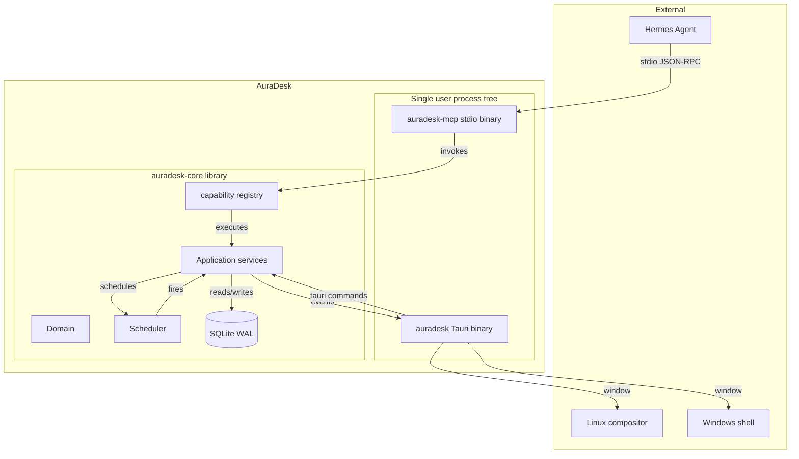

# AuraDesk — Architecture pointer

This page is the entry point to the project's architectural artifacts.
Phase 0 is the foundation commit (`633851c`–`24d5e54` on `main`); later
phases extend the same structure without re-architecting.

## Documents

| Doc | Path | Purpose |
|---|---|---|
| **Spec** | `docs/superpowers/specs/2026-10-16-auradesk-mvp-design.md` | The MVP design. 13 DB tables, 19 MCP tools, state machines, phases, acceptance criteria. |
| **Plan** | `docs/superpowers/plans/2026-10-16-auradesk-foundation.md` | Phase 0 task-by-task plan (12 tasks, TDD steps, review focus). |
| **License** | `LICENSE` + `PENDING_LICENSE_NOTICE.md` | GPL-3.0-only verbatim. Holder pending. |
| **Contributing** | `CONTRIBUTING.md` | Contribution freeze (CLA pending). |
| **ADRs** | `docs/decisions/0001-…-0012-…` | 12 architectural decision records. |
| **Dependency audit** | `docs/licensing/dependency-license-audit.md` | Preliminary (documentary). All declared deps A- or B-grade; 0 C-grade. Re-audit after lockfiles. |
| **CI** | `.github/workflows/ci.yml`, `release.yml` | Linux/macOS/Windows build, Tauri release on tags. |

## System diagram (verbatim from spec §4.1)



## Crate map

```
crates/
├── auradesk-core/    # framework-agnostic Rust library
│   ├── src/
│   │   ├── lib.rs
│   │   ├── error.rs                    # CoreError enum (Validation/NotFound/Conflict/Internal)
│   │   ├── domain/                     # pure entities
│   │   ├── application/                # use cases
│   │   ├── infrastructure/             # db, migrate, scheduler, clock, audio
│   │   ├── capabilities.rs             # single registry, both Tauri + MCP consume
│   │   ├── i18n.rs                     # rust-i18n init
│   │   └── bin/check-strings.rs        # CI guard
│   ├── migrations/V001__init.sql       # 13 tables, 31 indexes
│   ├── locales/{en,pt-BR}.yml
│   └── tests/capabilities_consistent.rs
├── auradesk/         # Tauri 2 binary (desktop UI host)
│   ├── src/
│   │   ├── main.rs
│   │   ├── lib.rs
│   │   ├── runtime.rs                  # window + tray + close-to-tray
│   │   └── ipc.rs                      # placeholder (T1+ adds commands)
│   ├── tauri.conf.json
│   ├── build.rs
│   └── capabilities/default.json
└── auradesk-mcp/     # JSON-RPC stdio server (Hermes integration)
    └── src/
        ├── main.rs
        ├── lib.rs
        └── server.rs                    # rmcp ServerHandler
```

## App map

```
apps/
└── web/                # React 18 + TypeScript + Vite + Tailwind + shadcn
    ├── src/
    │   ├── main.tsx
    │   ├── app/{router,layout/AppShell}.tsx
    │   ├── lib/{ipc,i18n,utils}.ts
    │   └── styles/globals.css
    ├── locales/{pt-BR,en}.json
    ├── public/                          # sounds + icons (T2+)
    ├── package.json
    ├── vite.config.ts
    ├── tailwind.config.js
    ├── tsconfig.json
    └── index.html
```

## Status of source-file headers (per ADR-0012 §4 + §5)

- **Manifests** (`Cargo.toml`, `package.json`, `pnpm-workspace.yaml`,
  `tsconfig.*`, `tailwind.config.*`, `postcss.config.*`, `components.json`,
  `flake.nix`, `.envrc`, `.gitignore`): no header. Configuration, not
  obra autoral criativa.
- **Lockfiles** (`pnpm-lock.yaml`, `flake.lock`): no header. Generated.
- **Nix config** (`flake.nix`, `.envrc`): no header. Nix convention.
- **CI workflows** (`.github/workflows/*.yml`): no header.
- **Docs** (`.md`): no header. The `LICENSE`/`NOTICE`/`PENDING_LICENSE_NOTICE`
  carry the license and copyright policy.
- **Source code** (`*.rs`, `*.ts`, `*.tsx`, `*.sql`, `*.sh`): header
  pending titular identification. Templates proposed in
  `PENDING_LICENSE_NOTICE.md` but not yet applied. Per Phase 0
  policy, no header is inserted until Q1 (titular) and Q2 (year)
  are answered in `PENDING_LICENSE_NOTICE.md`.
- **NOTICE**: not yet created. Awaiting the same answers.

## Phase boundaries

Phase 0 (this commit) is the **structural** foundation. Phases 1–5
are the business logic (tasks, reminders, Pomodoro, Hermes chat,
polish). Each phase has its own gate in
`docs/superpowers/specs/2026-10-16-auradesk-mvp-design.md` §11.
No business logic is implemented in Phase 0.
