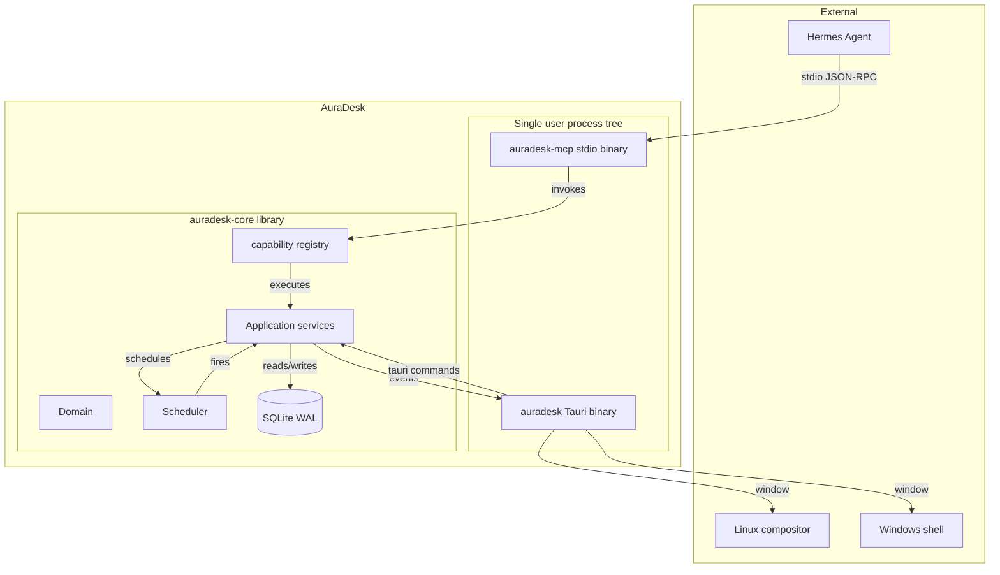

# AuraDesk — Architecture pointer

This page is the entry point to the project's architectural artifacts.
Phase 0 is the foundation commit (`633851c`–`24d5e54` on `main`); later
phases extend the same structure without re-architecting.

## Documents

| Doc | Path | Purpose |
|---|---|---|
| **Spec** | `docs/superpowers/specs/2026-10-16-auradesk-mvp-design.md` | The MVP design. 13 DB tables, 19 MCP tools, state machines, phases, acceptance criteria. |
| **Plan** | `docs/superpowers/plans/2026-10-16-auradesk-foundation.md` | Phase 0 task-by-task plan (12 tasks, TDD steps, review focus). |
| **License** | `LICENSE` + `PENDING_LICENSE_NOTICE.md` | GPL-3.0-only verbatim. Holder pending. |
| **Contributing** | `CONTRIBUTING.md` | Contribution freeze (CLA pending). |
| **ADRs** | `docs/decisions/0001-…-0012-…` | 12 architectural decision records. |
| **Dependency audit** | `docs/licensing/dependency-license-audit.md` | Preliminary (documentary). All declared deps A- or B-grade; 0 C-grade. Re-audit after lockfiles. |
| **CI** | `.github/workflows/ci.yml`, `release.yml` | Linux/macOS/Windows build, Tauri release on tags. |

## System diagram (verbatim from spec §4.1)



## Crate map

```
crates/
├── auradesk-core/    # framework-agnostic Rust library
│   ├── src/
│   │   ├── lib.rs
│   │   ├── error.rs                    # CoreError enum (Validation/NotFound/Conflict/Internal)
│   │   ├── domain/                     # pure entities
│   │   ├── application/                # use cases
│   │   ├── infrastructure/             # db, migrate, scheduler, clock, audio
│   │   ├── capabilities.rs             # single registry, both Tauri + MCP consume
│   │   ├── i18n.rs                     # rust-i18n init
│   │   └── bin/check-strings.rs        # CI guard
│   ├── migrations/                      # V001__init.sql .. V003__block_screen_setting.sql (see migrations/README.md)
│   ├── locales/{en,pt-BR}.yml
│   └── tests/capabilities_consistent.rs
├── auradesk/         # Tauri 2 binary (desktop UI host)
│   ├── src/
│   │   ├── main.rs
│   │   ├── lib.rs
│   │   ├── runtime.rs                  # window + tray + close-to-tray + command registration
│   │   ├── alert_lock.rs               # screen-lock backdrop/popup + emergency_unlock_all
│   │   └── ipc.rs                      # Tauri IPC handlers (incl. tasks_reorder, alerts_emergency_unlock)
│   ├── tauri.conf.json                 # window config + hardened Tauri CSP
│   ├── build.rs
│   └── capabilities/default.json
└── auradesk-mcp/     # JSON-RPC stdio server (Hermes integration)
    └── src/
        ├── main.rs
        ├── lib.rs
        └── server.rs                    # rmcp ServerHandler
```

## App map

```
apps/
└── web/                # React 18 + TypeScript + Vite + Tailwind + Aura Design System
    ├── src/
    │   ├── main.tsx
    │   ├── app/{router,layout/AppShell}.tsx
    │   ├── components/ui/{Button,Input,Badge,Dialog,Toast,Skeleton,EmptyState,index}
    │   ├── hooks/{usePomodoroController,useTasksController,useAlertsController}.ts
    │   ├── lib/{ipc,zip,i18n,utils,errors,theme,useTasks}.ts
    │   └── styles/globals.css           # semantic RGB CSS tokens (dark & light)
    ├── locales/{pt-BR,en}.json
    ├── public/                          # sounds + icons
    ├── package.json
    ├── vite.config.ts
    ├── tailwind.config.js               # aura.* semantic color, radius & shadow tokens
    ├── tsconfig.json
    └── index.html
```

## Status of source-file headers (per ADR-0012 §4 + §5)

- **Manifests** (`Cargo.toml`, `package.json`, `pnpm-workspace.yaml`,
  `tsconfig.*`, `tailwind.config.*`, `postcss.config.*`, `components.json`,
  `flake.nix`, `.envrc`, `.gitignore`): no header. Configuration, not
  obra autoral criativa.
- **Lockfiles** (`pnpm-lock.yaml`, `flake.lock`): no header. Generated.
- **Nix config** (`flake.nix`, `.envrc`): no header. Nix convention.
- **CI workflows** (`.github/workflows/*.yml`): no header.
- **Docs** (`.md`): no header. The `LICENSE`/`NOTICE`/`PENDING_LICENSE_NOTICE`
  carry the license and copyright policy.
- **Source code** (`*.rs`, `*.ts`, `*.tsx`, `*.sql`, `*.sh`): header
  pending titular identification. Templates proposed in
  `PENDING_LICENSE_NOTICE.md` but not yet applied. Per Phase 0
  policy, no header is inserted until Q1 (titular) and Q2 (year)
  are answered in `PENDING_LICENSE_NOTICE.md`.
- **NOTICE**: not yet created. Awaiting the same answers.

## Phase boundaries

Phase 0 (this commit) is the **structural** foundation. Phases 1–5
are the business logic (tasks, reminders, Pomodoro, Hermes chat,
polish). Each phase has its own gate in
`docs/superpowers/specs/2026-10-16-auradesk-mvp-design.md` §11.
No business logic is implemented in Phase 0.

## Phase 1 Stabilization & Architectural Improvements

Recorded in [ADR-0014](ADR-0014-phase1-stabilization-and-design-system.md):

1. **SQLite WAL Reader Pool (`Db::reader`)**: `Db::open` establishes a 4-connection pool configured with `SQLITE_OPEN_READ_ONLY`, `PRAGMA query_only = ON`, and `busy_timeout = 5000` (falling back to `writer()` for in-memory DBs). All read-only query paths across `auradesk-core` services use `db.reader()`, eliminating write-mutex contention for read traffic while keeping `db.writer()` serialized for atomic mutations.
2. **SQL-Side Task Filtering & Batch Reorder**: `TasksService::list` pushes `status`, `project_id`, `top_level_only`, and `overdue` (`julianday(due_at) < julianday(?)`) predicates into SQLite `WHERE` clauses. `TasksService::reorder_batch` + `tasks_reorder` IPC execute multi-card Kanban position and status transitions in one transaction.
3. **Lightweight Scheduler Pre-Check**: `RemindersService::poll_and_fire_overdue` executes an `EXISTS` query on `db.reader()` before acquiring `db.writer()` when no reminders are due.
4. **Desktop & Browser Fail-Safe / Parity**: Tauri CSP hardened in `tauri.conf.json`; `AlertLock` exposes `alerts_emergency_unlock` (`Ctrl+Shift+U` + error banner button); `apps/web/src/lib/zip.ts` implements pure-TS PKZIP Store/CRC-32 + async Deflate decompression for cross-runtime `bundle.json` v2 backup interoperability; Daily Plan payloads normalize plain text to `{"notes": ...}` JSON in both Rust and browser fallback; Web `alerts_resolve` handles `monthly` (`+30d`) recurrence.
5. **Frontend Architecture & Aura Design System**: Pomodoro state moved into `apps/web/src/hooks/usePomodoroController.ts`; `AppShell.tsx` reduces polling to 30s, pauses while `document.visibilityState === "hidden"`, and performs selective domain refreshes; `globals.css` + `tailwind.config.js` replace Light Mode `!important` overrides with RGB CSS variables; accessible UI primitives (`Button`, `Input`, `Badge`, `Dialog`, `Toast`, `Skeleton`, `EmptyState`) live in `apps/web/src/components/ui/`.

## Phase 1.5 Design System Consolidation & Desktop Validation

Recorded in [`docs/PHASE1_5_VALIDATION_REPORT.md`](../PHASE1_5_VALIDATION_REPORT.md):

1. **Aura Design System Rollout & Kanban Redesign**: Adopted `components/ui/{Badge,Button,Input,EmptyState,Skeleton,Toast}` across all primary pages (`DashboardPage`, `KanbanPage`, `PomodoroPage`, `RemindersPage`, `ReportsPage`, `SettingsPage`), `ReminderModal`, `KanbanBoard`, and a redesigned low-clutter `TaskCard`.
2. **Mobile Responsive Navigation & Further Shell Decomposition**: Extracted `useTasksController.ts` and `useAlertsController.ts` from `AppShell.tsx`, and added a fixed mobile bottom navigation bar (`< md`) backed by the single semantic `<nav>` landmark without DOM duplication.
3. **True Calendar Monthly Recurrence**: Replaced `+30 days` approximations with calendar month addition + short-month clamping (`checked_add_months(Months::new(1))` in Rust `alerts.rs`/`tasks.rs` and `advanceCalendarMonthIso` in `apps/web/src/lib/ipc.ts`).
4. **Runtime Validation & Test Hardening**: Added `AURADESK_DATA_DIR` isolation support in `crates/auradesk/src/runtime.rs`, validated live Desktop `auradesk.exe` startup/WAL/single-instance locking and Playwright Chrome E2E flows, and added regression coverage for large ZIP archives, `AlertLock` IPC polling failure recovery, and multi-threaded SQLite WAL reader/writer concurrency.
