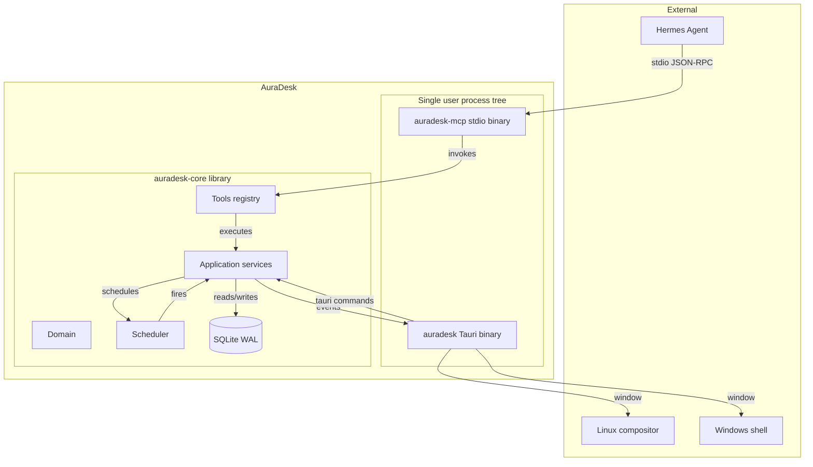
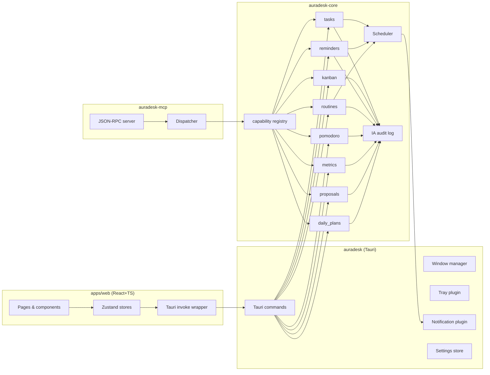
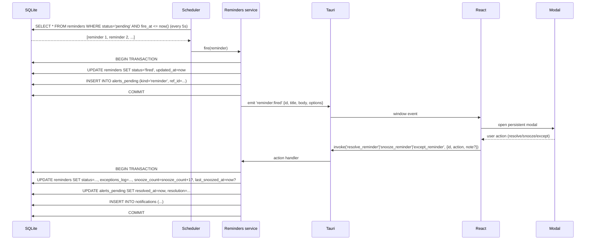
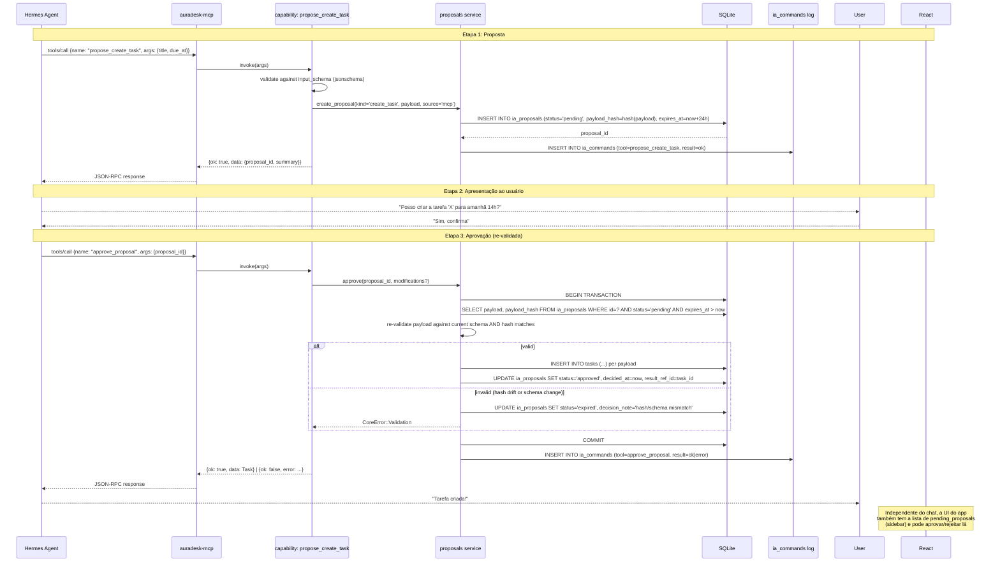
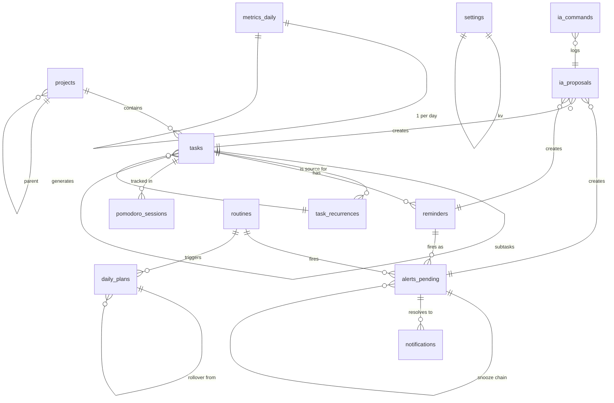
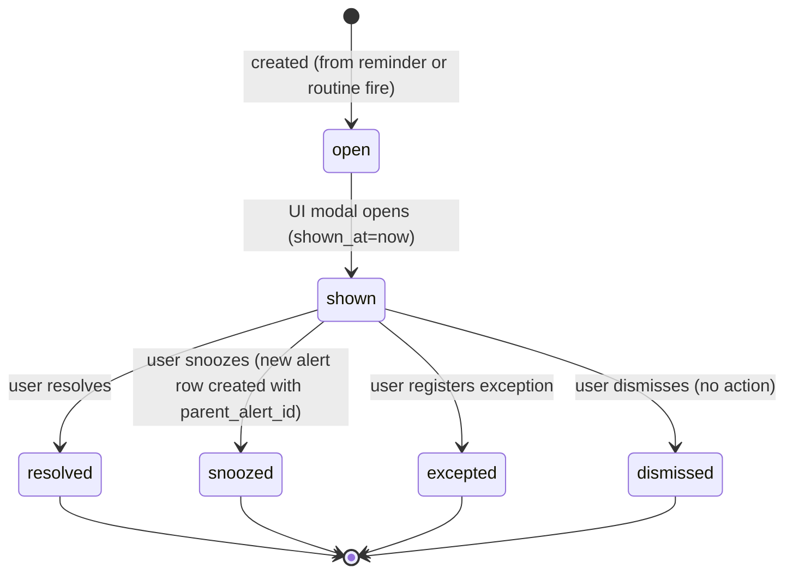
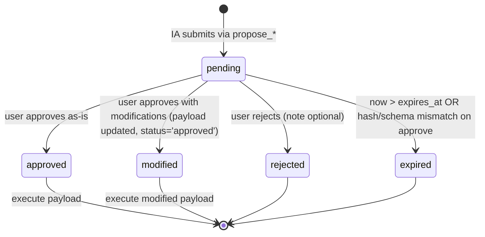
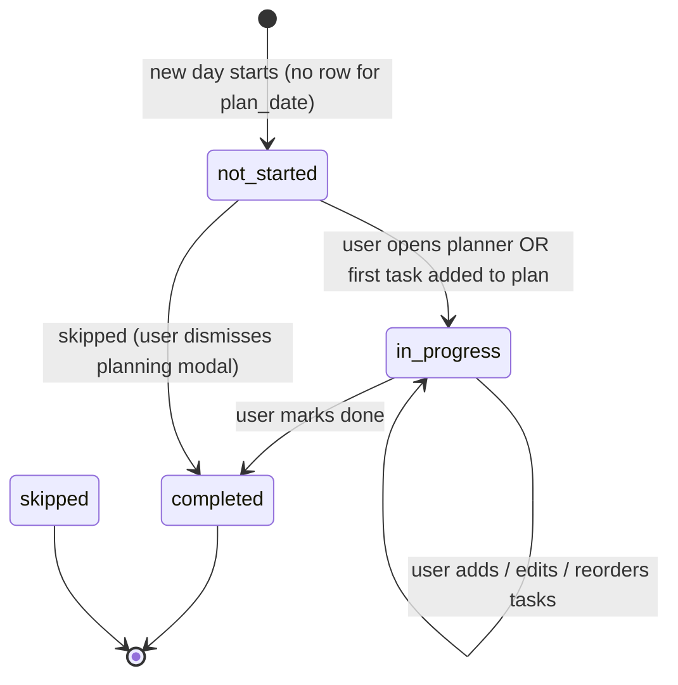
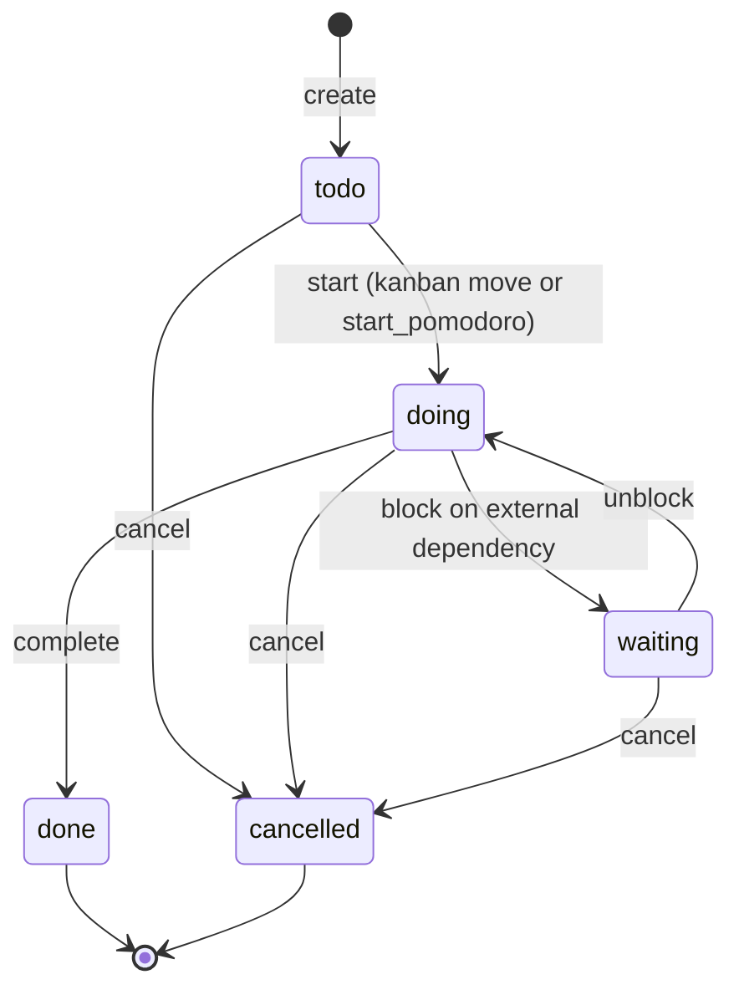

# AuraDesk — MVP Design Spec

| Field | Value |
|---|---|
| **Status** | Draft — awaiting review |
| **Date** | 2026-10-16 |
| **Author** | Aura (architect agent) |
| **Owner** | garton / RAGton |
| **Repository** | <https://github.com/RAGton/aura-desk> |
| **Implements** | `IDEA.md` (root) |

---

## 1. TL;DR

AuraDesk é um aplicativo desktop de produtividade pessoal, multiplataforma (Linux + Windows), construído em **Tauri 2 + Rust + React/TS + SQLite**, com **Nix Flakes** para dev reproduzível no NixOS. O coração é uma biblioteca Rust (`auradesk-core`) que expõe o domínio como **tools MCP** — o Hermes Agent conecta como cliente MCP e ganha linguagem natural pra operar o desk.

MVP em 6 fases incrementais (Fase 0: fundação → Fase 5: polish). Cada fase termina com critério de aceite verificável e CI verde.

---

## 2. Goals & Non-Goals

### 2.1 Goals (MVP)

1. Dashboard fixo no segundo monitor com Pomodoro, próxima tarefa, pendentes, água, pausas, últimas notificações, resumo do dia.
2. CRUD de tarefas e projetos com recorrência, prioridades, prazos, projetos de longo prazo e visão Kanban (A fazer / Em andamento / Aguardando / Concluído).
3. Lembretes com modal persistente, som, ações explícitas (Resolver / Adiar / Registrar exceção), recuperação pós-reinício e seleção de monitor secundário.
4. Rotinas: planejamento diário às 07:50 (configurável), hidratação, pausas.
5. Integração com Hermes Agent via MCP stdio: chat por texto, comandos em linguagem natural, criação assistida de tarefas e lembretes.
6. Suporte a Windows 10/11 e Linux (NixOS como alvo principal, outras distros suportadas).
7. App funciona 100% offline e sem IA. IA é camada opcional.
8. Persistência local em SQLite, banco versionado com migrations, backup exportável.
9. Interface acessível por teclado, leitor de tela, alto contraste.

### 2.2 Non-Goals (explicitamente fora do MVP)

- Sincronização em nuvem, conta de usuário, multi-device
- App mobile (Android, iOS)
- Marketplace de plugins/extensões
- Temas customizáveis (apenas dark; tema claro é v2)
- Editor RRULE custom (apenas presets: diário, semanal, mensal, cron)
- Transcrição de voz (apenas captura de áudio; transcrição YAGNI)
- Compartilhamento de tarefas, colaboração multi-usuário
- Integração com calendários externos (Google, Outlook, CalDAV)
- Painéis/widgets customizáveis no dashboard
- Code signing EV (usaremos Azure Trusted Signing; certificado EV é YAGNI até v2)
- Publicação em Microsoft Store, Flathub, Snapcraft (instalador standalone apenas)

---

## 3. Glossary

| Term | Meaning |
|---|---|
| **Core** | `auradesk-core`, biblioteca Rust que contém domínio, application services, infraestrutura e tools. Sem dependência de Tauri ou MCP. |
| **Desk** | `auradesk` (binário Tauri 2), o app desktop. Owner do DB, scheduler, windows, tray, notifications. |
| **MCP server** | `auradesk-mcp` (binário stdio), expõe o core como JSON-RPC pra Hermes. |
| **Tool** | Função nomeada com schema JSON (input/output) que o core expõe. É a unidade que o Hermes invoca via MCP. |
| **Routine** | Lembrete recorrente baseado em expressão cron (5-field). |
| **Alert** | Entrada em `alerts_pending` que dispara um modal persistente. |
| **Tray** | Ícone na bandeja do sistema. Fechar a janela principal esconde; Quit pelo menu encerra o processo. |
| **Watcher** | Subsistema tokio que poll-a o DB a cada N segundos para disparar lembretes/rotinas. |
| **Proposal** | Entrada em `ia_proposals` representando uma ação (criar/editar tarefa, lembrete, subtarefas) sugerida pela IA. Requer aprovação humana antes de executar. Nunca é escrita diretamente em `tasks` ou `reminders`. |
| **Daily Plan** | Registro em `daily_plans` representando o planejamento do dia. Estados: `not_started`, `in_progress`, `completed`, `skipped`. Um por data local (UNIQUE em `plan_date`). |
| **Capability** | Função nomeada (com input/output schema) que o core expõe. Cada capability é registrada UMA vez e consumida simultaneamente por Tauri IPC e/ou MCP dispatcher, garantindo um único contrato. |
| **Compact Mode** | Janela flutuante compacta (~280×96 px), always-on-top, fixa no monitor primário, mostrando próxima tarefa + estado do pomodoro. Alternativa leve ao dashboard completo. |

---

## 4. Architecture

### 4.1 System Diagram



### 4.2 Component Diagram



### 4.3 Data Flow: Lembrete dispara



### 4.4 Data Flow: IA propõe tarefa via MCP (com aprovação)



---

## 5. Technology Stack

| Layer | Choice | Rationale |
|---|---|---|
| **Shell desktop** | Tauri 2.x (pinned minor) | Bundle pequeno, Rust backend, multi-OS, bom ecossistema de plugins. |
| **Backend** | Rust (stable) | Performance, type safety, ecossistema maduro p/ SQLite e tempo. |
| **Frontend** | React 18 + TypeScript + Vite | Padrão Tauri default; Vite é rápido; TS dá segurança de tipos. |
| **Estilo** | Tailwind CSS v4 | Atomic CSS, build rápido, design system fácil. |
| **Componentes** | shadcn/ui (Radix primitives) | Copy-paste, sem dep runtime, audit-friendly, customizável. |
| **State** | Zustand | Mínimo boilerplate, persist middleware, devtools. |
| **DB** | SQLite + rusqlite + refinery | Zero runtime dep, controle total, migrations SQL. WAL mode. |
| **Scheduler** | tokio runtime (Tauri 2 já usa) | Poll a cada 5s, dispara events, gerencia timers via `tokio::time`. |
| **Cron parsing** | `croner` crate | Leve, sem deps pesadas, timezone-aware. |
| **RRULE** | `rrule` crate | RFC 5545, abrange presets comuns. |
| **Audio** | `rodio` | Backend Rust puro, sem GStreamer. |
| **HTTP client** | `reqwest` (apenas p/ future Hermes telemetry, MVP não usa) | Reservado, YAGNI por ora. |
| **Logging** | `tracing` + `tracing-subscriber` | Structured logs, fácil de filtrar. |
| **Errors** | `thiserror` (libs) + `anyhow` (binaries) | Convenção clara. |
| **Testing** | `cargo test`, `rstest`, `insta` (snapshots), `mockall` (mocks) | TDD-friendly. |
| **TS testing** | Vitest + Testing Library | Alinhado com Vite. |
| **E2E** | Playwright + Tauri driver | Padrão Tauri 2. |
| **Lint (Rust)** | `rustfmt` + `clippy -- -D warnings` | Política strict. |
| **Lint (TS)** | ESLint + Prettier | Padrão. |
| **Dev environment** | Nix flake + direnv | Reproductibilidade no NixOS. |
| **CI** | GitHub Actions (`tauri-action`) | Build linux + windows-latest. |
| **MCP SDK** | `rmcp` (Rust MCP SDK) | JSON-RPC stdio, schema validation built-in. |
| **i18n** | `react-i18next` (frontend) + `rust-i18n` (backend) | i18n-ready desde dia 1. |

---

## 6. Repository Layout

```
AuraDesk/
├── Cargo.toml                          # workspace: crates/*, apps/*-rs
├── pnpm-workspace.yaml                 # apps: apps/*-ts
├── package.json
├── tsconfig.base.json
├── flake.nix
├── flake.lock
├── .envrc
├── .gitignore
├── README.md
├── LICENSE
├── IDEA.md                             # já existe
│
├── docs/
│   ├── superpowers/
│   │   ├── specs/                      # este arquivo mora aqui
│   │   └── plans/                      # plan por fase
│   ├── decisions/                      # ADRs (Markdown + Nygard format)
│   ├── architecture/                   # diagramas extras, threat model
│   └── contributing.md
│
├── crates/
│   ├── auradesk-core/                  # domínio + aplicação + infra
│   │   ├── Cargo.toml
│   │   ├── src/
│   │   │   ├── lib.rs
│   │   │   ├── error.rs                # CoreError enum
│   │   │   ├── domain/                 # entidades puras, sem IO
│   │   │   │   ├── mod.rs
│   │   │   │   ├── id.rs               # ULID wrapper
│   │   │   │   ├── task.rs             # Task, Priority, Status
│   │   │   │   ├── project.rs
│   │   │   │   ├── reminder.rs
│   │   │   │   ├── routine.rs
│   │   │   │   ├── pomodoro.rs
│   │   │   │   ├── alert.rs
│   │   │   │   └── notification.rs
│   │   │   ├── application/            # use cases
│   │   │   │   ├── mod.rs
│   │   │   │   ├── tasks.rs
│   │   │   │   ├── projects.rs
│   │   │   │   ├── kanban.rs
│   │   │   │   ├── reminders.rs
│   │   │   │   ├── routines.rs
│   │   │   │   ├── pomodoro.rs
│   │   │   │   ├── alerts.rs
│   │   │   │   ├── metrics.rs
│   │   │   │   └── settings.rs
│   │   │   ├── infrastructure/
│   │   │   │   ├── mod.rs
│   │   │   │   ├── db/
│   │   │   │   │   ├── mod.rs          # Db struct + connection pool
│   │   │   │   │   ├── migrations.rs   # refinery runner
│   │   │   │   │   ├── repositories/   # 1 repo por aggregate
│   │   │   │   │   │   ├── tasks.rs
│   │   │   │   │   │   ├── projects.rs
│   │   │   │   │   │   ├── reminders.rs
│   │   │   │   │   │   ├── routines.rs
│   │   │   │   │   │   ├── pomodoro.rs
│   │   │   │   │   │   ├── alerts.rs
│   │   │   │   │   │   ├── notifications.rs
│   │   │   │   │   │   ├── metrics.rs
│   │   │   │   │   │   ├── ia_commands.rs
│   │   │   │   │   │   └── settings.rs
│   │   │   │   │   └── ulid.rs
│   │   │   │   ├── scheduler/
│   │   │   │   │   ├── mod.rs          # tokio task
│   │   │   │   │   ├── watcher.rs      # poll loop
│   │   │   │   │   └── cron.rs         # croner integration
│   │   │   │   ├── audio/
│   │   │   │   │   ├── mod.rs
│   │   │   │   │   └── assets.rs
│   │   │   │   └── clock/
│   │   │   │       ├── mod.rs          # trait Clock
│   │   │   │       └── system.rs       # SystemClock impl
│   │   │   ├── tools/                  # MCP tool definitions
│   │   │   │   ├── mod.rs              # registry + dispatch
│   │   │   │   ├── schema.rs           # JSON schema helpers
│   │   │   │   ├── audit.rs            # IA audit log helper
│   │   │   │   ├── tasks.rs            # create_task, list_tasks, ...
│   │   │   │   ├── projects.rs
│   │   │   │   ├── reminders.rs
│   │   │   │   ├── pomodoro.rs
│   │   │   │   └── ...
│   │   │   └── i18n.rs                 # rust-i18n init
│   │   ├── tests/
│   │   └── migrations/                 # SQL files embedded
│   │
│   ├── auradesk/                       # Tauri 2 binary
│   │   ├── Cargo.toml
│   │   ├── tauri.conf.json
│   │   ├── build.rs
│   │   ├── icons/                      # multi-resolution PNG/ICO
│   │   ├── capabilities/
│   │   │   └── default.json            # permissions ACL
│   │   └── src/
│   │       ├── main.rs                 # subcommand dispatch
│   │       ├── ipc/                    # tauri command handlers
│   │       │   ├── mod.rs
│   │       │   ├── tasks.rs
│   │       │   ├── projects.rs
│   │       │   ├── kanban.rs
│   │       │   ├── reminders.rs
│   │       │   ├── routines.rs
│   │       │   ├── pomodoro.rs
│   │       │   ├── alerts.rs
│   │       │   ├── metrics.rs
│   │       │   └── settings.rs
│   │       ├── windows/                # window manager
│   │       │   ├── mod.rs
│   │       │   ├── main.rs
│   │       │   ├── dashboard.rs
│   │       │   └── monitor.rs          # monitor detection
│   │       ├── tray/
│   │       │   ├── mod.rs
│   │       │   └── menu.rs
│   │       ├── notifications/
│   │       │   └── mod.rs
│   │       ├── settings/
│   │       │   └── mod.rs              # tauri-plugin-store wrapper
│   │       └── runtime.rs              # tokio runtime + tracing init
│   │
│   └── auradesk-mcp/                   # MCP stdio binary
│       ├── Cargo.toml
│       └── src/
│           ├── main.rs                 # subcommand 'mcp'
│           ├── server.rs               # rmcp server impl
│           └── errors.rs               # JSON-RPC error mapping
│
├── apps/
│   └── web/                            # frontend
│       ├── package.json
│       ├── vite.config.ts
│       ├── tailwind.config.ts
│       ├── postcss.config.js
│       ├── components.json             # shadcn config
│       ├── tsconfig.json
│       ├── index.html
│       ├── public/
│       │   ├── icons/
│       │   └── sounds/                 # 2-3 alert WAVs
│       │       ├── alert-info.wav
│       │       ├── alert-normal.wav
│       │       └── alert-urgent.wav
│       ├── locales/
│       │   ├── pt-BR.json
│       │   └── en.json
│       └── src/
│           ├── main.tsx
│           ├── app/
│           │   ├── router.tsx
│           │   ├── layout/
│           │   │   ├── AppShell.tsx
│           │   │   ├── Sidebar.tsx
│           │   │   └── TopBar.tsx
│           │   └── providers.tsx
│           ├── features/
│           │   ├── dashboard/
│           │   │   ├── DashboardPage.tsx
│           │   │   ├── components/
│           │   │   │   ├── PomodoroWidget.tsx
│           │   │   │   ├── NextTaskWidget.tsx
│           │   │   │   ├── HydrationWidget.tsx
│           │   │   │   ├── BreakWidget.tsx
│           │   │   │   ├── RecentNotifications.tsx
│           │   │   │   └── DailySummary.tsx
│           │   │   ├── hooks/
│           │   │   └── api.ts
│           │   ├── tasks/
│           │   ├── kanban/
│           │   ├── reminders/
│           │   ├── routines/
│           │   ├── pomodoro/
│           │   ├── hermes-chat/
│           │   └── settings/
│           ├── components/
│           │   └── ui/                 # shadcn copy-paste
│           ├── lib/
│           │   ├── ipc.ts              # typed tauri invoke
│           │   ├── store.ts            # zustand setup
│           │   ├── i18n.ts             # i18next init
│           │   ├── cn.ts               # className utility
│           │   └── utils.ts
│           └── styles/
│               └── globals.css         # Tailwind entry
│
├── migrations/                         # refinery SQL (single source)
│   ├── V001__init.sql
│   ├── V002__reminder_exceptions.sql
│   └── ...
│
├── tests/
│   └── e2e/                            # Playwright + tauri-driver
│       ├── fixtures/
│       └── specs/
│
├── scripts/
│   ├── dev.sh                          # direnv-friendly
│   ├── build.sh
│   ├── check.sh                        # fmt + clippy + test + lint
│   └── release.sh
│
└── .github/
    └── workflows/
        ├── ci.yml
        └── release.yml
```

### 6.1 Boundary rules

- `auradesk-core` **must not** import `tauri`, `tauri-plugin-*`, `rmcp`, or anything OS-specific. Testable em qualquer host.
- `auradesk` and `auradesk-mcp` **only** import `auradesk-core`'s public API. No shortcuts.
- Frontend **only** communicates with backend through typed Tauri commands. No raw `invoke` calls scattered.
- Migrations are SQL files in `migrations/`; `auradesk-core::infrastructure::db` embeds them at compile time via `include_str!`.

---

## 7. Data Model

SQLite in WAL mode. Single writer serialized via `tokio::sync::Mutex<Connection>`. Readers concurrent. IDs are ULIDs (sortable, URL-safe).

### 7.1 ER Overview



### 7.2 Schema (V001__init.sql)

> All timestamps: ISO 8601 with timezone offset (RFC 3339). All `CHECK` enums are defense-in-depth. JSON-typed columns use `json_valid()` (SQLite ≥ 3.38).

```sql
-- ── Projects ──────────────────────────────────────────────────
CREATE TABLE projects (
  id          TEXT PRIMARY KEY,
  name        TEXT NOT NULL CHECK (length(trim(name)) > 0),
  description TEXT,
  color       TEXT CHECK (color IS NULL OR color GLOB '#[0-9A-Fa-f][0-9A-Fa-f][0-9A-Fa-f][0-9A-Fa-f][0-9A-Fa-f][0-9A-Fa-f]'),
  parent_id   TEXT REFERENCES projects(id) ON DELETE CASCADE,
  status      TEXT NOT NULL DEFAULT 'active'
              CHECK (status IN ('active','paused','completed','archived')),
  start_date  TEXT,
  target_date TEXT,
  created_at  TEXT NOT NULL DEFAULT (datetime('now')),
  updated_at  TEXT NOT NULL DEFAULT (datetime('now'))
);
CREATE INDEX idx_projects_status ON projects(status);
CREATE INDEX idx_projects_parent ON projects(parent_id);

-- ── Tasks ─────────────────────────────────────────────────────
CREATE TABLE tasks (
  id              TEXT PRIMARY KEY,
  project_id      TEXT REFERENCES projects(id) ON DELETE SET NULL,
  parent_task_id  TEXT REFERENCES tasks(id) ON DELETE CASCADE,
  recurrence_id   TEXT REFERENCES task_recurrences(id) ON DELETE SET NULL,
  title           TEXT NOT NULL CHECK (length(trim(title)) > 0),
  description     TEXT,
  priority        TEXT NOT NULL DEFAULT 'normal'
                  CHECK (priority IN ('low','normal','high','urgent')),
  status          TEXT NOT NULL DEFAULT 'todo'
                  CHECK (status IN ('todo','doing','waiting','done','cancelled')),
  kanban_order    INTEGER NOT NULL DEFAULT 0,
  due_at          TEXT,
  started_at      TEXT,
  completed_at    TEXT,
  estimate_min    INTEGER CHECK (estimate_min IS NULL OR estimate_min > 0),
  actual_min      INTEGER CHECK (actual_min IS NULL OR actual_min >= 0),
  tags            TEXT,                                   -- JSON array of strings
  created_at      TEXT NOT NULL DEFAULT (datetime('now')),
  updated_at      TEXT NOT NULL DEFAULT (datetime('now')),
  CHECK (tags IS NULL OR json_valid(tags))
);
CREATE INDEX idx_tasks_status        ON tasks(status);
CREATE INDEX idx_tasks_due_open      ON tasks(due_at)
  WHERE status NOT IN ('done','cancelled');
CREATE INDEX idx_tasks_project       ON tasks(project_id);
CREATE INDEX idx_tasks_parent        ON tasks(parent_task_id);
CREATE INDEX idx_tasks_recurrence    ON tasks(recurrence_id);
CREATE INDEX idx_tasks_created       ON tasks(created_at DESC);

-- ── Task Recurrence (RRULE) ───────────────────────────────────
CREATE TABLE task_recurrences (
  id              TEXT PRIMARY KEY,
  task_id         TEXT NOT NULL REFERENCES tasks(id) ON DELETE CASCADE,
  rrule           TEXT NOT NULL,
  dtstart         TEXT NOT NULL,
  dtend           TEXT,
  exdates         TEXT,                                  -- JSON array of ISO timestamps
  lookahead_days  INTEGER NOT NULL DEFAULT 7
                  CHECK (lookahead_days > 0 AND lookahead_days <= 60),
  created_at      TEXT NOT NULL DEFAULT (datetime('now')),
  updated_at      TEXT NOT NULL DEFAULT (datetime('now')),
  CHECK (exdates IS NULL OR json_valid(exdates))
);
CREATE INDEX idx_recurrences_task ON task_recurrences(task_id);

-- ── Reminders ─────────────────────────────────────────────────
CREATE TABLE reminders (
  id               TEXT PRIMARY KEY,
  task_id          TEXT REFERENCES tasks(id) ON DELETE CASCADE,
  proposal_id      TEXT REFERENCES ia_proposals(id) ON DELETE SET NULL,
  title            TEXT NOT NULL CHECK (length(trim(title)) > 0),
  body             TEXT,
  fire_at          TEXT NOT NULL,
  repeat_kind      TEXT
                   CHECK (repeat_kind IS NULL OR repeat_kind IN ('none','daily','weekly','monthly','cron')),
  repeat_value     TEXT,
  monitor_target   TEXT
                   CHECK (monitor_target IS NULL OR monitor_target IN ('primary','secondary','preferred')),
  sound            TEXT
                   CHECK (sound IS NULL OR sound IN ('info','normal','urgent','none')),
  status           TEXT NOT NULL DEFAULT 'pending'
                   CHECK (status IN ('pending','fired','resolved','dismissed','snoozed','excepted')),
  snooze_count     INTEGER NOT NULL DEFAULT 0 CHECK (snooze_count >= 0),
  last_snoozed_at  TEXT,
  resolved_at      TEXT,
  exceptions_log   TEXT,                                -- JSON array of {at, action, note}
  created_at       TEXT NOT NULL DEFAULT (datetime('now')),
  updated_at       TEXT NOT NULL DEFAULT (datetime('now')),
  CHECK (exceptions_log IS NULL OR json_valid(exceptions_log))
);
CREATE INDEX idx_reminders_pending  ON reminders(fire_at) WHERE status = 'pending';
CREATE INDEX idx_reminders_task     ON reminders(task_id);
CREATE INDEX idx_reminders_proposal ON reminders(proposal_id);

-- ── Routines (cron-scheduled recurring actions) ──────────────
-- cron_expr is NULL for kind='daily_planning' — that kind reads its
-- schedule from the routine.daily_planning_time setting at runtime.
CREATE TABLE routines (
  id            TEXT PRIMARY KEY,
  kind          TEXT NOT NULL
                CHECK (kind IN ('water','break','daily_planning','custom')),
  title         TEXT NOT NULL CHECK (length(trim(title)) > 0),
  body          TEXT,
  cron_expr     TEXT,
  start_date    TEXT,
  end_date      TEXT,
  enabled       INTEGER NOT NULL DEFAULT 1 CHECK (enabled IN (0,1)),
  metadata      TEXT,                                   -- JSON
  last_fired_at TEXT,
  created_at    TEXT NOT NULL DEFAULT (datetime('now')),
  updated_at    TEXT NOT NULL DEFAULT (datetime('now')),
  CHECK (metadata IS NULL OR json_valid(metadata)),
  CHECK (kind != 'daily_planning' OR cron_expr IS NULL)
);
CREATE INDEX idx_routines_enabled ON routines(enabled) WHERE enabled = 1;
CREATE INDEX idx_routines_kind    ON routines(kind);

-- ── Daily Plans (one per local date) ─────────────────────────
CREATE TABLE daily_plans (
  id              TEXT PRIMARY KEY,
  plan_date       TEXT NOT NULL,                        -- YYYY-MM-DD (local TZ)
  state           TEXT NOT NULL DEFAULT 'not_started'
                  CHECK (state IN ('not_started','in_progress','completed','skipped')),
  started_at      TEXT,
  completed_at    TEXT,
  payload         TEXT,                                 -- JSON: {tasks:[{task_id,order}], notes}
  rollover_from   TEXT REFERENCES daily_plans(id) ON DELETE SET NULL,
  created_at      TEXT NOT NULL DEFAULT (datetime('now')),
  updated_at      TEXT NOT NULL DEFAULT (datetime('now')),
  CHECK (payload IS NULL OR json_valid(payload)),
  UNIQUE (plan_date)
);
CREATE INDEX idx_daily_plans_state ON daily_plans(state);

-- ── Pomodoro sessions ─────────────────────────────────────────
CREATE TABLE pomodoro_sessions (
  id              TEXT PRIMARY KEY,
  task_id         TEXT REFERENCES tasks(id) ON DELETE SET NULL,
  kind            TEXT NOT NULL
                  CHECK (kind IN ('focus','short_break','long_break')),
  planned_min     INTEGER NOT NULL CHECK (planned_min > 0),
  actual_min      INTEGER CHECK (actual_min IS NULL OR actual_min > 0),
  cycle_index     INTEGER CHECK (cycle_index IS NULL OR cycle_index > 0),
  cycle_count     INTEGER CHECK (cycle_count IS NULL OR cycle_count > 0),
  started_at      TEXT NOT NULL,
  ended_at        TEXT,
  status          TEXT NOT NULL DEFAULT 'running'
                  CHECK (status IN ('running','completed','interrupted')),
  interruptions   INTEGER NOT NULL DEFAULT 0 CHECK (interruptions >= 0)
);
CREATE INDEX idx_pomo_task    ON pomodoro_sessions(task_id);
CREATE INDEX idx_pomo_started ON pomodoro_sessions(started_at DESC);

-- ── Alerts (persistent modal queue) ───────────────────────────
CREATE TABLE alerts_pending (
  id                TEXT PRIMARY KEY,
  kind              TEXT NOT NULL,                     -- 'reminder' | 'routine' | 'system'
  ref_id            TEXT,                               -- reminder_id or routine_id
  proposal_id       TEXT REFERENCES ia_proposals(id) ON DELETE SET NULL,
  title             TEXT NOT NULL,
  body              TEXT,
  severity          TEXT NOT NULL DEFAULT 'normal'
                    CHECK (severity IN ('info','normal','urgent')),
  show_on_monitor   TEXT,                               -- 'primary' | 'secondary' | 'preferred' | monitor_id
  options           TEXT,                               -- JSON: {snooze_min, actions, sound}
  parent_alert_id   TEXT REFERENCES alerts_pending(id) ON DELETE SET NULL,
  created_at        TEXT NOT NULL DEFAULT (datetime('now')),
  shown_at          TEXT,
  resolved_at       TEXT,
  resolution        TEXT
                    CHECK (resolution IS NULL OR resolution IN ('resolved','snoozed','excepted','dismissed')),
  CHECK (options IS NULL OR json_valid(options))
);
CREATE INDEX idx_alerts_open     ON alerts_pending(created_at) WHERE resolved_at IS NULL;
CREATE INDEX idx_alerts_severity ON alerts_pending(severity) WHERE resolved_at IS NULL;
CREATE INDEX idx_alerts_parent   ON alerts_pending(parent_alert_id);

-- ── Notifications log ─────────────────────────────────────────
CREATE TABLE notifications (
  id           TEXT PRIMARY KEY,
  alert_id     TEXT REFERENCES alerts_pending(id) ON DELETE SET NULL,
  proposal_id  TEXT REFERENCES ia_proposals(id) ON DELETE SET NULL,
  kind         TEXT NOT NULL,
  ref_id       TEXT,
  title        TEXT NOT NULL,
  body         TEXT,
  delivered_at TEXT NOT NULL,
  read_at      TEXT
);
CREATE INDEX idx_notif_at       ON notifications(delivered_at DESC);
CREATE INDEX idx_notif_kind     ON notifications(kind);
CREATE INDEX idx_notif_alert    ON notifications(alert_id);
CREATE INDEX idx_notif_proposal ON notifications(proposal_id);

-- ── Daily metrics (aggregated) ────────────────────────────────
CREATE TABLE metrics_daily (
  date            TEXT PRIMARY KEY,                    -- YYYY-MM-DD (local TZ)
  focus_minutes   INTEGER NOT NULL DEFAULT 0 CHECK (focus_minutes >= 0),
  break_minutes   INTEGER NOT NULL DEFAULT 0 CHECK (break_minutes >= 0),
  water_count     INTEGER NOT NULL DEFAULT 0 CHECK (water_count >= 0),
  tasks_done      INTEGER NOT NULL DEFAULT 0 CHECK (tasks_done >= 0),
  tasks_created   INTEGER NOT NULL DEFAULT 0 CHECK (tasks_created >= 0),
  active_minutes  INTEGER NOT NULL DEFAULT 0 CHECK (active_minutes >= 0),
  notes           TEXT
);

-- ── IA command audit log ──────────────────────────────────────
-- 'voice' removed: voice capture is in scope but transcription/transcription
-- -driven tool calls are YAGNI. Source is therefore limited to 'mcp' | 'ui'.
CREATE TABLE ia_commands (
  id             TEXT PRIMARY KEY,
  source         TEXT NOT NULL
                 CHECK (source IN ('mcp','ui')),
  tool_name      TEXT NOT NULL,
  args_json      TEXT NOT NULL,
  result_status  TEXT NOT NULL
                 CHECK (result_status IN ('ok','rejected','error')),
  result_message TEXT,
  proposal_id    TEXT REFERENCES ia_proposals(id) ON DELETE SET NULL,
  invoked_at     TEXT NOT NULL DEFAULT (datetime('now'))
);
CREATE INDEX idx_ia_at        ON ia_commands(invoked_at DESC);
CREATE INDEX idx_ia_tool      ON ia_commands(tool_name);
CREATE INDEX idx_ia_status    ON ia_commands(result_status);
CREATE INDEX idx_ia_proposal  ON ia_commands(proposal_id);

-- ── IA proposals (approval workflow) ─────────────────────────
-- The IA NEVER writes directly to tasks / reminders / etc. It writes ONLY
-- here. The user reviews in the UI (or via Hermes chat) and approves.
-- Approval re-validates the payload against the current input schema
-- AND checks the stored payload_hash; drift causes status='expired'.
CREATE TABLE ia_proposals (
  id              TEXT PRIMARY KEY,
  source          TEXT NOT NULL
                  CHECK (source IN ('mcp','ui')),
  kind            TEXT NOT NULL
                  CHECK (kind IN ('create_task','update_task','delete_task','create_reminder','propose_subtasks','bulk_plan')),
  payload         TEXT NOT NULL,                       -- JSON: typed payload matching kind
  summary         TEXT NOT NULL,                       -- human-readable preview
  status          TEXT NOT NULL DEFAULT 'pending'
                  CHECK (status IN ('pending','approved','rejected','modified','expired')),
  created_at      TEXT NOT NULL DEFAULT (datetime('now')),
  expires_at      TEXT NOT NULL,                       -- default now + proposals.ttl_hours
  decided_at      TEXT,
  decision_note   TEXT,
  result_ref_id   TEXT,                                -- id of created/updated entity
  decided_by      TEXT CHECK (decided_by IS NULL OR decided_by IN ('user','auto')),
  payload_hash    TEXT NOT NULL,                       -- SHA-256 of payload; re-checked on approve
  CHECK (payload IS NULL OR json_valid(payload))
);
CREATE INDEX idx_proposals_status  ON ia_proposals(status, created_at DESC);
CREATE INDEX idx_proposals_kind    ON ia_proposals(kind);
CREATE INDEX idx_proposals_expires ON ia_proposals(expires_at) WHERE status = 'pending';

-- ── Settings (kv) ─────────────────────────────────────────────
-- Writes are gated through a Rust SettingsKey enum to prevent typos.
-- A write to a key not in the enum is rejected at the application layer.
CREATE TABLE settings (
  key        TEXT PRIMARY KEY,
  value      TEXT NOT NULL,                            -- JSON
  updated_at TEXT NOT NULL DEFAULT (datetime('now'))
);

-- ── Refinery schema tracking (auto-created by refinery) ──────
-- Created on first run; do not pre-create.
```

### 7.3 Defaults seeded on first run

```sql
INSERT INTO settings (key, value) VALUES
  ('app.version',                '"0.1.0"'),
  ('app.theme',                  '"dark"'),
  ('app.locale',                 '"pt-BR"'),
  ('dashboard.refresh_sec',      '30'),
  ('monitor.preferred',          '"primary"'),
  ('monitor.fallback_strategy',  '"primary_then_hide"'),
  ('reminders.sound',            'true'),
  ('reminders.paused_until',     'null'),
  ('pomodoro.focus_min',         '25'),
  ('pomodoro.short_min',         '5'),
  ('pomodoro.long_min',          '15'),
  ('pomodoro.cycles_to_long',    '4'),
  ('routine.daily_planning_time','"07:50"'),
  ('routine.water_interval_min', '60'),
  ('routine.break_interval_min', '90'),
  ('alerts.max_queue_size',      '50'),
  ('proposals.ttl_hours',        '24');

-- daily_planning is intentionally seeded with cron_expr=NULL; the
-- scheduler reads its trigger time from routine.daily_planning_time.
INSERT INTO routines (id, kind, title, body, cron_expr, enabled) VALUES
  (lower(hex(randomblob(16))), 'daily_planning', 'Planejamento diário',
   'Organize as tarefas do dia.', NULL, 1),
  (lower(hex(randomblob(16))), 'water',  'Hidratação',
   'Beba um copo de água.', '0 */1 * * *', 1),
  (lower(hex(randomblob(16))), 'break',  'Pausa',
   'Levante e alongue por 5 minutos.', '0 */1 * * *', 1);

-- SettingsKey enum in Rust defines the canonical set; writes outside it
-- are rejected. See crates/auradesk-core/src/application/settings.rs (Phase 0).
```

### 7.4 State Machines

#### Reminder lifecycle

```mermaid
stateDiagram-v2
    [*] --> pending: create
    pending --> fired: scheduler fires (fire_at reached)
    fired --> resolved: user resolves
    fired --> dismissed: user dismisses (no action)
    fired --> snoozed: user snoozes (writes new fire_at, +snooze_count)
    fired --> excepted: user registers exception (note required)
    snoozed --> pending: new fire_at set; reminder re-enters pool
    pending --> fired: re-fire on new fire_at
    resolved --> [*]
    dismissed --> [*]
    excepted --> [*]
```

Rules:
- `pending → fired` happens in a scheduler tick when `fire_at <= now()`. The fire writes `alerts_pending` and updates the reminder in the same transaction.
- `fired → snoozed`: increment `snooze_count`, write `last_snoozed_at`, set new `fire_at`, insert a NEW `alerts_pending` row with `parent_alert_id` linking to the previous alert (preserves the chain). The reminder transitions back to `pending` so the scheduler can re-fire it.
- `fired → resolved | dismissed | excepted` is **transactional**: the alert's `resolved_at`/`resolution` and the reminder's `status`/`resolved_at` are updated atomically.
- `excepted` requires a non-empty note; validated at API boundary, mirrored in `exceptions_log` (JSON).

#### Alert lifecycle



Queue ordering:
- Default FIFO by `created_at ASC`.
- `severity='urgent'` jumps to the front regardless of `created_at`.
- Maximum queue size is enforced (`alerts.max_queue_size` setting, default 50). When exceeded, oldest non-urgent pending alerts are auto-dismissed (and a `notifications` row is written) to prevent runaway queues.

#### IA Proposal lifecycle



Rules:
- **The IA never writes directly to `tasks`, `reminders`, or any state table.** It writes ONLY to `ia_proposals`. Direct write tools (`create_task`, `add_reminder`, etc.) are exposed only via Tauri IPC to the React UI.
- On `approve` or `modify`, the dispatcher **re-validates** the payload against the current input schema AND verifies the `payload_hash` matches. If either fails, the proposal is moved to `expired` with a `decision_note='hash/schema mismatch'`.
- Execution of an approved proposal writes to the destination table and sets `result_ref_id`. The whole sequence is a single DB transaction.
- The execution itself is audited in `ia_commands` with `tool_name='approve_proposal'`.
- Proposals expire automatically after `proposals.ttl_hours` (default 24). A scheduler tick purges `pending` rows past `expires_at`.

#### Daily Plan lifecycle



Rules:
- One `daily_plans` row per local date (enforced by `UNIQUE (plan_date)`).
- The 07:50 routine (or any time read from `routine.daily_planning_time`) creates a `not_started` row if none exists for today; transitions to `in_progress` on first open.
- If a `completed` row already exists for today, the routine is a no-op (no duplicate planning prompt).
- On app restart, `in_progress` plans older than 24h are auto-marked `skipped` with a `decision_note` indicating the rollover.

#### Task status



#### Pomodoro cycle (in-memory state machine)

The active session in memory is one of: `Idle → Focusing → ShortBreak | LongBreak → Focusing …` driven by `cycle_count` and `cycle_index` in `pomodoro_sessions`. A `long_break` is triggered every `pomodoro.cycles_to_long` focus sessions. Persisted `pomodoro_sessions` rows are the auditable record; in-memory state is rebuilt from the latest `running` row on app start.

#### Pause semantics

`reminders.paused_until` setting holds an ISO timestamp. The scheduler skips **all** reminder and routine fires while `paused_until > now()`. When the timestamp passes, fires resume automatically. The tray menu's "Pause all" sets this to `now + N minutes` (configurable, default 60).

---

## 8. API Contracts

### 8.1 Tauri Commands (frontend ↔ backend)

All commands return `Result<T, CoreError>`. `CoreError` is serialized to a discriminated JSON `{kind, message, details?}` (see §8.6 for the error taxonomy).

The full set of Tauri commands and their MCP counterparts is the single source of truth in §8.5 (capability registry). Listed here for frontend discoverability:

```rust
// crates/auradesk/src/ipc/tasks.rs
#[tauri::command] pub async fn create_task(input: CreateTaskInput)  -> Result<Task, CoreError>;
#[tauri::command] pub async fn get_task(id: String)               -> Result<Task, CoreError>;
#[tauri::command] pub async fn list_tasks(filter: TaskFilter)     -> Result<Vec<Task>, CoreError>;
#[tauri::command] pub async fn update_task(id: String, patch: TaskPatch) -> Result<Task, CoreError>;
#[tauri::command] pub async fn complete_task(id: String)          -> Result<Task, CoreError>;
#[tauri::command] pub async fn delete_task(id: String)            -> Result<(),  CoreError>;
#[tauri::command] pub async fn move_task_kanban(id: String, column: KanbanColumn, order: i64) -> Result<(), CoreError>;

// crates/auradesk/src/ipc/projects.rs
#[tauri::command] pub async fn list_projects() -> Result<Vec<Project>, CoreError>;
#[tauri::command] pub async fn get_project(id: String) -> Result<Project, CoreError>;
#[tauri::command] pub async fn create_project(input: ProjectInput) -> Result<Project, CoreError>;
#[tauri::command] pub async fn update_project(id: String, patch: ProjectPatch) -> Result<Project, CoreError>;
#[tauri::command] pub async fn archive_project(id: String) -> Result<(), CoreError>;

// crates/auradesk/src/ipc/kanban.rs
#[tauri::command] pub async fn get_kanban_board() -> Result<KanbanBoard, CoreError>;

// crates/auradesk/src/ipc/reminders.rs
#[tauri::command] pub async fn list_reminders(filter: ReminderFilter) -> Result<Vec<Reminder>, CoreError>;
#[tauri::command] pub async fn add_reminder(input: ReminderInput)     -> Result<Reminder, CoreError>;
#[tauri::command] pub async fn snooze_reminder(id: String, minutes: i64) -> Result<Reminder, CoreError>;
#[tauri::command] pub async fn resolve_reminder(id: String)          -> Result<Reminder, CoreError>;
#[tauri::command] pub async fn except_reminder(id: String, note: String) -> Result<Reminder, CoreError>;

// crates/auradesk/src/ipc/alerts.rs
#[tauri::command] pub async fn list_pending_alerts() -> Result<Vec<Alert>, CoreError>;
#[tauri::command] pub async fn dismiss_alert(id: String) -> Result<(), CoreError>;

// crates/auradesk/src/ipc/routines.rs
#[tauri::command] pub async fn list_routines() -> Result<Vec<Routine>, CoreError>;
#[tauri::command] pub async fn add_routine(input: RoutineInput) -> Result<Routine, CoreError>;
#[tauri::command] pub async fn toggle_routine(id: String, enabled: bool) -> Result<Routine, CoreError>;
#[tauri::command] pub async fn delete_routine(id: String) -> Result<(), CoreError>;

// crates/auradesk/src/ipc/daily_plans.rs
#[tauri::command] pub async fn get_today_plan() -> Result<DailyPlan, CoreError>;
#[tauri::command] pub async fn get_plan_for_date(date: String) -> Result<DailyPlan, CoreError>;
#[tauri::command] pub async fn save_today_plan(payload: PlanPayload) -> Result<DailyPlan, CoreError>;
#[tauri::command] pub async fn complete_today_plan() -> Result<DailyPlan, CoreError>;

// crates/auradesk/src/ipc/pomodoro.rs
#[tauri::command] pub async fn start_pomodoro(input: PomodoroInput) -> Result<PomodoroSession, CoreError>;
#[tauri::command] pub async fn stop_pomodoro(id: String, reason: StopReason) -> Result<PomodoroSession, CoreError>;
#[tauri::command] pub async fn pomodoro_status() -> Result<Option<PomodoroSession>, CoreError>;

// crates/auradesk/src/ipc/proposals.rs
#[tauri::command] pub async fn list_pending_proposals() -> Result<Vec<Proposal>, CoreError>;
#[tauri::command] pub async fn get_proposal(id: String) -> Result<Proposal, CoreError>;
#[tauri::command] pub async fn approve_proposal(id: String, modifications: Option<Value>) -> Result<ProposalResult, CoreError>;
#[tauri::command] pub async fn reject_proposal(id: String, note: Option<String>) -> Result<Proposal, CoreError>;

// crates/auradesk/src/ipc/settings.rs
#[tauri::command] pub async fn get_setting(key: String) -> Result<Value, CoreError>;
#[tauri::command] pub async fn set_setting(key: String, value: Value) -> Result<(), CoreError>;

// crates/auradesk/src/ipc/metrics.rs
#[tauri::command] pub async fn today_overview() -> Result<TodayOverview, CoreError>;
#[tauri::command] pub async fn metrics_for_range(from: String, to: String) -> Result<Vec<DailyMetrics>, CoreError>;
```

### 8.2 MCP Tools (Hermes ↔ backend)

Tools are exposed via the `rmcp` server. Each tool declares an `input_schema` and `output_schema` (JSON Schema 2020-12). The dispatcher validates input against the schema before invoking the Rust handler; on failure returns JSON-RPC `-32602 Invalid params`. Unknown tool returns `-32601 Method not found`.

The single source of truth is the capability registry (§8.5). Listed here are the schemas the IA (Hermes) needs to plan its tool calls.

#### 8.2.1 Categories

| Category | Effect | Approval needed? | Source of the schema check |
|---|---|---|---|
| **Read** (`get_*`, `list_*`, `today_overview`, `pomodoro_status`) | None | No | jsonschema on input only |
| **Propose** (`propose_*`) | INSERT into `ia_proposals` only | Yes (approve before execute) | jsonschema on input + re-validate on approve |
| **Approve / Reject** (`approve_proposal`, `reject_proposal`) | UPDATE `ia_proposals`; on approve, also execute payload | User has already approved | jsonschema on input + payload_hash check |

#### 8.2.2 Common shapes (referenced from tool schemas)

```json
{
  "Task": {
    "type": "object",
    "properties": {
      "id":             {"type": "string"},
      "project_id":     {"type": ["string", "null"]},
      "parent_task_id": {"type": ["string", "null"]},
      "recurrence_id":  {"type": ["string", "null"]},
      "title":          {"type": "string"},
      "description":    {"type": ["string", "null"]},
      "priority":       {"enum": ["low", "normal", "high", "urgent"]},
      "status":         {"enum": ["todo", "doing", "waiting", "done", "cancelled"]},
      "kanban_order":   {"type": "integer"},
      "due_at":         {"type": ["string", "null"], "format": "date-time"},
      "started_at":     {"type": ["string", "null"], "format": "date-time"},
      "completed_at":   {"type": ["string", "null"], "format": "date-time"},
      "estimate_min":   {"type": ["integer", "null"]},
      "actual_min":     {"type": ["integer", "null"]},
      "tags":           {"type": "array", "items": {"type": "string"}},
      "created_at":     {"type": "string", "format": "date-time"},
      "updated_at":     {"type": "string", "format": "date-time"}
    },
    "required": ["id", "title", "status", "priority", "created_at", "updated_at"]
  },
  "Project": {
    "type": "object",
    "properties": {
      "id":          {"type": "string"},
      "name":        {"type": "string"},
      "description": {"type": ["string", "null"]},
      "color":       {"type": ["string", "null"]},
      "parent_id":   {"type": ["string", "null"]},
      "status":      {"enum": ["active", "paused", "completed", "archived"]},
      "start_date":  {"type": ["string", "null"], "format": "date"},
      "target_date": {"type": ["string", "null"], "format": "date"},
      "created_at":  {"type": "string", "format": "date-time"},
      "updated_at":  {"type": "string", "format": "date-time"}
    },
    "required": ["id", "name", "status", "created_at", "updated_at"]
  },
  "Reminder": {
    "type": "object",
    "properties": {
      "id":             {"type": "string"},
      "task_id":        {"type": ["string", "null"]},
      "proposal_id":    {"type": ["string", "null"]},
      "title":          {"type": "string"},
      "body":           {"type": ["string", "null"]},
      "fire_at":        {"type": "string", "format": "date-time"},
      "repeat_kind":    {"enum": ["none", "daily", "weekly", "monthly", "cron", null]},
      "repeat_value":   {"type": ["string", "null"]},
      "monitor_target": {"enum": ["primary", "secondary", "preferred", null]},
      "sound":          {"enum": ["info", "normal", "urgent", "none", null]},
      "status":         {"enum": ["pending", "fired", "resolved", "dismissed", "snoozed", "excepted"]},
      "snooze_count":   {"type": "integer"},
      "last_snoozed_at":{"type": ["string", "null"], "format": "date-time"},
      "resolved_at":    {"type": ["string", "null"], "format": "date-time"},
      "created_at":     {"type": "string", "format": "date-time"},
      "updated_at":     {"type": "string", "format": "date-time"}
    },
    "required": ["id", "title", "fire_at", "status", "created_at", "updated_at"]
  },
  "Proposal": {
    "type": "object",
    "properties": {
      "id":            {"type": "string"},
      "source":        {"enum": ["mcp", "ui"]},
      "kind":          {"enum": ["create_task", "update_task", "delete_task", "create_reminder", "propose_subtasks", "bulk_plan"]},
      "payload":       {"type": "object", "additionalProperties": true},
      "summary":       {"type": "string"},
      "status":        {"enum": ["pending", "approved", "rejected", "modified", "expired"]},
      "created_at":    {"type": "string", "format": "date-time"},
      "expires_at":    {"type": "string", "format": "date-time"},
      "decided_at":    {"type": ["string", "null"], "format": "date-time"},
      "decision_note": {"type": ["string", "null"]},
      "result_ref_id": {"type": ["string", "null"]},
      "decided_by":    {"enum": ["user", "auto", null]}
    },
    "required": ["id", "kind", "payload", "summary", "status", "created_at", "expires_at"]
  },
  "ProposalSummary": {
    "type": "object",
    "properties": {
      "proposal_id": {"type": "string"},
      "summary":     {"type": "string"},
      "kind":        {"enum": ["create_task", "update_task", "delete_task", "create_reminder", "propose_subtasks", "bulk_plan"]},
      "preview":     {"type": "object", "additionalProperties": true}
    },
    "required": ["proposal_id", "summary", "kind"]
  }
}
```

#### 8.2.3 Read tools (no approval needed)

##### `get_task`

```json
{
  "name": "get_task",
  "description": "Fetch one task by id.",
  "input_schema": {
    "type": "object",
    "properties": {"id": {"type": "string"}},
    "required": ["id"],
    "additionalProperties": false
  },
  "output_schema": {"$ref": "#/$defs/Task"}
}
```

##### `list_tasks`

```json
{
  "name": "list_tasks",
  "description": "List tasks, optionally filtered. Pending = status not in {done, cancelled}. Overdue = due_at < now AND pending.",
  "input_schema": {
    "type": "object",
    "properties": {
      "status":       {"type": "array", "items": {"enum": ["todo", "doing", "waiting", "done", "cancelled"]}},
      "project_id":   {"type": "string"},
      "overdue_only": {"type": "boolean"},
      "due_before":   {"type": "string", "format": "date-time"},
      "tags":         {"type": "array", "items": {"type": "string"}},
      "limit":        {"type": "integer", "minimum": 1, "maximum": 500, "default": 100},
      "offset":       {"type": "integer", "minimum": 0, "default": 0}
    },
    "additionalProperties": false
  },
  "output_schema": {"type": "array", "items": {"$ref": "#/$defs/Task"}}
}
```

##### `list_projects`

```json
{
  "name": "list_projects",
  "description": "List all projects (optionally including archived).",
  "input_schema": {
    "type": "object",
    "properties": {"include_archived": {"type": "boolean", "default": false}},
    "additionalProperties": false
  },
  "output_schema": {"type": "array", "items": {"$ref": "#/$defs/Project"}}
}
```

##### `get_project`

```json
{
  "name": "get_project",
  "description": "Fetch one project by id.",
  "input_schema": {"type": "object", "properties": {"id": {"type": "string"}}, "required": ["id"], "additionalProperties": false},
  "output_schema": {"$ref": "#/$defs/Project"}
}
```

##### `list_reminders`

```json
{
  "name": "list_reminders",
  "description": "List reminders, optionally filtered. Pending reminders are scheduled to fire; resolved/dismissed/etc. are terminal.",
  "input_schema": {
    "type": "object",
    "properties": {
      "status":  {"type": "array", "items": {"enum": ["pending", "fired", "resolved", "dismissed", "snoozed", "excepted"]}},
      "task_id": {"type": "string"},
      "fire_before": {"type": "string", "format": "date-time"},
      "limit":  {"type": "integer", "minimum": 1, "maximum": 500, "default": 100}
    },
    "additionalProperties": false
  },
  "output_schema": {"type": "array", "items": {"$ref": "#/$defs/Reminder"}}
}
```

##### `get_kanban_board`

```json
{
  "name": "get_kanban_board",
  "description": "Return all kanban columns (todo, doing, waiting, done) with their ordered tasks.",
  "input_schema": {"type": "object", "properties": {}, "additionalProperties": false},
  "output_schema": {
    "type": "object",
    "properties": {
      "columns": {
        "type": "array",
        "items": {
          "type": "object",
          "properties": {
            "column": {"enum": ["todo", "doing", "waiting", "done"]},
            "tasks":  {"type": "array", "items": {"$ref": "#/$defs/Task"}}
          },
          "required": ["column", "tasks"]
        }
      },
      "updated_at": {"type": "string", "format": "date-time"}
    },
    "required": ["columns", "updated_at"]
  }
}
```

##### `today_overview`

```json
{
  "name": "today_overview",
  "description": "Lightweight daily context for the IA. Aggregates only what is relevant for reasoning: overdue, due today, in-progress, pomodoro state, today's plan status, last 5 notifications.",
  "input_schema": {"type": "object", "properties": {}, "additionalProperties": false},
  "output_schema": {
    "type": "object",
    "properties": {
      "date":                {"type": "string", "format": "date"},
      "overdue_tasks":       {"type": "array", "items": {"$ref": "#/$defs/Task"}},
      "due_today":           {"type": "array", "items": {"$ref": "#/$defs/Task"}},
      "in_progress":         {"type": "array", "items": {"$ref": "#/$defs/Task"}},
      "pomodoro_active":     {"type": ["object", "null"]},
      "today_plan_state":    {"enum": ["none", "not_started", "in_progress", "completed", "skipped"]},
      "recent_notifications":{"type": "array", "items": {"type": "object"}},
      "metrics_today": {
        "type": "object",
        "properties": {
          "focus_minutes":  {"type": "integer"},
          "break_minutes":  {"type": "integer"},
          "water_count":    {"type": "integer"},
          "tasks_done":     {"type": "integer"},
          "tasks_created":  {"type": "integer"}
        }
      }
    },
    "required": ["date", "due_today", "in_progress", "today_plan_state", "metrics_today"]
  }
}
```

##### `get_today_plan`

```json
{
  "name": "get_today_plan",
  "description": "Fetch today's daily plan. Returns null if no plan exists yet.",
  "input_schema": {"type": "object", "properties": {}, "additionalProperties": false},
  "output_schema": {
    "oneOf": [
      {"type": "null"},
      {
        "type": "object",
        "properties": {
          "id":            {"type": "string"},
          "plan_date":     {"type": "string", "format": "date"},
          "state":         {"enum": ["not_started", "in_progress", "completed", "skipped"]},
          "started_at":    {"type": ["string", "null"], "format": "date-time"},
          "completed_at":  {"type": ["string", "null"], "format": "date-time"},
          "payload":       {"type": "object", "additionalProperties": true}
        },
        "required": ["id", "plan_date", "state"]
      }
    ]
  }
}
```

##### `list_pending_proposals`

```json
{
  "name": "list_pending_proposals",
  "description": "List IA proposals still awaiting user decision.",
  "input_schema": {
    "type": "object",
    "properties": {"limit": {"type": "integer", "minimum": 1, "maximum": 200, "default": 50}},
    "additionalProperties": false
  },
  "output_schema": {"type": "array", "items": {"$ref": "#/$defs/Proposal"}}
}
```

##### `get_proposal`

```json
{
  "name": "get_proposal",
  "description": "Fetch one proposal by id.",
  "input_schema": {"type": "object", "properties": {"id": {"type": "string"}}, "required": ["id"], "additionalProperties": false},
  "output_schema": {"$ref": "#/$defs/Proposal"}
}
```

##### `pomodoro_status`

```json
{
  "name": "pomodoro_status",
  "description": "Return the currently running pomodoro session, or null if idle.",
  "input_schema": {"type": "object", "properties": {}, "additionalProperties": false},
  "output_schema": {
    "oneOf": [
      {"type": "null"},
      {
        "type": "object",
        "properties": {
          "id":            {"type": "string"},
          "task_id":       {"type": ["string", "null"]},
          "kind":          {"enum": ["focus", "short_break", "long_break"]},
          "planned_min":   {"type": "integer"},
          "started_at":    {"type": "string", "format": "date-time"},
          "cycle_index":   {"type": ["integer", "null"]},
          "cycle_count":   {"type": ["integer", "null"]}
        },
        "required": ["id", "kind", "planned_min", "started_at"]
      }
    ]
  }
}
```

#### 8.2.4 Propose tools (write to `ia_proposals` only)

> All `propose_*` tools return a `ProposalSummary`. The actual mutation of `tasks` / `reminders` only happens after the user approves via `approve_proposal`.

##### `propose_create_task`

```json
{
  "name": "propose_create_task",
  "description": "Propose creating a new task. Does NOT create the task; the user must approve.",
  "input_schema": {
    "type": "object",
    "properties": {
      "title":         {"type": "string", "minLength": 1, "maxLength": 500},
      "description":   {"type": "string", "maxLength": 5000},
      "project_id":    {"type": "string"},
      "parent_task_id":{"type": "string"},
      "priority":      {"enum": ["low", "normal", "high", "urgent"]},
      "due_at":        {"type": "string", "format": "date-time"},
      "estimate_min":  {"type": "integer", "minimum": 1, "maximum": 10000},
      "tags":          {"type": "array", "items": {"type": "string"}, "maxItems": 20}
    },
    "required": ["title"],
    "additionalProperties": false
  },
  "output_schema": {"$ref": "#/$defs/ProposalSummary"}
}
```

##### `propose_update_task`

```json
{
  "name": "propose_update_task",
  "description": "Propose updating an existing task (any subset of fields).",
  "input_schema": {
    "type": "object",
    "properties": {
      "id":           {"type": "string"},
      "title":        {"type": "string", "minLength": 1, "maxLength": 500},
      "description":  {"type": "string", "maxLength": 5000},
      "project_id":   {"type": ["string", "null"]},
      "priority":     {"enum": ["low", "normal", "high", "urgent"]},
      "due_at":       {"type": ["string", "null"], "format": "date-time"},
      "estimate_min": {"type": ["integer", "null"]},
      "tags":         {"type": ["string", "null"], "items": {"type": "string"}}
    },
    "required": ["id"],
    "additionalProperties": false
  },
  "output_schema": {"$ref": "#/$defs/ProposalSummary"}
}
```

##### `propose_delete_task`

```json
{
  "name": "propose_delete_task",
  "description": "Propose deleting a task. Use with care; for recurring instances, propose updating status='cancelled' instead.",
  "input_schema": {
    "type": "object",
    "properties": {"id": {"type": "string"}},
    "required": ["id"],
    "additionalProperties": false
  },
  "output_schema": {"$ref": "#/$defs/ProposalSummary"}
}
```

##### `propose_create_reminder`

```json
{
  "name": "propose_create_reminder",
  "description": "Propose a new reminder. Optionally link to an existing task.",
  "input_schema": {
    "type": "object",
    "properties": {
      "title":          {"type": "string", "minLength": 1, "maxLength": 500},
      "body":           {"type": "string"},
      "fire_at":        {"type": "string", "format": "date-time"},
      "task_id":        {"type": "string"},
      "monitor_target": {"enum": ["primary", "secondary", "preferred"]},
      "sound":          {"enum": ["info", "normal", "urgent", "none"]},
      "repeat": {
        "type": "object",
        "properties": {
          "kind":  {"enum": ["none", "daily", "weekly", "monthly", "cron"]},
          "value": {"type": "string"}
        },
        "required": ["kind"]
      }
    },
    "required": ["title", "fire_at"],
    "additionalProperties": false
  },
  "output_schema": {"$ref": "#/$defs/ProposalSummary"}
}
```

##### `propose_subtasks`

```json
{
  "name": "propose_subtasks",
  "description": "Propose splitting a task into N subtasks. Subtasks are persisted as separate task rows with parent_task_id.",
  "input_schema": {
    "type": "object",
    "properties": {
      "parent_task_id": {"type": "string"},
      "subtasks": {
        "type": "array",
        "minItems": 1,
        "maxItems": 20,
        "items": {
          "type": "object",
          "properties": {
            "title":        {"type": "string", "minLength": 1, "maxLength": 500},
            "estimate_min": {"type": "integer", "minimum": 1, "maximum": 10000},
            "priority":     {"enum": ["low", "normal", "high", "urgent"]}
          },
          "required": ["title"],
          "additionalProperties": false
        }
      }
    },
    "required": ["parent_task_id", "subtasks"],
    "additionalProperties": false
  },
  "output_schema": {"$ref": "#/$defs/ProposalSummary"}
}
```

##### `propose_bulk_plan`

```json
{
  "name": "propose_bulk_plan",
  "description": "Propose the day's plan as a set of tasks (some may be existing, some new). User approves once; approved entries are inserted/added to today's daily_plans payload.",
  "input_schema": {
    "type": "object",
    "properties": {
      "entries": {
        "type": "array",
        "minItems": 1,
        "maxItems": 30,
        "items": {
          "type": "object",
          "properties": {
            "kind":  {"enum": ["existing", "new"]},
            "task_id":      {"type": "string", "description": "Required when kind=existing"},
            "new_task":     {"type": "object", "description": "Required when kind=new (same shape as propose_create_task input)"},
            "order":        {"type": "integer", "minimum": 0},
            "estimate_min": {"type": "integer", "minimum": 1, "maximum": 10000}
          },
          "required": ["kind", "order"]
        }
      },
      "notes": {"type": "string"}
    },
    "required": ["entries"],
    "additionalProperties": false
  },
  "output_schema": {"$ref": "#/$defs/ProposalSummary"}
}
```

#### 8.2.5 Approve / Reject (executes the proposal after re-validation)

##### `approve_proposal`

```json
{
  "name": "approve_proposal",
  "description": "Approve a pending proposal. Re-validates the payload against the current schema and the stored payload_hash. If both match, the proposal's payload is executed (writes to tasks/reminders/etc.) and the proposal moves to 'approved'. On hash/schema drift, the proposal moves to 'expired' and the call returns CoreError::Validation.",
  "input_schema": {
    "type": "object",
    "properties": {
      "id":            {"type": "string"},
      "modifications": {"type": "object", "additionalProperties": true, "description": "Optional. If provided, the IA-supplied modifications are merged into the payload before re-validation. The proposal's status transitions through 'modified' to 'approved' on success."},
      "note":          {"type": "string"}
    },
    "required": ["id"],
    "additionalProperties": false
  },
  "output_schema": {
    "type": "object",
    "properties": {
      "proposal":      {"$ref": "#/$defs/Proposal"},
      "result_ref_id": {"type": ["string", "null"], "description": "Id of the entity created/updated."},
      "result_kind":   {"enum": ["task", "reminder", "subtask_group", "plan", "none"]}
    },
    "required": ["proposal", "result_kind"]
  }
}
```

##### `reject_proposal`

```json
{
  "name": "reject_proposal",
  "description": "Reject a pending proposal. Does not affect the destination table.",
  "input_schema": {
    "type": "object",
    "properties": {
      "id":   {"type": "string"},
      "note": {"type": "string"}
    },
    "required": ["id"],
    "additionalProperties": false
  },
  "output_schema": {"$ref": "#/$defs/Proposal"}
}
```

### 8.3 Internal Rust API (`auradesk-core`)

```rust
pub struct Core {
    db: Db,
    scheduler: SchedulerHandle,
    clock: Arc<dyn Clock>,
}

impl Core {
    pub async fn new(config: CoreConfig) -> Result<Self, CoreError>;
    pub fn tasks(&self) -> &TasksService;
    pub fn projects(&self) -> &ProjectsService;
    pub fn kanban(&self) -> &KanbanService;
    pub fn reminders(&self) -> &RemindersService;
    pub fn routines(&self) -> &RoutinesService;
    pub fn pomodoro(&self) -> &PomodoroService;
    pub fn alerts(&self) -> &AlertsService;
    pub fn metrics(&self) -> &MetricsService;
    pub fn settings(&self) -> &SettingsService;
    pub fn shutdown(self) -> Result<(), CoreError>;
}
```

Services take `&self` and a `&Connection` (or use internal pool). All return `Result<T, CoreError>`.

### 8.4 Frontend IPC Wrapper

```ts
// apps/web/src/lib/ipc.ts
import { invoke } from '@tauri-apps/api/core';
import type { Task, CreateTaskInput, ... } from './types';

export const ipc = {
  createTask: (input: CreateTaskInput) => invoke<Task>('create_task', { input }),
  listTasks: (filter: TaskFilter) => invoke<Task[]>('list_tasks', { filter }),
  // ...
} as const;
```

Components **never** call `invoke` directly. They go through `ipc.*`. Types are hand-maintained (we will codegen later if it becomes painful; YAGNI for MVP).

### 8.5 Capability Registry (single source of truth)

A capability is the unit shared by Tauri IPC and the MCP dispatcher. Each is registered once in `auradesk-core`; both binaries iterate the same list.

```rust
// crates/auradesk-core/src/capabilities.rs
pub struct Capability {
    pub name: &'static str,
    pub description: &'static str,
    pub kind: CapabilityKind,
    pub input_schema: serde_json::Value,   // JSON Schema 2020-12
    pub output_schema: serde_json::Value,
    pub handler: Arc<dyn CapabilityHandler>,
}

pub enum CapabilityKind {
    /// Callable by Tauri IPC (the React UI) only.
    Tauri,
    /// Callable via MCP (Hermes) only. Used for propose_* tools.
    Mcp,
    /// Callable from either surface.
    Both,
}

pub trait CapabilityHandler: Send + Sync {
    fn invoke(&self, input: serde_json::Value, ctx: &InvocationContext) -> Result<serde_json::Value, CoreError>;
}

pub fn capabilities() -> &'static [Capability] {
    &[ /* … 19 entries, one per tool, sharing handler functions with Tauri commands … */ ]
}
```

- `auradesk/src/ipc/*.rs` calls `auradesk_core::capabilities::capabilities()` and exposes a Tauri command per `Capability { kind: Tauri | Both }`.
- `auradesk-mcp/src/server.rs` exposes the same list as MCP tools for `Capability { kind: Mcp | Both }`.
- This guarantees there is **one** implementation per operation. Drift between the two surfaces is structurally impossible.

### 8.6 CoreError → JSON-RPC mapping

`CoreError` is an enum in `auradesk-core::error`. The Tauri IPC layer serializes it as `{kind, message, details?}`. The MCP dispatcher maps it to JSON-RPC codes:

| `CoreError` variant | JSON-RPC code | Notes |
|---|---|---|
| `Validation { field, reason }` | `-32602` (Invalid params) | Input schema mismatch, hash drift, etc. |
| `NotFound { entity, id }` | `-32004` (custom: Not found) | |
| `Conflict { entity, reason }` | `-32009` (custom: Conflict) | E.g. UNIQUE violation on `daily_plans.plan_date` |
| `Unauthorized { reason }` | `-32005` (custom: Unauthorized) | Reserved for v2; not used in MVP. |
| `RateLimited { until }` | `-32010` (custom: Rate limited) | |
| `ProposalExpired { id }` | `-32011` (custom: Proposal expired) | Maps the `expired` status to a distinct code so the IA can tell the user explicitly. |
| `Internal { source }` | `-32603` (Internal error) | The last-resort code; logged with full chain. |
| Anything else (catch-all) | `-32603` (Internal error) | |

`code` and `data` (with `{kind, message, details?}`) are populated on every error response. Success responses use the standard `{jsonrpc: "2.0", id, result}` envelope.

### 8.7 Degraded mode (MCP / Hermes disabled)

AuraDesk must remain fully functional when the MCP server is not running, when Hermes is not running, or when the user is offline. Concretely:

- **MCP server not running.** `auradesk` (Tauri) starts and the UI works. The user creates tasks, sets reminders, runs the scheduler — all from the desktop UI. No proposal flow, no IA suggestions, but the app is operational.
- **Hermes not connected.** Same as above. Even with `auradesk-mcp` running, if no MCP client is connected, the server just sits idle waiting for stdin traffic.
- **Offline (no internet).** The MCP server and the IA live on the user's machine (Hermes can be configured to use local Ollama / LM Studio). No external HTTP calls are required. The user can disable `app.network_enabled` in settings; doing so has no effect on core flows.
- **Proposals from the IA fail or are rejected.** The user keeps working manually. No data loss; pending proposals are merely `pending` until acted on.

The capability registry (§8.5) is structured so that any `Capability { kind: Tauri | Both }` is callable from the UI regardless of MCP / IA state. The `Mcp`-only capabilities (`propose_*`) become inert (they have no Tauri route) but never block the app.

A `settings.app.degraded_mode` flag (default `false`) is **not** needed: the design is degraded-mode by default. We document this explicitly in the README so the user understands the app never requires IA.

---

## 9. Platform-Specific Design

### 9.1 Linux / NixOS

#### Dev shell (`flake.nix`)

```nix
{
  description = "AuraDesk dev shell";

  inputs = {
    nixpkgs.url = "github:NixOS/nixpkgs/nixos-unstable";
    rust-overlay.url = "github:oxalica/rust-overlay";
    flake-utils.url = "github:numtide/flake-utils";
  };

  outputs = { self, nixpkgs, rust-overlay, flake-utils }:
    flake-utils.lib.eachDefaultSystem (system:
      let
        overlays = [ (import rust-overlay) ];
        pkgs = import nixpkgs { inherit system overlays; };
        rust = pkgs.rust-bin.stable."1.82.0".default.override {
          extensions = [ "rust-src" "rust-analyzer" "clippy" "rustfmt" ];
        };
      in {
        devShells.default = pkgs.mkShell {
          buildInputs = with pkgs; [
            rust
            nodejs_22
            pnpm
            pkg-config
            openssl
            sqlite
            webkit2gtk_4_1
            libsoup_3
            gtk3
            libayatana-appindicator
            librsvg
            xdg-utils
            binaryen
            wayland                  # for wlr-output-management binding (Phase 3 monitor hot-plug)
            wlr-protocols
          ];
          shellHook = ''
            export PKG_CONFIG_PATH="${pkgs.openssl.dev}/lib/pkgconfig"
            export RUST_SRC_PATH="${rust}/lib/rustlib/src/rust/src"
            export WEBKIT_DISABLE_COMPOSITING_MODE=1
            # nix develop requires flakes; warn the user if they're missing
            if ! nix show-config 2>/dev/null | grep -q "experimental-features.*flakes"; then
              echo "WARNING: Nix flakes are not enabled. Either run with"
              echo "  nix develop --experimental-features 'nix-command flakes'"
              echo "or persist by writing ~/.config/nix/nix.conf:"
              echo "  experimental-features = nix-command flakes"
            fi
            echo "AuraDesk dev shell — Rust ${rust.version}, Node ${pkgs.nodejs_22.version}"
          '';
        };
      });
}
```

#### NixOS module (optional, for system service)

```nix
# modules/auradesk.nix (in repo, not consumed by dev shell)
{ config, pkgs, lib, ... }:
with lib;
{
  options.services.auradesk = {
    enable = mkEnableOption "AuraDesk productivity app";
    package = mkOption { type = pkgs.stdenv.hostPlatform.packageType; };
  };
  config = mkIf config.services.auradesk.enable {
    environment.systemPackages = [ config.services.auradesk.package ];
    # User-level autostart handled by the app, not here.
  };
}
```

#### Autostart (Linux)

Write `~/.config/autostart/auradesk.desktop` on first run when user enables setting:

```ini
[Desktop Entry]
Type=Application
Name=AuraDesk
Exec=auradesk --tray
Icon=auradesk
Terminal=false
Categories=Office;Utility;
StartupNotify=false
X-GNOME-Autostart-enabled=true
```

#### Notes for end users (NixOS-specific)

- `xdg-desktop-portal-hyprland` (Wayland) or `xdg-desktop-portal-gtk` (X11) must be installed.
- `pkgs.webkit2gtk_4_1` must match what the user has system-wide, or the bundled version is used.
- `services.dbus` and `services.xdg-desktop-portal` are commonly required.

#### Linux / Hyprland behaviors

**System tray on wlroots (Hyprland, Sway):**
- `tauri-plugin-system-tray` uses `StatusNotifierItem` over D-Bus.
- Hyprland requires `xdg-desktop-portal-hyprland` and a running `waybar`/`walker`/equivalent for the icon to appear in the bar.
- If SNI is not available, the app falls back to writing notifications via `tauri-plugin-notification` (which routes through the portal) and exposes a "Show window" action in the notification body.
- We do NOT depend on `libappindicator` for Hyprland; we use SNI directly via D-Bus.

**Monitor hot-plug (Phase 3):**
- Subscribe to `wlr-output-management-unstable-v1` for live monitor add/remove events.
- On monitor disconnect, the window manager (`monitor.preferred` setting) decides the fallback:
  - `primary_then_hide` (default): the dashboard window moves to the new primary monitor if it is connected; otherwise it is hidden but the scheduler keeps running. Tray remains.
  - `primary`: always relocate to the new primary.
  - `hide`: never relocate; just hide and rely on the tray to re-show when the user clicks.
- Resolution/scale changes are detected via `wlr-output-mode` events; the window is re-laid-out without a restart.

**After suspend/resume (Linux):**
- systemd-logind emits `PrepareForSleep` / `WakeFromSleep` D-Bus signals. The app subscribes to these.
- On resume, the scheduler immediately queries `reminders WHERE status='pending' AND fire_at <= now()` to catch any reminder that should have fired during sleep. The result is replayed as a normal alert on the user's monitor.
- Pomodoro sessions in `running` state at suspend are NOT auto-paused. The UI shows a banner after resume asking the user to confirm whether to discard or keep the session. (Auto-pause is a Phase 5 enhancement.)

### 9.2 Windows

- **WebView2 runtime**: Tauri bootstrapper downloads if missing. Document minimum Windows 10 1903.
- **AppUserModelID**: `com.ragton.auradesk` set in `tauri.conf.json` and in NSIS installer.
- **Code signing**: Azure Trusted Signing configured in CI release workflow.
- **Autostart**: `tauri-plugin-autostart` uses `HKEY_CURRENT_USER\Software\Microsoft\Windows\CurrentVersion\Run`.
- **Manifest**: `Win10LongPathAware`, `PerMonitorV2`, `asInvoker` execution level.
- **Installer**: NSIS only for MVP (Tauri default). MSI deferred to v2.
- **Tray**: `tauri-plugin-system-tray` handles Win32 MessageWindow.

**System tray on Windows:**
- Implemented via `Shell_NotifyIcon` (NIF_MESSAGE) inside a hidden MessageWindow. Tauri's plugin abstracts this.
- Right-click menu: Open Dashboard / Open Proposals / Pause All (60 min) / Quit. The menu is built from the capability registry; entries are dynamic.
- Notifications group under the `AppUserModelID = com.ragton.auradesk` so they collapse into one icon in the Action Center.

**Monitor hot-plug (Phase 3):**
- Subscribe to `WM_DISPLAYCHANGE` via the Tauri window event hook.
- Behavior is identical to Linux: apply `monitor.preferred` + `monitor.fallback_strategy` settings.
- `PerMonitorV2` DPI awareness means the window is re-laid out at the new scale without restart.
- Disconnecting the only monitor is rare on desktops; on laptops, the dashboard auto-relocates to the new primary or hides (per fallback strategy).

**After suspend/resume (Windows):**
- `WM_POWERBROADCAST` with `PBT_APMRESUMEAUTOMATIC` signals resume. The app subscribes via the Tauri window event hook.
- Same recovery as Linux: replay any `reminders` whose `fire_at` is now in the past.
- Pomodoro sessions: same "ask the user" behavior as Linux.

### 9.3 Cross-platform shared

- **Paths**: use `dirs` crate for XDG-compliant paths. Linux: `~/.local/share/auradesk/`. Windows: `%APPDATA%/auradesk/`.
- **Single instance**: `tauri-plugin-single-instance` (lock file in DB dir).
- **Logging**: `tracing` writes to `auradesk.log` in data dir + stderr (for dev).
- **Crash reporting**: YAGNI. Use `tracing` + Sentry only if user requests in v2.
- **Updates**: YAGNI. Manual download for MVP.
- **Compact mode**: a separate `WebviewWindow` (~280×96 px, always-on-top, frameless, pinned to `monitor.preferred`) that shows next task + pomodoro state. Toggled by a tray menu entry and by a global shortcut. It co-exists with the main window; either may be hidden without affecting the other.
- **i18n validation**: at compile time, the `bin/check-strings` script greps `apps/web/src` for hard-coded user-facing strings (matches against an allow-list of allowed contexts: `aria-*`, `data-*`, `key=`, etc.) and exits non-zero on violations. CI runs this in `pnpm lint`. The Rust side uses `rust-i18n` with the same allow-list via a `clippy.toml` deny list (no custom clippy lint; a script is simpler and more auditable).

---

## 10. Phased Delivery

Each phase ends with CI green and a verifiable acceptance gate. The next phase does not start until the previous is fully green.

### Phase 0 — Foundation (3-5 days)

**Scope:** repo skeleton, Nix dev shell, Tauri opens window, MCP responds, DB initialized, CI runs on linux + windows.

**Deliverables:**
- Cargo workspace + pnpm workspace
- Tauri 2 scaffold with Vite + React + TS + Tailwind v4 + shadcn initialized
- `auradesk-core::Db` with refinery
- `migrations/V001__init.sql` applied on first run
- `auradesk` (Tauri) tray + "Hello AuraDesk" window
- `auradesk-mcp` (stdio) answers `initialize` + `tools/list` with `[]`
- CI: fmt + clippy + test + lint + tauri build on ubuntu + windows-latest
- Nix flake with toolchain pinned
- README + CONTRIBUTING

**Gate:**
- `nix develop` exits 0
- `cargo test` exits 0
- `pnpm tauri dev` opens window
- `auradesk-mcp <<< '{"jsonrpc":"2.0","id":1,"method":"tools/list"}'` returns `{"result":{"tools":[]}}`
- First-launch DB has 12 settings rows + 1 daily_planning routine

### Phase 1 — Tasks & Kanban (1-2 weeks)

**Scope:** full CRUD de projetos e tarefas, recorrência, kanban drag-drop, MCP tools.

**Deliverables:**
- `domain::task`, `domain::project`, `domain::id`
- Repositories: `tasks`, `projects`, `recurrences`
- Services: `TasksService`, `ProjectsService`, `KanbanService`
- Tauri commands: all task/project/kanban ops
- MCP tools: `create_task`, `list_tasks`, `update_task`, `complete_task`, `delete_task`, `move_task_kanban`, `list_projects`, `create_project`
- Frontend pages: Tasks, Project, Kanban
- RRULE engine (using `rrule` crate)
- Pending-task roll-over query helper

**Gate:**
- Create task with title, project, priority, due date via UI → appears in list
- Recurring task fires next occurrence automatically (test: create daily, advance clock 24h, second occurrence exists)
- `due_at < today AND status NOT IN (done, cancelled)` appears in "Pendentes" filter
- Drag-drop in kanban updates DB
- `hermes chat -q "cria tarefa revisar PR amanhã 14h"` results in task in DB and UI
- 80%+ test coverage on `application::tasks`, `application::kanban`, `tools::tasks`

### Phase 2 — Time: Pomodoro, Reminders, Routines (2-3 weeks)

**Scope:** scheduler, lembretes persistentes, som, snooze/resolve/exception, recuperação pós-reinício, pomodoro state machine, rotinas, **proposal/approval flow (foundation)**, **daily plans**, **state machine tests**.

**Deliverables:**
- `infrastructure::scheduler` (tokio task, 5s poll)
- `infrastructure::audio` (rodio + bundled WAVs)
- Services: `RemindersService`, `RoutinesService`, `PomodoroService`, `AlertsService`, **`ProposalsService`**, **`DailyPlansService`**
- `AlertsService` writes to `alerts_pending` + emits Tauri event (transactional with reminder)
- Tauri window for persistent alert modal (non-dismissable without action)
- **MCP tools: `propose_create_task`, `propose_update_task`, `propose_create_reminder`, `propose_subtasks`, `propose_bulk_plan`, `approve_proposal`, `reject_proposal`, `list_pending_proposals`, `get_proposal`**
- **MCP tools: `get_kanban_board`, `today_overview`, `get_today_plan`, `pomodoro_status`** (read side)
- **Capability registry (§8.5) wired into Tauri and MCP**
- **State machine tests for reminders, alerts, proposals, daily plans (§7.4)**
- **Proposals sidebar in the React UI** (list pending, view, approve/modify/reject)
- Frontend: Dashboard (Pomododoro widget, Next Task, Hydration, Break, Recent Notifications, Daily Summary), Reminder Modal, Routines Settings, Proposals Panel

**Gate:**
- Lembrete dispara em ±5s de `fire_at`
- Modal **não** fecha por timeout, ESC, ou clique fora — só ação explícita
- "Adiar 10min" move `fire_at` para futuro, incrementa `snooze_count`, e cria nova `alerts_pending` com `parent_alert_id` (sem duplicar)
- "Resolver" marca `reminders.status='resolved'` e `alerts_pending.resolution='resolved'`, loga em `notifications` (transação única)
- "Registrar exceção" exige nota não-vazia (validation error se vazia)
- `kill -9` + restart mostra os mesmos alertas pendentes
- Som toca; toggle mute desativa
- Pomodoro start/pause/stop funciona; sessão grava no DB; `tasks.actual_min` é incrementado quando `kind='focus'` e `status='completed'` (regra documentada no service)
- Planejamento diário dispara às 07:50 (lê de `routine.daily_planning_time`; `cron_expr=NULL` na rotina)
- **Proposal: `propose_create_task` cria linha em `ia_proposals` com `status='pending'`. Re-executar `propose_create_task` com a mesma tool não duplica.**
- **Proposal: `approve_proposal` re-valida payload e `payload_hash`; em caso de drift, marca `expired` e retorna `CoreError::Validation`**
- **Daily plan: criar/editar/completar funciona; UNIQUE em `plan_date` rejeita duplicatas com `CoreError::Conflict`**
- **Recovery pós-suspend: `kill -STOP` + `kill -CONT` em 30min faz a próxima janela de scheduler replayar os lembretes perdidos (teste com `clock` mockável)**
- 80%+ test coverage on `application::proposals`, `application::daily_plans`, `application::reminders`, `application::alerts`
- 100% on state machine transition rules

### Phase 3 — Desktop Integration (1 week)

**Scope:** multi-monitor, tray, autostart, window state, **monitor fallback strategy**, **compact mode**, **suspend/resume recovery**.

**Deliverables:**
- Window manager: main window, dashboard window, **compact window** (each can be on different monitor)
- Monitor detection via `tauri::WebviewWindow::available_monitors()` + `MonitorProvider` trait (mockable in tests)
- `tauri-plugin-window-state` (position, size, monitor)
- `tauri-plugin-system-tray` with menu: Open Dashboard / Open Proposals / Pause All (60 min) / Quit
- `tauri-plugin-autostart` enabled per platform
- `~/.config/autostart/auradesk.desktop` (Linux) writer
- **Linux: `wlr-output-management-unstable-v1` subscription; `PrepareForSleep` / `WakeFromSleep` D-Bus subscription**
- **Windows: `WM_DISPLAYCHANGE` + `WM_POWERBROADCAST` event hooks**
- Settings: monitor preferred, monitor fallback strategy, autostart on/off, hide-on-close, compact mode enabled

**Gate:**
- Ícone na bandeja com menu funcional
- Fechar janela principal: processo continua, ícone persiste
- Quit pelo menu encerra processo com cleanup
- Dashboard window abre no monitor selecionado
- Configuração de monitor preferencial persiste entre reinícios
- Autostart toggle funciona em Linux (`.desktop`) e Windows (`Run` key)
- **Compact mode abre/fecha via tray; aparece no monitor primário como widget flutuante**
- **Desconectar o monitor preferencial (simulado via `MonitorProvider` mock) faz a janela mover pro novo primary; se não houver primary, fica oculta mas o scheduler continua**
- **Suspend/resume replay dos lembretes perdidos funciona em Linux e Windows**

### Phase 4 — Hermes Integration (1-2 weeks)

**Scope:** chat in-app, MCP server hardened, voice capture stub.

**Deliverables:**
- `apps/web/src/features/hermes-chat/` (panel with message list + input)
- Hermes subprocess spawn from app (Tauri sidecar) — optional mode
- Stream responses via Tauri events
- Voice capture via `MediaRecorder` (web), upload to `auradesk-mcp` as binary blob (YAGNI transcription)
- `auradesk-mcp` validation: jsonschema on input, error mapping (JSON-RPC codes), audit log writes
- Per-tool input validation tests

**Gate:**
- Chat panel within app streams a response from Hermes
- Tool call from Hermes invokes desk command; user sees it in audit log
- Args inválidos rejeitados com `-32602`
- Tool desconhecido rejeitado com `-32601`
- Audio capture funciona (saved to WAV localmente; transcrição YAGNI)

### Phase 5 — Polish (1 week)

**Scope:** metrics, accessibility, i18n, export, code signing.

**Deliverables:**
- Metrics dashboard: focus time, breaks, water, daily chart
- Export `.zip` with `auradesk.db` + `settings.json` + `audit-log.json`
- i18n: all strings in `locales/pt-BR.json` + `locales/en.json`; switchable in settings
- Accessibility: keyboard nav 100%, ARIA labels, focus ring audit, contrast 4.5:1
- Visual review pass (`aura-impeccable` skill)
- Code signing: Azure Trusted Signing for Windows in release workflow

**Gate:**
- Métricas renderizam; gráfico de foco por dia funcional
- Export gera `.zip` válido (verificável via `unzip -t`)
- Toda string de UI em arquivo de tradução (zero hard-coded pt-BR em componentes)
- Navegação por teclado alcança 100% dos elementos
- Focus ring visível em todos os controles
- `tauri build` em Windows produz binário signed; SmartScreen passa

---

## 11. Acceptance Criteria (full MVP)

Each line below has either an automated test or a documented command that proves it.

### 11.1 Foundation
- [ ] `nix develop` (or `direnv allow`) brings toolchain sem warnings
- [ ] `cargo build --release` em Linux e Windows produz binário
- [ ] `pnpm tauri dev` abre janela; fecha e reabre preserva estado
- [ ] `cargo run -p auradesk -- mcp` responde corretamente a `initialize` e `tools/list`
- [ ] DB criado em `XDG_DATA_HOME/auradesk/auradesk.db` (Linux) / `%APPDATA%/auradesk/auradesk.db` (Windows) com todas as migrations
- [ ] `cargo test` + `pnpm test` + CI verde em ambos OS

### 11.2 Tasks & Kanban
- [ ] Criar, listar, editar, concluir, deletar tarefa via UI e via MCP
- [ ] Tarefa recorrente gera próxima ocorrência automaticamente
- [ ] Tarefa com `due_at < today` aparece em "Pendentes de dias anteriores"
- [ ] Drag-drop no kanban atualiza `status` e `kanban_order` no DB
- [ ] `hermes chat -q "cria tarefa revisar PR amanhã 14h"` resulta em **proposta pendente** (não em task criada diretamente)
- [ ] Tarefa com priority `urgent` aparece destacada na UI

### 11.3 Time
- [ ] Lembrete dispara em ±5s de `fire_at` (teste com `Clock` mockável)
- [ ] Modal de alerta **não** fecha por timeout, ESC, ou clique fora
- [ ] "Adiar 10min" move `fire_at` para futuro, incrementa `snooze_count`, e cria nova `alerts_pending` com `parent_alert_id` (sem duplicar alertas)
- [ ] "Resolver" marca `reminders.status='resolved'` e `alerts_pending.resolution='resolved'`, loga em `notifications` (transação única verificada com `BEGIN TRANSACTION` ... `COMMIT`)
- [ ] "Registrar exceção" exige nota (não vazia) e grava em `exceptions_log`
- [ ] `kill -9` + restart mostra os mesmos alertas pendentes no mesmo estado
- [ ] **Suspend/resume replay: `kill -STOP` + `kill -CONT` em 30 min faz a próxima janela de scheduler replayar os lembretes perdidos (Linux + Windows)**
- [ ] Som toca ao disparar; toggle de mute desativa
- [ ] Pomodoro start/pause/stop funciona; sessão grava no DB; `tasks.actual_min` é incrementado quando `kind='focus'` e `status='completed'`
- [ ] Planejamento diário 07:50 dispara rotina (lê `routine.daily_planning_time` setting)
- [ ] **Daily plan UNIQUE em `plan_date`: segunda inserção no mesmo dia retorna `CoreError::Conflict` (HTTP-style 409 → JSON-RPC -32009)**
- [ ] **Proposal: `propose_create_task` cria linha em `ia_proposals`; executar duas vezes com mesmo conteúdo gera duas propostas distintas (cada uma com seu `proposal_id`); `approve_proposal` na primeira NÃO afeta a segunda**
- [ ] **Proposal: `approve_proposal` re-valida payload e `payload_hash`; se o schema mudar entre a proposta e a aprovação, marca `expired` e retorna `CoreError::Validation` (teste: alterar o schema, aprovar, esperar rejeição)**
- [ ] **Alerts queue: `severity='urgent'` aparece antes de `severity='normal'` independentemente de `created_at`**

### 11.4 Desktop
- [ ] Ícone na bandeja com menu (Open Dashboard, Open Proposals, Pause All, Quit)
- [ ] Fechar janela principal: processo continua, ícone persiste
- [ ] Quit pelo menu encerra processo com cleanup completo
- [ ] Janela dashboard pode ser fixada em monitor secundário específico
- [ ] Configuração de monitor preferencial persiste entre reinícios
- [ ] **Monitor fallback: desconectar o monitor preferencial (mock `MonitorProvider`) → janela move pro novo primary; sem primary disponível → janela oculta mas scheduler continua**
- [ ] **Compact mode abre/fecha via tray; flutua sempre-on-top no monitor primário**
- [ ] Autostart toggle funciona em Linux (`~/.config/autostart/`) e Windows (`Run` key)

### 11.5 Hermes
- [ ] Chat panel dentro do app envia mensagem; resposta streama via Tauri event
- [ ] **Tool call do Hermes para o desk resulta em PROPOSTA pendente (não em mutação direta)**
- [ ] User aprova a proposta pela UI do app OU responde "sim" no chat do Hermes; o resultado é a entidade criada e visível na UI
- [ ] Args inválidos rejeitados com `-32602 Invalid params`
- [ ] Tool desconhecido rejeitado com `-32601 Method not found`
- [ ] **Capability registry exposto por `auradesk-mcp` e por `auradesk` é o mesmo (verificado: rodar `auradesk list-capabilities` retorna a mesma lista que o MCP `tools/list`)**
- [ ] Capture de áudio funciona (gravação local; transcrição YAGNI)
- [ ] **Degraded mode: com `auradesk-mcp` parado, todos os flows de §11.2, §11.3, §11.4 continuam funcionando (testado por `kill $(pidof auradesk-mcp)` durante uso normal)**

### 11.6 Polish
- [ ] Métricas: gráfico de foco por dia, pausas, água renderizam
- [ ] Export gera `.zip` com `auradesk.db` + `settings.json` + `audit-log.json`
- [ ] Toda string de UI em arquivo de tradução (pt-BR + en mínimo)
- [ ] `bin/check-strings` retorna 0 (zero hard-coded user-facing strings em componentes)
- [ ] Navegação por teclado alcança 100% dos elementos interativos
- [ ] Focus ring visível em todos os controles
- [ ] Code signing configurado no Windows (cert + SmartScreen passa)
- [ ] `aura-impeccable` review pass: zero desleixo visual

### 11.7 Test coverage

- Domain: 90%+ line coverage, 100% on enums and invariants
- Application: 85%+ line coverage, every error path tested
- Tools: 100% schema validation tests (ok + every error path)
- Scheduler: 100% on time-of-fire logic; recovery scenarios tested
- MCP: JSON-RPC conformance tests; all error codes represented
- IPC: route + authorization + error mapping tests
- Frontend: 70%+ component coverage; all stores tested
- E2E: happy paths for create-task, fire-reminder, drag-drop-kanban, pause-quit

---

## 12. Risks & Mitigations

### 12.1 NixOS / Wayland

| # | Risk | Impact | Mitigation |
|---|---|---|---|
| R-L1 | WebKitGTK version drift (`4_0` vs `4_1`) | App doesn't start or CSS breaks | Pin `webkit2gtk_4_1` + `libsoup_3` in flake; CI runs on NixOS |
| R-L2 | `xdg-desktop-portal` missing | Notifications muted, file picker fails | Document `xdg-desktop-portal-hyprland` (Wayland) / `-gtk` (X11); check at startup, warn if missing |
| R-L3 | SNI tray on wlroots (Sway, Hyprland) | Icon doesn't appear or disappears | Use SNI directly over D-Bus; documented in §9.1; falls back to portal notifications |
| **R-L4** | **Monitor hot-plug (Hyprland) requires live `wlr-output-management` subscription; not exposed by Tauri 2** | **Dashboard window stuck on missing monitor after laptop undock** | **Use `wayland-rs` directly in the desktop binary; subscribe to `wlr-output-management-unstable-v1`; apply `monitor.fallback_strategy` (default `primary_then_hide`)** |
| R-L5 | Audio blocked by PipeWire session | Silent reminders | `rodio` directly in backend (not WebView); PipeWire sink selection |
| R-L6 | SQLite version mismatch across distros | `PRAGMA` not supported | Use `rusqlite` with the `bundled` feature (compiles SQLite from source); remove `pkgs.sqlite` from flake |
| R-L7 | Systemd user service for autostart | Doesn't start with session | Use `~/.config/autostart/` `.desktop` (no systemd dependency) |
| R-L8 | Polkit prompts | App blocks | Minimize Polkit dependency; route notifications via portal |
| R-L9 | HiDPI scaling varies by compositor | Blurry or tiny UI | `GDK_SCALE` env; test 1x, 1.5x, 2x |
| R-L10 | AT-SPI optional | Screen reader doesn't work | shadcn keyboard-friendly; ARIA labels; test with Orca |
| R-L11 | Suspend/resume leaves scheduler in stale state | Reminders missed during sleep | Subscribe to `PrepareForSleep`/`WakeFromSleep`; on resume, replay due reminders; covered in §9.1 and Phase 3 gate |

### 12.2 Windows

| # | Risk | Impact | Mitigation |
|---|---|---|---|
| R-W1 | WebView2 runtime missing (Win 10) | App doesn't start | Tauri bootstrapper downloads if missing; document min Win10 1903 |
| R-W2 | SmartScreen blocks unsigned | User sees scary warning | Code signing with Azure Trusted Signing; document manual override |
| R-W3 | Antivirus false positive | Quarantine, app disappears | `lto = "thin"`, `codegen-units = 1`, `strip = true`, code-sign |
| R-W4 | Tray icon needs MessageWindow | API tricky | Tauri 2 plugin abstracts; test on Win 10 + 11 |
| R-W5 | WinRT notifications need AppUserModelID | Toast doesn't group | Set `com.ragton.auradesk` in `tauri.conf.json` + NSIS |
| R-W6 | Long path support >260 chars | DB paths may overflow | Add `Win10LongPathAware` to manifest; use `\\?\` internally |
| R-W7 | Autostart permission (Run key HKCU) | AV questions | Tauri plugin uses HKCU, no prompt; OK |
| R-W8 | Multi-monitor hot-plug | Window goes to wrong monitor | Re-list monitors on `WM_DISPLAYCHANGE`; reposition |
| R-W9 | DPI awareness per-monitor | UI in wrong scale | `PerMonitorV2` in manifest; test 100% + 200% simultaneously |
| R-W10 | NSIS vs MSI | Distribution | MVP: NSIS (Tauri default); MSI v2 |

### 12.3 Cross-cutting

| # | Risk | Impact | Mitigation |
|---|---|---|---|
| R-C1 | Tauri 2 minor API changes | Compile break between minors | Pin exact minor version; review release notes on upgrade |
| R-C2 | MCP SDK schema/transport changes | Server breaks | Pin version; isolate in `auradesk-mcp` crate (1 place to update) |
| R-C3 | User changes system clock | Reminders misfire | Monotonic time for intervals; absolute time only for one-shots with drift detection |
| R-C4 | SQLite corruption | Data loss | WAL mode + `PRAGMA integrity_check` daily via scheduler |
| R-C5 | RRULE full spec | Heavy implementation | Use `rrule` crate; limit UI to presets; free-form text only for simple cases |
| R-C6 | SQLite single-writer contention | Latency under load | `Mutex<Connection>` for writes; reads in WAL are concurrent |
| R-C7 | Hermes AI hallucinates tool args | Invalid state | JSON schema validation in `auradesk-mcp`; reject and log |
| R-C8 | Cross-platform audio assets | Linux vs Windows codecs | WAV PCM 16-bit 44.1kHz; bundling in `apps/web/public/sounds/` |
| R-C9 | Path encoding | Unicode filenames | Use `dirs` crate + UTF-8 internally; never call OS APIs with raw bytes |
| R-C10 | Time zones | DST transitions, wrong local time | All timestamps stored as RFC 3339 with offset; settings for TZ |
| **R-C11** | **Race: two `approve_proposal` calls on the same id before the first commits** | **Duplicate entities** | **The `approve_proposal` SQL `UPDATE ia_proposals SET status='approved' WHERE id=? AND status='pending'` is a single statement; the Rust mutex serializes writes; second call finds `status != 'pending'` and returns `CoreError::Conflict` (proposal already decided)** |
| R-C12 | Two MCP clients call `propose_create_task` with the same content concurrently | Two `ia_proposals` rows (one per call) | By design: each tool call is its own proposal; dedup would surprise the user. Cover in docs. |
| R-C13 | IA tool surface drift between Tauri and MCP | User invokes a tool that "exists" in Tauri but not in MCP, or vice versa | Capability registry (§8.5) is the single source; both binaries iterate the same list; a CI test asserts the two surfaces match |

---

## 13. Open Questions

| # | Question | Decision | Status |
|---|---|---|---|
| Q1 | Como AuraDesk conversa com Hermes? | AuraDesk expõe MCP stdio server. Tauri também pode spawnar Hermes como sidecar (Fase 4). | Resolved 2026-10-16 |
| Q2 | Stack de DB? | rusqlite + refinery (com feature `bundled` — sem dependência de sistema). | Resolved 2026-10-16 |
| Q3 | UI framework? | Tailwind v4 + shadcn/ui (copy-paste components). | Resolved 2026-10-16 |
| Q4 | Scheduler? | In-process tokio task. Lê do DB na inicialização. | Resolved 2026-10-16 |
| Q5 | Execução de comandos pela IA? | **Propose → user approves → execute.** IA só escreve em `ia_proposals`; execução após re-validação de schema e `payload_hash`. | Resolved 2026-10-16 |
| Q6 | Repository location? | `RAGton/aura-desk` no GitHub. | Resolved 2026-10-16 |
| Q7 | Windows app domain? | `com.ragton.auradesk` (matches GitHub org). | Resolved 2026-10-16 |
| Q8 | Autostart strategy? | `~/.config/autostart/auradesk.desktop` (Linux) + `Run` key (Windows). Sem systemd. | Resolved 2026-10-16 |
| Q9 | Sounds? | Bundle 3 WAVs (info/normal/urgent) em `apps/web/public/sounds/`. | Resolved 2026-10-16 |
| Q10 | i18n? | i18n-ready desde dia 1 (pt-BR + en mínimo no MVP). | Resolved 2026-10-16 |
| Q11 | Recorrências — comportamento ao deletar a regra? | `ON DELETE SET NULL` em `tasks.recurrence_id`; ocorrências geradas sobrevivem. | Resolved 2026-10-16 |
| Q12 | Daily plan — onde mora o estado? | Tabela dedicada `daily_plans` com `UNIQUE(plan_date)` e 4 estados. | Resolved 2026-10-16 |
| Q13 | Snooze — como evitar duplicar alertas? | `snooze_count` + `last_snoozed_at` no reminder; novo `alerts_pending` com `parent_alert_id`. | Resolved 2026-10-16 |
| Q14 | Capability registry — surface única? | Função `auradesk_core::capabilities()` itera uma vez; Tauri e MCP consomem a mesma lista. | Resolved 2026-10-16 |
| Q15 | Monitor desconectado — comportamento? | `monitor.fallback_strategy` setting; default `primary_then_hide`. | Resolved 2026-10-16 |
| Q16 | **Licença do projeto?** | **MIT é o default técnico (todas as deps são MIT/Apache-2.0). Aguardando confirmação do owner para criar `LICENSE`.** | **Pending user decision** |

The LICENSE is intentionally NOT committed in this round, awaiting Q16. License research is summarized in `docs/decisions/0011-license.md` (placeholder — the ADR will be written after the user picks).

---

## 14. Architecture Decision Records (ADRs)

ADRs live in `docs/decisions/`. Each is a single Markdown file with Nygard format: Context, Decision, Consequences, Status.

Initial set:

- **ADR-001**: Workspace mono-repo (Cargo + pnpm)
- **ADR-002**: `auradesk-core` is framework-agnostic (no Tauri, no MCP imports)
- **ADR-003**: SQLite + rusqlite + refinery for storage (with `bundled` feature)
- **ADR-004**: MCP stdio server is the primary Hermes integration (with capability registry)
- **ADR-005**: Tailwind v4 + shadcn/ui for the UI
- **ADR-006**: In-process tokio scheduler, single-writer SQLite, `last_fired_at` in V001
- **ADR-007**: i18n-ready from day 1 (validated by `bin/check-strings`)
- **ADR-008**: RRULE via the `rrule` crate, not custom
- **ADR-009**: Sounds bundled as WAV, not synth
- **ADR-010**: Code signing via Azure Trusted Signing, not self-signed
- **ADR-011**: IA propose/approve workflow; IA never writes directly to state tables (pending — created alongside the proposal flow; see §8.5)
- **ADR-012**: License (pending — see Q16)

Each ADR is one paragraph per section. The full text is in `docs/decisions/00XX-*.md`.

---

## 15. References

- Tauri 2 docs: <https://v2.tauri.app/>
- MCP spec: <https://modelcontextprotocol.io/>
- rmcp (Rust MCP SDK): <https://github.com/anthropics/rust-mcp-sdk>
- SQLite WAL: <https://www.sqlite.org/wal.html>
- refinery: <https://github.com/rust-db/refinery>
- rrule crate: <https://github.com/fmeringdal/rust-rrule>
- shadcn/ui: <https://ui.shadcn.com/>
- Tailwind v4: <https://tailwindcss.com/docs>
- Nix flakes: <https://nixos.wiki/wiki/Flakes>
- gtk-layer-shell: <https://github.com/wmww/gtk-layer-shell>
- tauri-action: <https://github.com/tauri-apps/tauri-action>

---

## 16. Self-Review

This spec was re-reviewed by the author after the critical review pass and the 9 owner decisions on 2026-10-17. The checks below were re-run on the updated content:

1. **Placeholder scan:** no `TBD`, `TODO`, or `FIXME`. Q16 is marked `Pending user decision` and is the only outstanding open item.
2. **Internal consistency:** the data model (§7.2) matches the state machines (§7.4); the MCP tool catalog (§8.2) maps 1:1 to the capability registry (§8.5); the §11 acceptance criteria reference the §7.4 state machine transitions; ADRs match the resolved open questions.
3. **Scope check:** focused on MVP. v2 items explicitly listed in §2.2 and §12. No additions during the review pass.
4. **Ambiguity check:** every MCP tool has a full `input_schema` and `output_schema` (§8.2); every Tauri command has a typed signature (§8.1); `CoreError` → JSON-RPC mapping is explicit (§8.6); every risk has a mitigation (§12); every state machine has explicit rules (§7.4).

Ready for user review.
