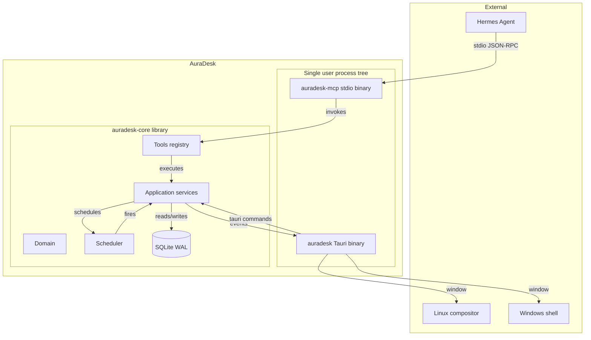
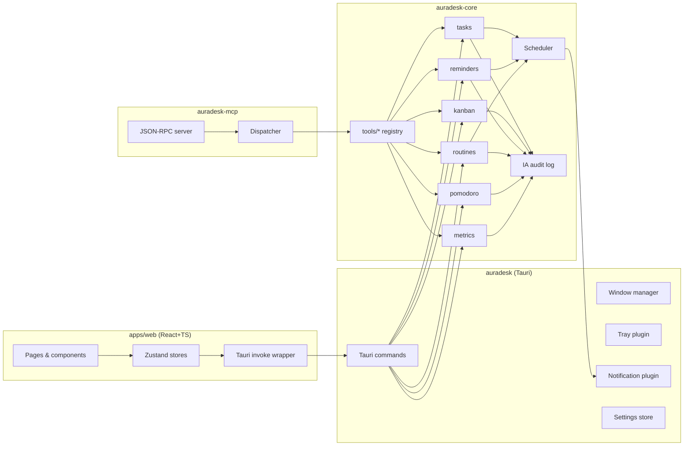
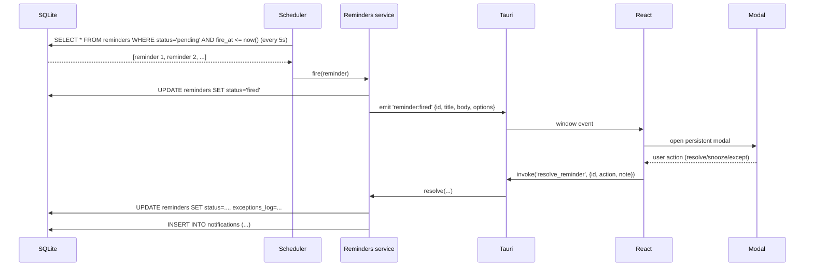
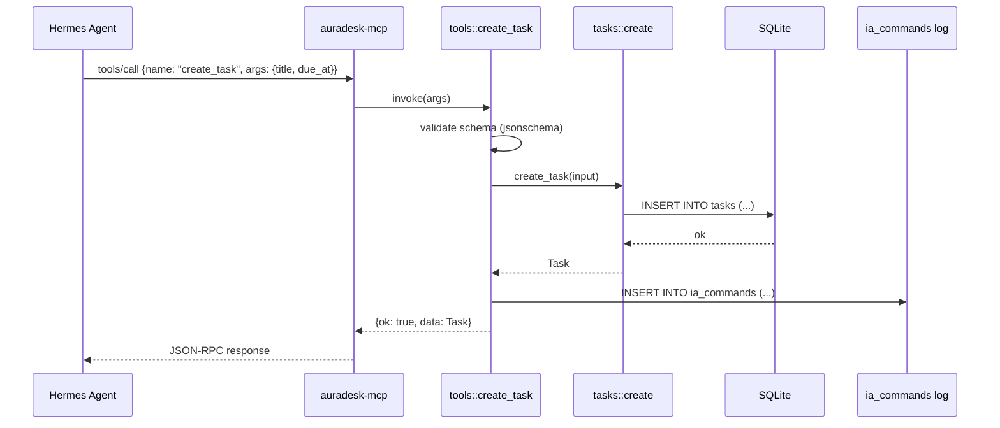
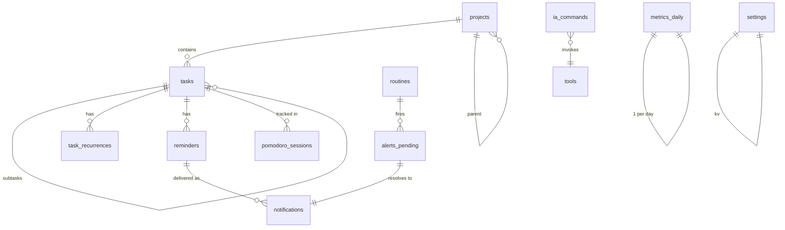

# AuraDesk — MVP Design Spec

| Field | Value |
|---|---|
| **Status** | Draft — awaiting review |
| **Date** | 2026-10-16 |
| **Author** | Aura (architect agent) |
| **Owner** | garton / RAGton |
| **Repository** | <https://github.com/RAGton/aura-desk> |
| **Implements** | `IDEA.md` (root) |

---

## 1. TL;DR

AuraDesk é um aplicativo desktop de produtividade pessoal, multiplataforma (Linux + Windows), construído em **Tauri 2 + Rust + React/TS + SQLite**, com **Nix Flakes** para dev reproduzível no NixOS. O coração é uma biblioteca Rust (`auradesk-core`) que expõe o domínio como **tools MCP** — o Hermes Agent conecta como cliente MCP e ganha linguagem natural pra operar o desk.

MVP em 6 fases incrementais (Fase 0: fundação → Fase 5: polish). Cada fase termina com critério de aceite verificável e CI verde.

---

## 2. Goals & Non-Goals

### 2.1 Goals (MVP)

1. Dashboard fixo no segundo monitor com Pomodoro, próxima tarefa, pendentes, água, pausas, últimas notificações, resumo do dia.
2. CRUD de tarefas e projetos com recorrência, prioridades, prazos, projetos de longo prazo e visão Kanban (A fazer / Em andamento / Aguardando / Concluído).
3. Lembretes com modal persistente, som, ações explícitas (Resolver / Adiar / Registrar exceção), recuperação pós-reinício e seleção de monitor secundário.
4. Rotinas: planejamento diário às 07:50 (configurável), hidratação, pausas.
5. Integração com Hermes Agent via MCP stdio: chat por texto, comandos em linguagem natural, criação assistida de tarefas e lembretes.
6. Suporte a Windows 10/11 e Linux (NixOS como alvo principal, outras distros suportadas).
7. App funciona 100% offline e sem IA. IA é camada opcional.
8. Persistência local em SQLite, banco versionado com migrations, backup exportável.
9. Interface acessível por teclado, leitor de tela, alto contraste.

### 2.2 Non-Goals (explicitamente fora do MVP)

- Sincronização em nuvem, conta de usuário, multi-device
- App mobile (Android, iOS)
- Marketplace de plugins/extensões
- Temas customizáveis (apenas dark; tema claro é v2)
- Editor RRULE custom (apenas presets: diário, semanal, mensal, cron)
- Transcrição de voz (apenas captura de áudio; transcrição YAGNI)
- Compartilhamento de tarefas, colaboração multi-usuário
- Integração com calendários externos (Google, Outlook, CalDAV)
- Painéis/widgets customizáveis no dashboard
- Code signing EV (usaremos Azure Trusted Signing; certificado EV é YAGNI até v2)
- Publicação em Microsoft Store, Flathub, Snapcraft (instalador standalone apenas)

---

## 3. Glossary

| Term | Meaning |
|---|---|
| **Core** | `auradesk-core`, biblioteca Rust que contém domínio, application services, infraestrutura e tools. Sem dependência de Tauri ou MCP. |
| **Desk** | `auradesk` (binário Tauri 2), o app desktop. Owner do DB, scheduler, windows, tray, notifications. |
| **MCP server** | `auradesk-mcp` (binário stdio), expõe o core como JSON-RPC pra Hermes. |
| **Tool** | Função nomeada com schema JSON (input/output) que o core expõe. É a unidade que o Hermes invoca via MCP. |
| **Routine** | Lembrete recorrente baseado em expressão cron (5-field). |
| **Alert** | Entrada em `alerts_pending` que dispara um modal persistente. |
| **Tray** | Ícone na bandeja do sistema. Fechar a janela principal esconde; Quit pelo menu encerra o processo. |
| **Watcher** | Subsistema tokio que poll-a o DB a cada N segundos para disparar lembretes/rotinas. |

---

## 4. Architecture

### 4.1 System Diagram



### 4.2 Component Diagram



### 4.3 Data Flow: Lembrete disparam



### 4.4 Data Flow: Hermes cria tarefa via MCP



---

## 5. Technology Stack

| Layer | Choice | Rationale |
|---|---|---|
| **Shell desktop** | Tauri 2.x (pinned minor) | Bundle pequeno, Rust backend, multi-OS, bom ecossistema de plugins. |
| **Backend** | Rust (stable) | Performance, type safety, ecossistema maduro p/ SQLite e tempo. |
| **Frontend** | React 18 + TypeScript + Vite | Padrão Tauri default; Vite é rápido; TS dá segurança de tipos. |
| **Estilo** | Tailwind CSS v4 | Atomic CSS, build rápido, design system fácil. |
| **Componentes** | shadcn/ui (Radix primitives) | Copy-paste, sem dep runtime, audit-friendly, customizável. |
| **State** | Zustand | Mínimo boilerplate, persist middleware, devtools. |
| **DB** | SQLite + rusqlite + refinery | Zero runtime dep, controle total, migrations SQL. WAL mode. |
| **Scheduler** | tokio runtime (Tauri 2 já usa) | Poll a cada 5s, dispara events, gerencia timers via `tokio::time`. |
| **Cron parsing** | `croner` crate | Leve, sem deps pesadas, timezone-aware. |
| **RRULE** | `rrule` crate | RFC 5545, abrange presets comuns. |
| **Audio** | `rodio` | Backend Rust puro, sem GStreamer. |
| **HTTP client** | `reqwest` (apenas p/ future Hermes telemetry, MVP não usa) | Reservado, YAGNI por ora. |
| **Logging** | `tracing` + `tracing-subscriber` | Structured logs, fácil de filtrar. |
| **Errors** | `thiserror` (libs) + `anyhow` (binaries) | Convenção clara. |
| **Testing** | `cargo test`, `rstest`, `insta` (snapshots), `mockall` (mocks) | TDD-friendly. |
| **TS testing** | Vitest + Testing Library | Alinhado com Vite. |
| **E2E** | Playwright + Tauri driver | Padrão Tauri 2. |
| **Lint (Rust)** | `rustfmt` + `clippy -- -D warnings` | Política strict. |
| **Lint (TS)** | ESLint + Prettier | Padrão. |
| **Dev environment** | Nix flake + direnv | Reproductibilidade no NixOS. |
| **CI** | GitHub Actions (`tauri-action`) | Build linux + windows-latest. |
| **MCP SDK** | `rmcp` (Rust MCP SDK) | JSON-RPC stdio, schema validation built-in. |
| **i18n** | `react-i18next` (frontend) + `rust-i18n` (backend) | i18n-ready desde dia 1. |

---

## 6. Repository Layout

```
AuraDesk/
├── Cargo.toml                          # workspace: crates/*, apps/*-rs
├── pnpm-workspace.yaml                 # apps: apps/*-ts
├── package.json
├── tsconfig.base.json
├── flake.nix
├── flake.lock
├── .envrc
├── .gitignore
├── README.md
├── LICENSE
├── IDEA.md                             # já existe
│
├── docs/
│   ├── superpowers/
│   │   ├── specs/                      # este arquivo mora aqui
│   │   └── plans/                      # plan por fase
│   ├── decisions/                      # ADRs (Markdown + Nygard format)
│   ├── architecture/                   # diagramas extras, threat model
│   └── contributing.md
│
├── crates/
│   ├── auradesk-core/                  # domínio + aplicação + infra
│   │   ├── Cargo.toml
│   │   ├── src/
│   │   │   ├── lib.rs
│   │   │   ├── error.rs                # CoreError enum
│   │   │   ├── domain/                 # entidades puras, sem IO
│   │   │   │   ├── mod.rs
│   │   │   │   ├── id.rs               # ULID wrapper
│   │   │   │   ├── task.rs             # Task, Priority, Status
│   │   │   │   ├── project.rs
│   │   │   │   ├── reminder.rs
│   │   │   │   ├── routine.rs
│   │   │   │   ├── pomodoro.rs
│   │   │   │   ├── alert.rs
│   │   │   │   └── notification.rs
│   │   │   ├── application/            # use cases
│   │   │   │   ├── mod.rs
│   │   │   │   ├── tasks.rs
│   │   │   │   ├── projects.rs
│   │   │   │   ├── kanban.rs
│   │   │   │   ├── reminders.rs
│   │   │   │   ├── routines.rs
│   │   │   │   ├── pomodoro.rs
│   │   │   │   ├── alerts.rs
│   │   │   │   ├── metrics.rs
│   │   │   │   └── settings.rs
│   │   │   ├── infrastructure/
│   │   │   │   ├── mod.rs
│   │   │   │   ├── db/
│   │   │   │   │   ├── mod.rs          # Db struct + connection pool
│   │   │   │   │   ├── migrations.rs   # refinery runner
│   │   │   │   │   ├── repositories/   # 1 repo por aggregate
│   │   │   │   │   │   ├── tasks.rs
│   │   │   │   │   │   ├── projects.rs
│   │   │   │   │   │   ├── reminders.rs
│   │   │   │   │   │   ├── routines.rs
│   │   │   │   │   │   ├── pomodoro.rs
│   │   │   │   │   │   ├── alerts.rs
│   │   │   │   │   │   ├── notifications.rs
│   │   │   │   │   │   ├── metrics.rs
│   │   │   │   │   │   ├── ia_commands.rs
│   │   │   │   │   │   └── settings.rs
│   │   │   │   │   └── ulid.rs
│   │   │   │   ├── scheduler/
│   │   │   │   │   ├── mod.rs          # tokio task
│   │   │   │   │   ├── watcher.rs      # poll loop
│   │   │   │   │   └── cron.rs         # croner integration
│   │   │   │   ├── audio/
│   │   │   │   │   ├── mod.rs
│   │   │   │   │   └── assets.rs
│   │   │   │   └── clock/
│   │   │   │       ├── mod.rs          # trait Clock
│   │   │   │       └── system.rs       # SystemClock impl
│   │   │   ├── tools/                  # MCP tool definitions
│   │   │   │   ├── mod.rs              # registry + dispatch
│   │   │   │   ├── schema.rs           # JSON schema helpers
│   │   │   │   ├── audit.rs            # IA audit log helper
│   │   │   │   ├── tasks.rs            # create_task, list_tasks, ...
│   │   │   │   ├── projects.rs
│   │   │   │   ├── reminders.rs
│   │   │   │   ├── pomodoro.rs
│   │   │   │   └── ...
│   │   │   └── i18n.rs                 # rust-i18n init
│   │   ├── tests/
│   │   └── migrations/                 # SQL files embedded
│   │
│   ├── auradesk/                       # Tauri 2 binary
│   │   ├── Cargo.toml
│   │   ├── tauri.conf.json
│   │   ├── build.rs
│   │   ├── icons/                      # multi-resolution PNG/ICO
│   │   ├── capabilities/
│   │   │   └── default.json            # permissions ACL
│   │   └── src/
│   │       ├── main.rs                 # subcommand dispatch
│   │       ├── ipc/                    # tauri command handlers
│   │       │   ├── mod.rs
│   │       │   ├── tasks.rs
│   │       │   ├── projects.rs
│   │       │   ├── kanban.rs
│   │       │   ├── reminders.rs
│   │       │   ├── routines.rs
│   │       │   ├── pomodoro.rs
│   │       │   ├── alerts.rs
│   │       │   ├── metrics.rs
│   │       │   └── settings.rs
│   │       ├── windows/                # window manager
│   │       │   ├── mod.rs
│   │       │   ├── main.rs
│   │       │   ├── dashboard.rs
│   │       │   └── monitor.rs          # monitor detection
│   │       ├── tray/
│   │       │   ├── mod.rs
│   │       │   └── menu.rs
│   │       ├── notifications/
│   │       │   └── mod.rs
│   │       ├── settings/
│   │       │   └── mod.rs              # tauri-plugin-store wrapper
│   │       └── runtime.rs              # tokio runtime + tracing init
│   │
│   └── auradesk-mcp/                   # MCP stdio binary
│       ├── Cargo.toml
│       └── src/
│           ├── main.rs                 # subcommand 'mcp'
│           ├── server.rs               # rmcp server impl
│           └── errors.rs               # JSON-RPC error mapping
│
├── apps/
│   └── web/                            # frontend
│       ├── package.json
│       ├── vite.config.ts
│       ├── tailwind.config.ts
│       ├── postcss.config.js
│       ├── components.json             # shadcn config
│       ├── tsconfig.json
│       ├── index.html
│       ├── public/
│       │   ├── icons/
│       │   └── sounds/                 # 2-3 alert WAVs
│       │       ├── alert-info.wav
│       │       ├── alert-normal.wav
│       │       └── alert-urgent.wav
│       ├── locales/
│       │   ├── pt-BR.json
│       │   └── en.json
│       └── src/
│           ├── main.tsx
│           ├── app/
│           │   ├── router.tsx
│           │   ├── layout/
│           │   │   ├── AppShell.tsx
│           │   │   ├── Sidebar.tsx
│           │   │   └── TopBar.tsx
│           │   └── providers.tsx
│           ├── features/
│           │   ├── dashboard/
│           │   │   ├── DashboardPage.tsx
│           │   │   ├── components/
│           │   │   │   ├── PomodoroWidget.tsx
│           │   │   │   ├── NextTaskWidget.tsx
│           │   │   │   ├── HydrationWidget.tsx
│           │   │   │   ├── BreakWidget.tsx
│           │   │   │   ├── RecentNotifications.tsx
│           │   │   │   └── DailySummary.tsx
│           │   │   ├── hooks/
│           │   │   └── api.ts
│           │   ├── tasks/
│           │   ├── kanban/
│           │   ├── reminders/
│           │   ├── routines/
│           │   ├── pomodoro/
│           │   ├── hermes-chat/
│           │   └── settings/
│           ├── components/
│           │   └── ui/                 # shadcn copy-paste
│           ├── lib/
│           │   ├── ipc.ts              # typed tauri invoke
│           │   ├── store.ts            # zustand setup
│           │   ├── i18n.ts             # i18next init
│           │   ├── cn.ts               # className utility
│           │   └── utils.ts
│           └── styles/
│               └── globals.css         # Tailwind entry
│
├── migrations/                         # refinery SQL (single source)
│   ├── V001__init.sql
│   ├── V002__reminder_exceptions.sql
│   └── ...
│
├── tests/
│   └── e2e/                            # Playwright + tauri-driver
│       ├── fixtures/
│       └── specs/
│
├── scripts/
│   ├── dev.sh                          # direnv-friendly
│   ├── build.sh
│   ├── check.sh                        # fmt + clippy + test + lint
│   └── release.sh
│
└── .github/
    └── workflows/
        ├── ci.yml
        └── release.yml
```

### 6.1 Boundary rules

- `auradesk-core` **must not** import `tauri`, `tauri-plugin-*`, `rmcp`, or anything OS-specific. Testable em qualquer host.
- `auradesk` and `auradesk-mcp` **only** import `auradesk-core`'s public API. No shortcuts.
- Frontend **only** communicates with backend through typed Tauri commands. No raw `invoke` calls scattered.
- Migrations are SQL files in `migrations/`; `auradesk-core::infrastructure::db` embeds them at compile time via `include_str!`.

---

## 7. Data Model

SQLite in WAL mode. Single writer serialized via `tokio::sync::Mutex<Connection>`. Readers concurrent. IDs are ULIDs (sortable, URL-safe).

### 7.1 ER Overview



### 7.2 Schema (V001__init.sql)

> All timestamps: ISO 8601 with timezone offset (RFC 3339). All `CHECK` enums are defense-in-depth.

```sql
-- ── Projects ──────────────────────────────────────────────────
CREATE TABLE projects (
  id          TEXT PRIMARY KEY,
  name        TEXT NOT NULL CHECK (length(trim(name)) > 0),
  description TEXT,
  color       TEXT CHECK (color IS NULL OR color GLOB '#[0-9A-Fa-f][0-9A-Fa-f][0-9A-Fa-f][0-9A-Fa-f][0-9A-Fa-f][0-9A-Fa-f]'),
  parent_id   TEXT REFERENCES projects(id) ON DELETE CASCADE,
  status      TEXT NOT NULL DEFAULT 'active'
              CHECK (status IN ('active','paused','completed','archived')),
  start_date  TEXT,
  target_date TEXT,
  created_at  TEXT NOT NULL DEFAULT (datetime('now')),
  updated_at  TEXT NOT NULL DEFAULT (datetime('now'))
);
CREATE INDEX idx_projects_status ON projects(status);
CREATE INDEX idx_projects_parent ON projects(parent_id);

-- ── Tasks ─────────────────────────────────────────────────────
CREATE TABLE tasks (
  id             TEXT PRIMARY KEY,
  project_id     TEXT REFERENCES projects(id) ON DELETE SET NULL,
  parent_task_id TEXT REFERENCES tasks(id) ON DELETE CASCADE,
  title          TEXT NOT NULL CHECK (length(trim(title)) > 0),
  description    TEXT,
  priority       TEXT NOT NULL DEFAULT 'normal'
                 CHECK (priority IN ('low','normal','high','urgent')),
  status         TEXT NOT NULL DEFAULT 'todo'
                 CHECK (status IN ('todo','doing','waiting','done','cancelled')),
  kanban_order   INTEGER NOT NULL DEFAULT 0,
  due_at         TEXT,
  started_at     TEXT,
  completed_at   TEXT,
  estimate_min   INTEGER CHECK (estimate_min IS NULL OR estimate_min > 0),
  actual_min     INTEGER CHECK (actual_min IS NULL OR actual_min >= 0),
  created_at     TEXT NOT NULL DEFAULT (datetime('now')),
  updated_at     TEXT NOT NULL DEFAULT (datetime('now'))
);
CREATE INDEX idx_tasks_status        ON tasks(status);
CREATE INDEX idx_tasks_due_open      ON tasks(due_at)
  WHERE status NOT IN ('done','cancelled');
CREATE INDEX idx_tasks_project       ON tasks(project_id);
CREATE INDEX idx_tasks_parent        ON tasks(parent_task_id);
CREATE INDEX idx_tasks_created       ON tasks(created_at DESC);

-- ── Task Recurrence (RRULE) ───────────────────────────────────
CREATE TABLE task_recurrences (
  id         TEXT PRIMARY KEY,
  task_id    TEXT NOT NULL REFERENCES tasks(id) ON DELETE CASCADE,
  rrule      TEXT NOT NULL,
  dtstart    TEXT NOT NULL,
  dtend      TEXT,
  exdates    TEXT,                              -- JSON array of ISO timestamps
  created_at TEXT NOT NULL DEFAULT (datetime('now'))
);
CREATE INDEX idx_recurrences_task ON task_recurrences(task_id);

-- ── Reminders ─────────────────────────────────────────────────
CREATE TABLE reminders (
  id             TEXT PRIMARY KEY,
  task_id        TEXT REFERENCES tasks(id) ON DELETE CASCADE,
  title          TEXT NOT NULL CHECK (length(trim(title)) > 0),
  body           TEXT,
  fire_at        TEXT NOT NULL,
  repeat_kind    TEXT
                 CHECK (repeat_kind IS NULL OR repeat_kind IN ('none','daily','weekly','monthly','cron')),
  repeat_value   TEXT,
  status         TEXT NOT NULL DEFAULT 'pending'
                 CHECK (status IN ('pending','fired','resolved','dismissed','snoozed','excepted')),
  resolved_at    TEXT,
  exceptions_log TEXT,                          -- JSON array
  created_at     TEXT NOT NULL DEFAULT (datetime('now')),
  updated_at     TEXT NOT NULL DEFAULT (datetime('now'))
);
CREATE INDEX idx_reminders_pending ON reminders(fire_at)
  WHERE status = 'pending';
CREATE INDEX idx_reminders_task    ON reminders(task_id);

-- ── Routines (cron-scheduled recurring reminders) ────────────
CREATE TABLE routines (
  id         TEXT PRIMARY KEY,
  kind       TEXT NOT NULL
             CHECK (kind IN ('water','break','daily_planning','custom')),
  title      TEXT NOT NULL CHECK (length(trim(title)) > 0),
  body       TEXT,
  cron_expr  TEXT NOT NULL,                     -- 5-field, local TZ
  start_date TEXT,
  end_date   TEXT,
  enabled    INTEGER NOT NULL DEFAULT 1 CHECK (enabled IN (0,1)),
  metadata   TEXT,                              -- JSON
  created_at TEXT NOT NULL DEFAULT (datetime('now')),
  updated_at TEXT NOT NULL DEFAULT (datetime('now'))
);
CREATE INDEX idx_routines_enabled ON routines(enabled) WHERE enabled = 1;

-- ── Pomodoro sessions ─────────────────────────────────────────
CREATE TABLE pomodoro_sessions (
  id            TEXT PRIMARY KEY,
  task_id       TEXT REFERENCES tasks(id) ON DELETE SET NULL,
  kind          TEXT NOT NULL
                CHECK (kind IN ('focus','short_break','long_break')),
  planned_min   INTEGER NOT NULL CHECK (planned_min > 0),
  actual_min    INTEGER CHECK (actual_min IS NULL OR actual_min > 0),
  started_at    TEXT NOT NULL,
  ended_at      TEXT,
  status        TEXT NOT NULL DEFAULT 'running'
                CHECK (status IN ('running','completed','interrupted')),
  interruptions INTEGER NOT NULL DEFAULT 0 CHECK (interruptions >= 0)
);
CREATE INDEX idx_pomo_task    ON pomodoro_sessions(task_id);
CREATE INDEX idx_pomo_started ON pomodoro_sessions(started_at DESC);

-- ── Alerts (persistent modal queue) ───────────────────────────
CREATE TABLE alerts_pending (
  id              TEXT PRIMARY KEY,
  kind            TEXT NOT NULL,
  ref_id          TEXT,
  title           TEXT NOT NULL,
  body            TEXT,
  severity        TEXT NOT NULL DEFAULT 'normal'
                  CHECK (severity IN ('info','normal','urgent')),
  show_on_monitor TEXT,                         -- 'primary' | 'secondary' | monitor_id
  options         TEXT,                         -- JSON
  created_at      TEXT NOT NULL DEFAULT (datetime('now')),
  shown_at        TEXT,
  resolved_at     TEXT,
  resolution      TEXT CHECK (resolution IS NULL OR resolution IN ('resolved','snoozed','excepted','dismissed'))
);
CREATE INDEX idx_alerts_open    ON alerts_pending(created_at) WHERE resolved_at IS NULL;
CREATE INDEX idx_alerts_severity ON alerts_pending(severity) WHERE resolved_at IS NULL;

-- ── Notifications log ─────────────────────────────────────────
CREATE TABLE notifications (
  id           TEXT PRIMARY KEY,
  kind         TEXT NOT NULL,
  ref_id       TEXT,
  title        TEXT NOT NULL,
  body         TEXT,
  delivered_at TEXT NOT NULL,
  read_at      TEXT
);
CREATE INDEX idx_notif_at   ON notifications(delivered_at DESC);
CREATE INDEX idx_notif_kind ON notifications(kind);

-- ── Daily metrics (aggregated) ────────────────────────────────
CREATE TABLE metrics_daily (
  date            TEXT PRIMARY KEY,             -- YYYY-MM-DD (local TZ)
  focus_minutes   INTEGER NOT NULL DEFAULT 0 CHECK (focus_minutes >= 0),
  break_minutes   INTEGER NOT NULL DEFAULT 0 CHECK (break_minutes >= 0),
  water_count     INTEGER NOT NULL DEFAULT 0 CHECK (water_count >= 0),
  tasks_done      INTEGER NOT NULL DEFAULT 0 CHECK (tasks_done >= 0),
  tasks_created   INTEGER NOT NULL DEFAULT 0 CHECK (tasks_created >= 0),
  active_minutes  INTEGER NOT NULL DEFAULT 0 CHECK (active_minutes >= 0),
  notes           TEXT
);

-- ── IA command audit log ──────────────────────────────────────
CREATE TABLE ia_commands (
  id             TEXT PRIMARY KEY,
  source         TEXT NOT NULL
                 CHECK (source IN ('mcp','ui','voice')),
  tool_name      TEXT NOT NULL,
  args_json      TEXT NOT NULL,
  result_status  TEXT NOT NULL
                 CHECK (result_status IN ('ok','rejected','error')),
  result_message TEXT,
  invoked_at     TEXT NOT NULL DEFAULT (datetime('now'))
);
CREATE INDEX idx_ia_at        ON ia_commands(invoked_at DESC);
CREATE INDEX idx_ia_tool      ON ia_commands(tool_name);
CREATE INDEX idx_ia_status    ON ia_commands(result_status);

-- ── Settings (kv) ─────────────────────────────────────────────
CREATE TABLE settings (
  key        TEXT PRIMARY KEY,
  value      TEXT NOT NULL,                     -- JSON
  updated_at TEXT NOT NULL DEFAULT (datetime('now'))
);

-- ── Refinery schema tracking (auto-created by refinery) ──────
-- Created on first run; do not pre-create.
```

### 7.3 Defaults seeded on first run

```sql
INSERT INTO settings (key, value) VALUES
  ('app.version',           '"0.1.0"'),
  ('app.theme',             '"dark"'),
  ('app.locale',            '"pt-BR"'),
  ('dashboard.refresh_sec', '30'),
  ('monitor.preferred',     '"primary"'),
  ('reminders.sound',       'true'),
  ('pomodoro.focus_min',    '25'),
  ('pomodoro.short_min',    '5'),
  ('pomodoro.long_min',     '15'),
  ('pomodoro.cycles_to_long','4'),
  ('routine.daily_planning_time','"07:50"'),
  ('routine.water_interval_min','60'),
  ('routine.break_interval_min','90');

INSERT INTO routines (id, kind, title, body, cron_expr, enabled) VALUES
  (lower(hex(randomblob(16))), 'daily_planning', 'Planejamento diário',
   'Organize as tarefas do dia.', '50 7 * * *', 1);
```

---

## 8. API Contracts

### 8.1 Tauri Commands (frontend ↔ backend)

All commands return `Result<T, CoreError>`. CoreError is serialized to a discriminated JSON `{kind, message, details?}`.

```rust
// crates/auradesk/src/ipc/tasks.rs
#[tauri::command]
pub async fn create_task(input: CreateTaskInput) -> Result<Task, CoreError>;

#[tauri::command]
pub async fn list_tasks(filter: TaskFilter) -> Result<Vec<Task>, CoreError>;

#[tauri::command]
pub async fn update_task(id: String, patch: TaskPatch) -> Result<Task, CoreError>;

#[tauri::command]
pub async fn complete_task(id: String) -> Result<Task, CoreError>;

#[tauri::command]
pub async fn delete_task(id: String) -> Result<(), CoreError>;

#[tauri::command]
pub async fn move_task_kanban(id: String, column: KanbanColumn, order: i64) -> Result<(), CoreError>;
```

### 8.2 MCP Tools (Hermes ↔ backend)

Tools are exposed via `rmcp` server. Each tool declares an `input_schema` and `output_schema` (JSON Schema 2020-12). The dispatcher validates input against the schema before invoking the Rust handler; on failure returns JSON-RPC `-32602 Invalid params`. Unknown tool returns `-32601 Method not found`.

**Tool catalog v1 (MVP, with input/output schemas):**

#### `create_task`

```json
{
  "name": "create_task",
  "description": "Create a new task. Title is required. Returns the created task with its ULID id.",
  "input_schema": {
    "type": "object",
    "properties": {
      "title": {"type": "string", "minLength": 1, "maxLength": 500},
      "description": {"type": "string", "maxLength": 5000},
      "project_id": {"type": "string"},
      "parent_task_id": {"type": "string"},
      "priority": {"enum": ["low", "normal", "high", "urgent"]},
      "due_at": {"type": "string", "format": "date-time"},
      "estimate_min": {"type": "integer", "minimum": 1, "maximum": 10000},
      "tags": {"type": "array", "items": {"type": "string"}, "maxItems": 20}
    },
    "required": ["title"],
    "additionalProperties": false
  },
  "output_schema": {
    "type": "object",
    "properties": {
      "id": {"type": "string"},
      "title": {"type": "string"},
      "status": {"enum": ["todo", "doing", "waiting", "done", "cancelled"]},
      "priority": {"enum": ["low", "normal", "high", "urgent"]},
      "due_at": {"type": ["string", "null"]},
      "created_at": {"type": "string"}
    },
    "required": ["id", "title", "status", "created_at"]
  }
}
```

#### `list_tasks`

```json
{
  "name": "list_tasks",
  "description": "List tasks, optionally filtered. Pending = status not in {done, cancelled}. Overdue = due_at < now AND pending.",
  "input_schema": {
    "type": "object",
    "properties": {
      "status": {"type": "array", "items": {"enum": ["todo", "doing", "waiting", "done", "cancelled"]}},
      "project_id": {"type": "string"},
      "overdue_only": {"type": "boolean"},
      "due_before": {"type": "string", "format": "date-time"},
      "limit": {"type": "integer", "minimum": 1, "maximum": 500, "default": 100},
      "offset": {"type": "integer", "minimum": 0, "default": 0}
    },
    "additionalProperties": false
  }
}
```

#### `update_task`, `complete_task`, `delete_task`

Standard CRUD. Schemas follow same pattern. `complete_task` sets `status='done'`, `completed_at=now`.

#### `add_reminder`

```json
{
  "input_schema": {
    "type": "object",
    "properties": {
      "title": {"type": "string", "minLength": 1},
      "body": {"type": "string"},
      "fire_at": {"type": "string", "format": "date-time"},
      "task_id": {"type": "string"},
      "repeat": {
        "type": "object",
        "properties": {
          "kind": {"enum": ["none", "daily", "weekly", "monthly", "cron"]},
          "value": {"type": "string"}
        },
        "required": ["kind"]
      }
    },
    "required": ["title", "fire_at"]
  }
}
```

#### `list_reminders`, `snooze_reminder`, `resolve_reminder`, `except_reminder`

Standard CRUD + actions. `except_reminder` requires a non-empty `note` (validated schema).

#### `start_pomodoro`, `stop_pomodoro`, `pomodoro_status`

```json
{"name": "start_pomodoro", "input_schema": {"type": "object", "properties": {
  "kind": {"enum": ["focus", "short_break", "long_break"]},
  "task_id": {"type": "string"},
  "duration_min": {"type": "integer", "minimum": 1, "maximum": 180}
}}}
```

#### `add_routine`, `list_routines`, `toggle_routine`, `delete_routine`

CRUD over `routines` table.

#### `dashboard_summary`

```json
{"name": "dashboard_summary", "description": "Aggregated state for the dashboard.",
 "input_schema": {"type": "object", "properties": {}, "additionalProperties": false},
 "output_schema": {"type": "object", "properties": {
   "next_task": {"type": ["object", "null"]},
   "overdue_count": {"type": "integer"},
   "pending_today_count": {"type": "integer"},
   "pomodoro_active": {"type": ["object", "null"]},
   "recent_notifications": {"type": "array", "items": {"type": "object"}},
   "metrics_today": {"type": "object"}
 }}}
```

### 8.3 Internal Rust API (`auradesk-core`)

```rust
pub struct Core {
    db: Db,
    scheduler: SchedulerHandle,
    clock: Arc<dyn Clock>,
}

impl Core {
    pub async fn new(config: CoreConfig) -> Result<Self, CoreError>;
    pub fn tasks(&self) -> &TasksService;
    pub fn projects(&self) -> &ProjectsService;
    pub fn kanban(&self) -> &KanbanService;
    pub fn reminders(&self) -> &RemindersService;
    pub fn routines(&self) -> &RoutinesService;
    pub fn pomodoro(&self) -> &PomodoroService;
    pub fn alerts(&self) -> &AlertsService;
    pub fn metrics(&self) -> &MetricsService;
    pub fn settings(&self) -> &SettingsService;
    pub fn shutdown(self) -> Result<(), CoreError>;
}
```

Services take `&self` and a `&Connection` (or use internal pool). All return `Result<T, CoreError>`.

### 8.4 Frontend IPC Wrapper

```ts
// apps/web/src/lib/ipc.ts
import { invoke } from '@tauri-apps/api/core';
import type { Task, CreateTaskInput, ... } from './types';

export const ipc = {
  createTask: (input: CreateTaskInput) => invoke<Task>('create_task', { input }),
  listTasks: (filter: TaskFilter) => invoke<Task[]>('list_tasks', { filter }),
  // ...
} as const;
```

Components **never** call `invoke` directly. They go through `ipc.*`. Types are hand-maintained (we will codegen later if it becomes painful; YAGNI for MVP).

---

## 9. Platform-Specific Design

### 9.1 Linux / NixOS

#### Dev shell (`flake.nix`)

```nix
{
  description = "AuraDesk dev shell";

  inputs = {
    nixpkgs.url = "github:NixOS/nixpkgs/nixos-unstable";
    rust-overlay.url = "github:oxalica/rust-overlay";
    flake-utils.url = "github:numtide/flake-utils";
  };

  outputs = { self, nixpkgs, rust-overlay, flake-utils }:
    flake-utils.lib.eachDefaultSystem (system:
      let
        overlays = [ (import rust-overlay) ];
        pkgs = import nixpkgs { inherit system overlays; };
        rust = pkgs.rust-bin.stable."1.82.0".default.override {
          extensions = [ "rust-src" "rust-analyzer" "clippy" "rustfmt" ];
        };
      in {
        devShells.default = pkgs.mkShell {
          buildInputs = with pkgs; [
            rust
            nodejs_22
            pnpm
            pkg-config
            openssl
            sqlite
            webkit2gtk_4_1
            libsoup_3
            gtk3
            libayatana-appindicator
            librsvg
            xdg-utils
            binaryen
          ];
          shellHook = ''
            export PKG_CONFIG_PATH="${pkgs.openssl.dev}/lib/pkgconfig"
            export RUST_SRC_PATH="${rust}/lib/rustlib/src/rust/src"
            export WEBKIT_DISABLE_COMPOSITING_MODE=1
            echo "AuraDesk dev shell — Rust ${rust.version}, Node ${pkgs.nodejs_22.version}"
          '';
        };
      });
}
```

#### NixOS module (optional, for system service)

```nix
# modules/auradesk.nix (in repo, not consumed by dev shell)
{ config, pkgs, lib, ... }:
with lib;
{
  options.services.auradesk = {
    enable = mkEnableOption "AuraDesk productivity app";
    package = mkOption { type = pkgs.stdenv.hostPlatform.packageType; };
  };
  config = mkIf config.services.auradesk.enable {
    environment.systemPackages = [ config.services.auradesk.package ];
    # User-level autostart handled by the app, not here.
  };
}
```

#### Autostart (Linux)

Write `~/.config/autostart/auradesk.desktop` on first run when user enables setting:

```ini
[Desktop Entry]
Type=Application
Name=AuraDesk
Exec=auradesk --tray
Icon=auradesk
Terminal=false
Categories=Office;Utility;
StartupNotify=false
X-GNOME-Autostart-enabled=true
```

#### Notes for end users (NixOS-specific)

- `xdg-desktop-portal-hyprland` (Wayland) or `xdg-desktop-portal-gtk` (X11) must be installed.
- `pkgs.webkit2gtk_4_1` must match what the user has system-wide, or the bundled version is used.
- `services.dbus` and `services.xdg-desktop-portal` are commonly required.

### 9.2 Windows

- **WebView2 runtime**: Tauri bootstrapper downloads if missing. Document minimum Windows 10 1903.
- **AppUserModelID**: `com.ragton.auradesk` set in `tauri.conf.json` and in NSIS installer.
- **Code signing**: Azure Trusted Signing configured in CI release workflow.
- **Autostart**: `tauri-plugin-autostart` uses `HKEY_CURRENT_USER\Software\Microsoft\Windows\CurrentVersion\Run`.
- **Manifest**: `Win10LongPathAware`, `PerMonitorV2`, `asInvoker` execution level.
- **Installer**: NSIS only for MVP (Tauri default). MSI deferred to v2.
- **Tray**: `tauri-plugin-system-tray` handles Win32 MessageWindow.

### 9.3 Cross-platform shared

- **Paths**: use `dirs` crate for XDG-compliant paths. Linux: `~/.local/share/auradesk/`. Windows: `%APPDATA%/auradesk/`.
- **Single instance**: `tauri-plugin-single-instance` (lock file in DB dir).
- **Logging**: `tracing` writes to `auradesk.log` in data dir + stderr (for dev).
- **Crash reporting**: YAGNI. Use `tracing` + Sentry only if user requests in v2.
- **Updates**: YAGNI. Manual download for MVP.

---

## 10. Phased Delivery

Each phase ends with CI green and a verifiable acceptance gate. The next phase does not start until the previous is fully green.

### Phase 0 — Foundation (3-5 days)

**Scope:** repo skeleton, Nix dev shell, Tauri opens window, MCP responds, DB initialized, CI runs on linux + windows.

**Deliverables:**
- Cargo workspace + pnpm workspace
- Tauri 2 scaffold with Vite + React + TS + Tailwind v4 + shadcn initialized
- `auradesk-core::Db` with refinery
- `migrations/V001__init.sql` applied on first run
- `auradesk` (Tauri) tray + "Hello AuraDesk" window
- `auradesk-mcp` (stdio) answers `initialize` + `tools/list` with `[]`
- CI: fmt + clippy + test + lint + tauri build on ubuntu + windows-latest
- Nix flake with toolchain pinned
- README + CONTRIBUTING

**Gate:**
- `nix develop` exits 0
- `cargo test` exits 0
- `pnpm tauri dev` opens window
- `auradesk-mcp <<< '{"jsonrpc":"2.0","id":1,"method":"tools/list"}'` returns `{"result":{"tools":[]}}`
- First-launch DB has 12 settings rows + 1 daily_planning routine

### Phase 1 — Tasks & Kanban (1-2 weeks)

**Scope:** full CRUD de projetos e tarefas, recorrência, kanban drag-drop, MCP tools.

**Deliverables:**
- `domain::task`, `domain::project`, `domain::id`
- Repositories: `tasks`, `projects`, `recurrences`
- Services: `TasksService`, `ProjectsService`, `KanbanService`
- Tauri commands: all task/project/kanban ops
- MCP tools: `create_task`, `list_tasks`, `update_task`, `complete_task`, `delete_task`, `move_task_kanban`, `list_projects`, `create_project`
- Frontend pages: Tasks, Project, Kanban
- RRULE engine (using `rrule` crate)
- Pending-task roll-over query helper

**Gate:**
- Create task with title, project, priority, due date via UI → appears in list
- Recurring task fires next occurrence automatically (test: create daily, advance clock 24h, second occurrence exists)
- `due_at < today AND status NOT IN (done, cancelled)` appears in "Pendentes" filter
- Drag-drop in kanban updates DB
- `hermes chat -q "cria tarefa revisar PR amanhã 14h"` results in task in DB and UI
- 80%+ test coverage on `application::tasks`, `application::kanban`, `tools::tasks`

### Phase 2 — Time: Pomodoro, Reminders, Routines (2-3 weeks)

**Scope:** scheduler, lembretes persistentes, som, snooze/resolve/exception, recuperação pós-reinício, pomodoro state machine, rotinas.

**Deliverables:**
- `infrastructure::scheduler` (tokio task, 5s poll)
- `infrastructure::audio` (rodio + bundled WAVs)
- Services: `RemindersService`, `RoutinesService`, `PomodoroService`, `AlertsService`
- `AlertsService` writes to `alerts_pending` + emits Tauri event
- Tauri window for persistent alert modal (non-dismissable without action)
- MCP tools: reminder + pomodoro + routine
- Frontend: Dashboard (Pomodoro widget, Next Task, Hydration, Break, Recent Notifications, Daily Summary), Reminder Modal, Routines Settings

**Gate:**
- Lembrete dispara em ±5s de `fire_at`
- Modal **não** fecha por timeout, ESC, ou clique fora — só ação explícita
- "Adiar 10min" move `fire_at` para futuro e re-arma scheduler
- "Resolver" marca `status='resolved'` e loga em `notifications`
- "Registrar exceção" exige nota não-vazia (validation error se vazia)
- `kill -9` + restart mostra os mesmos alertas pendentes
- Som toca; toggle mute desativa
- Pomodoro start/pause/stop funciona; sessão grava no DB; métrica diária atualiza
- Planejamento diário dispara às 07:50 (teste com `clock` mock)

### Phase 3 — Desktop Integration (1 week)

**Scope:** multi-monitor, tray, autostart, window state.

**Deliverables:**
- Window manager: main window, dashboard window (separate, can be on secondary monitor)
- Monitor detection via `tauri::WebviewWindow::available_monitors()`
- `tauri-plugin-window-state` (position, size, monitor)
- `tauri-plugin-system-tray` with menu (Open, Pause all, Quit)
- `tauri-plugin-autostart` enabled per platform
- `~/.config/autostart/auradesk.desktop` (Linux) writer
- Settings: monitor preferred, autostart on/off, hide-on-close

**Gate:**
- Ícone na bandeja com menu funcional
- Fechar janela principal: processo continua, ícone persiste
- Quit pelo menu encerra processo com cleanup
- Dashboard window abre no monitor selecionado
- Configuração de monitor preferencial persiste entre reinícios
- Autostart toggle funciona em Linux (`.desktop`) e Windows (`Run` key)

### Phase 4 — Hermes Integration (1-2 weeks)

**Scope:** chat in-app, MCP server hardened, voice capture stub.

**Deliverables:**
- `apps/web/src/features/hermes-chat/` (panel with message list + input)
- Hermes subprocess spawn from app (Tauri sidecar) — optional mode
- Stream responses via Tauri events
- Voice capture via `MediaRecorder` (web), upload to `auradesk-mcp` as binary blob (YAGNI transcription)
- `auradesk-mcp` validation: jsonschema on input, error mapping (JSON-RPC codes), audit log writes
- Per-tool input validation tests

**Gate:**
- Chat panel within app streams a response from Hermes
- Tool call from Hermes invokes desk command; user sees it in audit log
- Args inválidos rejeitados com `-32602`
- Tool desconhecido rejeitado com `-32601`
- Audio capture funciona (saved to WAV localmente; transcrição YAGNI)

### Phase 5 — Polish (1 week)

**Scope:** metrics, accessibility, i18n, export, code signing.

**Deliverables:**
- Metrics dashboard: focus time, breaks, water, daily chart
- Export `.zip` with `auradesk.db` + `settings.json` + `audit-log.json`
- i18n: all strings in `locales/pt-BR.json` + `locales/en.json`; switchable in settings
- Accessibility: keyboard nav 100%, ARIA labels, focus ring audit, contrast 4.5:1
- Visual review pass (`aura-impeccable` skill)
- Code signing: Azure Trusted Signing for Windows in release workflow

**Gate:**
- Métricas renderizam; gráfico de foco por dia funcional
- Export gera `.zip` válido (verificável via `unzip -t`)
- Toda string de UI em arquivo de tradução (zero hard-coded pt-BR em componentes)
- Navegação por teclado alcança 100% dos elementos
- Focus ring visível em todos os controles
- `tauri build` em Windows produz binário signed; SmartScreen passa

---

## 11. Acceptance Criteria (full MVP)

Each line below has either an automated test or a documented command that proves it.

### 11.1 Foundation
- [ ] `nix develop` (or `direnv allow`) brings toolchain sem warnings
- [ ] `cargo build --release` em Linux e Windows produz binário
- [ ] `pnpm tauri dev` abre janela; fecha e reabre preserva estado
- [ ] `cargo run -p auradesk -- mcp` responde corretamente a `initialize` e `tools/list`
- [ ] DB criado em `XDG_DATA_HOME/auradesk/auradesk.db` (Linux) / `%APPDATA%/auradesk/auradesk.db` (Windows) com todas as migrations
- [ ] `cargo test` + `pnpm test` + CI verde em ambos OS

### 11.2 Tasks & Kanban
- [ ] Criar, listar, editar, concluir, deletar tarefa via UI e via MCP
- [ ] Tarefa recorrente gera próxima ocorrência automaticamente
- [ ] Tarefa com `due_at < today` aparece em "Pendentes de dias anteriores"
- [ ] Drag-drop no kanban atualiza `status` e `kanban_order` no DB
- [ ] `hermes chat -q "cria tarefa revisar PR amanhã 14h"` resulta em task no DB e na UI
- [ ] Tarefa com priority `urgent` aparece destacada na UI

### 11.3 Time
- [ ] Lembrete dispara em ±5s de `fire_at` (teste com `Clock` mockável)
- [ ] Modal de alerta **não** fecha por timeout, ESC, ou clique fora
- [ ] "Adiar 10min" move `fire_at` para futuro e re-arma scheduler
- [ ] "Resolver" marca `status='resolved'` e loga em `notifications`
- [ ] "Registrar exceção" exige nota (não vazia) e grava em `exceptions_log`
- [ ] `kill -9` + restart mostra os mesmos alertas pendentes no mesmo estado
- [ ] Som toca ao disparar; toggle de mute desativa
- [ ] Pomodoro start/pause/stop funciona; sessão grava no DB; métrica diária atualiza
- [ ] Planejamento diário 07:50 dispara rotina (horário configurável em settings)

### 11.4 Desktop
- [ ] Ícone na bandeja com menu (Open Dashboard, Pause All Reminders, Quit)
- [ ] Fechar janela principal: processo continua, ícone persiste
- [ ] Quit pelo menu encerra processo com cleanup completo
- [ ] Janela dashboard pode ser fixada em monitor secundário específico
- [ ] Configuração de monitor preferencial persiste entre reinícios
- [ ] Autostart toggle funciona em Linux (`~/.config/autostart/`) e Windows (`Run` key)

### 11.5 Hermes
- [ ] Chat panel dentro do app envia mensagem; resposta streama via Tauri event
- [ ] Tool call do Hermes para o desk é executado e visível no audit log
- [ ] Args inválidos rejeitados com `-32602 Invalid params`
- [ ] Tool desconhecido rejeitado com `-32601 Method not found`
- [ ] Capture de áudio funciona (gravação local; transcrição YAGNI)

### 11.6 Polish
- [ ] Métricas: gráfico de foco por dia, pausas, água renderizam
- [ ] Export gera `.zip` com `auradesk.db` + `settings.json` + `audit-log.json`
- [ ] Toda string de UI em arquivo de tradução (pt-BR + en mínimo)
- [ ] Navegação por teclado alcança 100% dos elementos interativos
- [ ] Focus ring visível em todos os controles
- [ ] Code signing configurado no Windows (cert + SmartScreen passa)
- [ ] `aura-impeccable` review pass: zero desleixo visual

### 11.7 Test coverage

- Domain: 90%+ line coverage, 100% on enums and invariants
- Application: 85%+ line coverage, every error path tested
- Tools: 100% schema validation tests (ok + every error path)
- Scheduler: 100% on time-of-fire logic; recovery scenarios tested
- MCP: JSON-RPC conformance tests; all error codes represented
- IPC: route + authorization + error mapping tests
- Frontend: 70%+ component coverage; all stores tested
- E2E: happy paths for create-task, fire-reminder, drag-drop-kanban, pause-quit

---

## 12. Risks & Mitigations

### 12.1 NixOS / Wayland

| # | Risk | Impact | Mitigation |
|---|---|---|---|
| R-L1 | WebKitGTK version drift (`4_0` vs `4_1`) | App doesn't start or CSS breaks | Pin `webkit2gtk_4_1` + `libsoup_3` in flake; CI runs on NixOS |
| R-L2 | `xdg-desktop-portal` missing | Notifications muted, file picker fails | Document `xdg-desktop-portal-hyprland` (Wayland) / `-gtk` (X11); check at startup, warn if missing |
| R-L3 | SNI tray on wlroots (Sway, Hyprland) | Icon doesn't appear or disappears | Use `tauri-plugin-system-tray` + `libayatana-appindicator`; fallback to `Dunst` action scripts |
| R-L4 | Window placement in Wayland restricted | Dashboard opens on wrong monitor | `gtk-layer-shell` for dashboard; `tauri-plugin-window-state` for restore |
| R-L5 | Audio blocked by PipeWire session | Silent reminders | `rodio` directly in backend (not WebView); PipeWire sink selection |
| R-L6 | SQLite version mismatch across distros | `PRAGMA` not supported | Pin via `pkgs.sqlite` in flake; check `SQLITE_VERSION_NUMBER` in CI |
| R-L7 | Systemd user service for autostart | Doesn't start with session | Use `~/.config/autostart/` `.desktop` (no systemd dependency) |
| R-L8 | Polkit prompts | App blocks | Minimize Polkit dependency; route notifications via portal |
| R-L9 | HiDPI scaling varies by compositor | Blurry or tiny UI | `GDK_SCALE` env; test 1x, 1.5x, 2x |
| R-L10 | AT-SPI optional | Screen reader doesn't work | shadcn keyboard-friendly; ARIA labels; test with Orca |

### 12.2 Windows

| # | Risk | Impact | Mitigation |
|---|---|---|---|
| R-W1 | WebView2 runtime missing (Win 10) | App doesn't start | Tauri bootstrapper downloads if missing; document min Win10 1903 |
| R-W2 | SmartScreen blocks unsigned | User sees scary warning | Code signing with Azure Trusted Signing; document manual override |
| R-W3 | Antivirus false positive | Quarantine, app disappears | `lto = "thin"`, `codegen-units = 1`, `strip = true`, code-sign |
| R-W4 | Tray icon needs MessageWindow | API tricky | Tauri 2 plugin abstracts; test on Win 10 + 11 |
| R-W5 | WinRT notifications need AppUserModelID | Toast doesn't group | Set `com.ragton.auradesk` in `tauri.conf.json` + NSIS |
| R-W6 | Long path support >260 chars | DB paths may overflow | Add `Win10LongPathAware` to manifest; use `\\?\` internally |
| R-W7 | Autostart permission (Run key HKCU) | AV questions | Tauri plugin uses HKCU, no prompt; OK |
| R-W8 | Multi-monitor hot-plug | Window goes to wrong monitor | Re-list monitors on `WM_DISPLAYCHANGE`; reposition |
| R-W9 | DPI awareness per-monitor | UI in wrong scale | `PerMonitorV2` in manifest; test 100% + 200% simultaneously |
| R-W10 | NSIS vs MSI | Distribution | MVP: NSIS (Tauri default); MSI v2 |

### 12.3 Cross-cutting

| # | Risk | Impact | Mitigation |
|---|---|---|---|
| R-C1 | Tauri 2 minor API changes | Compile break between minors | Pin exact minor version; review release notes on upgrade |
| R-C2 | MCP SDK schema/transport changes | Server breaks | Pin version; isolate in `auradesk-mcp` crate (1 place to update) |
| R-C3 | User changes system clock | Reminders misfire | Monotonic time for intervals; absolute time only for one-shots with drift detection |
| R-C4 | SQLite corruption | Data loss | WAL mode + `PRAGMA integrity_check` daily via scheduler |
| R-C5 | RRULE full spec | Heavy implementation | Use `rrule` crate; limit UI to presets; free-form text only for simple cases |
| R-C6 | SQLite single-writer contention | Latency under load | `Mutex<Connection>` for writes; reads in WAL are concurrent |
| R-C7 | Hermes AI hallucinates tool args | Invalid state | JSON schema validation in `auradesk-mcp`; reject and log |
| R-C8 | Cross-platform audio assets | Linux vs Windows codecs | WAV PCM 16-bit 44.1kHz; bundling in `apps/web/public/sounds/` |
| R-C9 | Path encoding | Unicode filenames | Use `dirs` crate + UTF-8 internally; never call OS APIs with raw bytes |
| R-C10 | Time zones | DST transitions, wrong local time | All timestamps stored as RFC 3339 with offset; settings for TZ |

---

## 13. Open Questions (resolved)

| # | Question | Decision | Date |
|---|---|---|---|
| Q1 | Como AuraDesk conversa com Hermes? | AuraDesk expõe MCP stdio server. Tauri também pode spawnar Hermes como sidecar (Fase 4). | 2026-10-16 |
| Q2 | Stack de DB? | rusqlite + refinery. Zero runtime dep, controle total. | 2026-10-16 |
| Q3 | UI framework? | Tailwind v4 + shadcn/ui (copy-paste components). | 2026-10-16 |
| Q4 | Scheduler? | In-process tokio task. Lê do DB na inicialização. | 2026-10-16 |
| Q5 | Execução de comandos pela IA? | Tool-use nativo (MCP tool definitions). | 2026-10-16 |
| Q6 | Repository location? | `RAGton/aura-desk` no GitHub. | 2026-10-16 |
| Q7 | Windows app domain? | `com.ragton.auradesk` (matches GitHub org). | 2026-10-16 |
| Q8 | Autostart strategy? | `~/.config/autostart/auradesk.desktop` (Linux) + `Run` key (Windows). Sem systemd. | 2026-10-16 |
| Q9 | Sounds? | Bundle 3 WAVs (info/normal/urgent) em `apps/web/public/sounds/`. | 2026-10-16 |
| Q10 | i18n? | i18n-ready desde dia 1 (pt-BR + en mínimo no MVP). | 2026-10-16 |

---

## 14. Architecture Decision Records (ADRs)

ADRs live in `docs/decisions/`. Each is a single Markdown file with Nygard format: Context, Decision, Consequences, Status.

Initial set:

- **ADR-001**: Workspace mono-repo (Cargo + pnpm)
- **ADR-002**: `auradesk-core` is framework-agnostic (no Tauri, no MCP imports)
- **ADR-003**: SQLite + rusqlite + refinery for storage
- **ADR-004**: MCP stdio server is the primary Hermes integration
- **ADR-005**: Tailwind v4 + shadcn/ui for the UI
- **ADR-006**: In-process tokio scheduler, single-writer SQLite
- **ADR-007**: i18n-ready from day 1
- **ADR-008**: RRULE via the `rrule` crate, not a custom implementation
- **ADR-009**: Sounds bundled as WAV, not synth
- **ADR-010**: Code signing via Azure Trusted Signing, not self-signed

Each ADR is one paragraph per section. The full text is in `docs/decisions/00XX-*.md`.

---

## 15. References

- Tauri 2 docs: <https://v2.tauri.app/>
- MCP spec: <https://modelcontextprotocol.io/>
- rmcp (Rust MCP SDK): <https://github.com/anthropics/rust-mcp-sdk>
- SQLite WAL: <https://www.sqlite.org/wal.html>
- refinery: <https://github.com/rust-db/refinery>
- rrule crate: <https://github.com/fmeringdal/rust-rrule>
- shadcn/ui: <https://ui.shadcn.com/>
- Tailwind v4: <https://tailwindcss.com/docs>
- Nix flakes: <https://nixos.wiki/wiki/Flakes>
- gtk-layer-shell: <https://github.com/wmww/gtk-layer-shell>
- tauri-action: <https://github.com/tauri-apps/tauri-action>

---

## 16. Self-Review

This spec was written by the author and reviewed for:

1. **Placeholder scan:** no `TBD`, `TODO`, or vague requirements. Every "?" answered.
2. **Internal consistency:** schema matches domain; ADRs match decisions; phases match goals.
3. **Scope check:** focused on MVP. v2 items explicitly listed in §2.2 and §12.
4. **Ambiguity check:** every command has input schema; every tool has input/output schema; every risk has mitigation.

Ready for user review.
